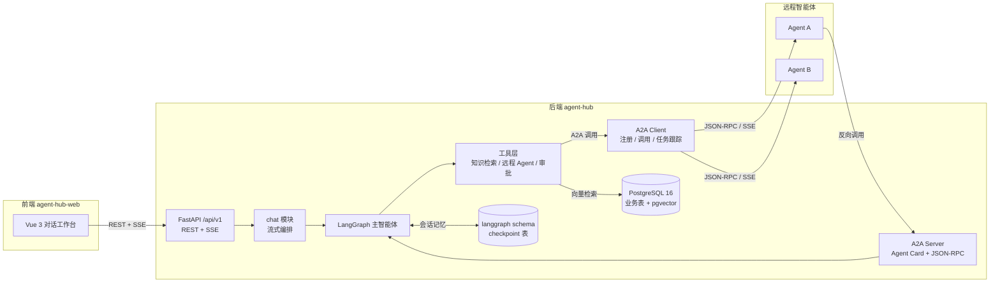

# Agent Hub（agent-hub）

> 面向用户的多智能体对话服务：LangGraph 负责编排，Google A2A 协议负责连接外部智能体，PostgreSQL + pgvector 负责业务数据、会话记忆与知识检索。

配套前端：[agent-hub-web](../../NodeJsProjects/agent-hub-web)（Vue 3 + TypeScript + Vite）。

> **当前状态：M0 结构初始化。**
> 本仓库目前只包含目录骨架、声明式配置（依赖清单、环境变量模板、Docker 编排）与设计文档，
> **不包含任何 Python 实现代码，未安装依赖，未启动数据库，也未执行迁移。**
> 需求还在细化，后续在独立工作区继续编码。

## 1. 项目定位

用户在前端与主智能体对话；主智能体在 LangGraph 状态图中自主决定：

- **直接回答**：通用对话，不调用外部能力；
- **查知识库**：通过 `search_knowledge` 工具做 RAG 检索，回答附来源；
- **调用远程智能体**：通过 A2A 协议把任务委派给其他智能体（如代码助手、数据分析、翻译），再把结果整合给用户；
- **请求人工确认**：高风险动作（写操作、外部副作用）触发 HITL 审批，用户确认后继续。

同时，本服务自身也是一个 A2A Server：发布 Agent Card，暴露 JSON-RPC 端点，允许其他智能体反向调用。

平台另提供**个人能力层**：账号级的 MCP 接入、Skill 技能包、长期记忆与自定义 Instruction。配置采用「系统默认 + 用户自定义」两层模型，运行时合并；会话内可以显式点名使用某个 Skill 或某个 MCP 服务器，只影响当次请求。设计见 [个人能力层设计](docs/superpowers/specs/2026-11-05-agent-capabilities-design.md)。

## 2. 架构（设计）



## 3. 技术选型（设计基线）

| 层 | 选型 | 说明 |
|---|---|---|
| Web 框架 | FastAPI + Uvicorn | `create_app()` 工厂，REST + SSE |
| 智能体编排 | LangChain 1.x + LangGraph 1.x | 状态图、工具调用、中断、流式事件 |
| A2A 协议 | `a2a-sdk[fastapi]` 1.x | 实现 A2A 1.0 规范，兼容 0.3 |
| 业务库 | PostgreSQL 16 + SQLAlchemy 2（异步） + Alembic | 统一承载业务表 |
| 向量检索 | pgvector（HNSW，cosine） | 与业务表同库同事务 |
| 会话记忆 | `langgraph-checkpoint-postgres` | checkpoint 表放独立 `langgraph` schema |
| 模型 | OpenAI 兼容接口（默认 DeepSeek） | base_url / model 可配置 |
| Embedding | OpenAI 兼容接口 | 可切硅基流动、阿里百炼、本地 vLLM |
| 认证 | JWT + pwdlib(argon2) | access/refresh 双令牌 |
| 前端 | Vue 3 + TypeScript + Vite + Pinia + Vue Router | 见 `agent-hub-web` |
| 包管理 | uv（Python 3.13） / pnpm | 与现有项目保持一致 |

> 以上为设计选择，依赖清单已写入 `pyproject.toml`，但**尚未安装**；需求细化后允许调整。

## 4. 目录结构

```text
agent-hub/
├── app/
│   ├── api/v1/              # /api/v1 聚合路由（空包，待实现）
│   ├── core/                # 配置、日志、中间件、异常（空包，待实现）
│   ├── db/                  # 数据库层（目录化，替代单文件 db.py）
│   │   ├── models/          # ORM 模型按领域分文件（待实现）
│   │   └── vector/          # 向量存储抽象与 pgvector 实现（待实现）
│   ├── agents/              # LangGraph 图、状态、提示词、工具（待实现）
│   │   └── tools/
│   └── modules/             # 业务模块（空目录，约定见 README）
│       ├── auth/
│       ├── conversations/
│       ├── chat/
│       ├── agents/
│       ├── a2a/
│       ├── knowledge/
│       ├── tasks/
│       └── approvals/
├── alembic/                 # 迁移目录（README + versions/.gitkeep，env.py 待生成）
├── docker/initdb/           # pgvector 扩展 + langgraph schema 初始化 SQL
├── docker-compose.yml       # PostgreSQL + pgvector 编排（仅配置，未启动）
├── scripts/                 # 离线脚本（规划，见 README）
├── tests/                   # 测试（规划，见 README）
├── data/                    # 知识库原始文档（规划）
├── docs/                    # 架构、数据库、A2A、API、开发、路线图
├── pyproject.toml           # 依赖声明（未安装）
├── .env.example             # 环境变量模板
└── README.md
```

说明：

- `app/db/` 是本次相对 `customer-service` 的关键调整：不再用单文件 `app/db.py`，而是 `base / engine / session / mixins / models / vector` 分目录；
- 当前所有 `app/**/` 只有 `__init__.py` 包标记与 README，**没有实现文件**；
- 规划中的具体文件与职责见 `app/modules/README.md`、`app/agents/README.md` 和 `docs/architecture.md`。

## 5. 后续开始编码时的环境准备（当前未执行）

> 以下命令是设计中的开发流程，当前仓库缺少实现代码与 `alembic/env.py`，**尚不能直接运行**。
> 需求细化、补齐代码后再执行；请勿把这里的命令当作“已完成”的证据。

```bash
# 1. 配置环境变量
cp .env.example .env
# 填入 LLM_API_KEY、EMBEDDING_API_KEY、JWT_SECRET（openssl rand -hex 32）

# 2. 安装依赖
uv sync

# 3. 启动 PostgreSQL + pgvector（宿主机端口 5433）
docker compose up -d

# 4. 初始化迁移环境（当前仓库未包含 env.py）
uv run alembic init alembic   # 或按 docs/database.md 的异步模板补 env.py
uv run alembic upgrade head

# 5. 启动服务（需先实现 app/main.py）
uv run uvicorn app.main:app --reload
curl http://localhost:8000/healthz
```

## 6. 当前状态（M0 · 仅结构）

已初始化：

- [x] 分层目录与模块边界约定（`app/modules/README.md`、`app/agents/README.md`）
- [x] 依赖声明 `pyproject.toml`（未安装、未生成锁文件）
- [x] 环境变量模板 `.env.example`
- [x] PostgreSQL + pgvector 的 Docker 编排与初始化 SQL（未拉取镜像、未启动）
- [x] 数据库目录化方案：`app/db/{models,vector}` 分层
- [x] 完整设计文档：架构、数据库、A2A、API、开发、路线图、初始化设计稿
- [x] 个人能力层需求设计：MCP / Skill / 长期记忆 / Instruction（仅文档，未实现）

明确未包含（全部留待后续编码任务）：

- [ ] Python 实现代码（`app/main.py`、`core/`、`db/`、`agents/`、`modules/` 下的业务代码）
- [ ] 个人能力层的实现、数据库迁移与前端改动
- [ ] Alembic `env.py` 与迁移脚本
- [ ] 依赖安装、锁文件、虚拟环境
- [ ] 容器拉取/启动、数据库迁移
- [ ] 测试用例与 CI

## 7. 与 customer-service 的结构差异

| 维度 | customer-service | agent-hub |
|---|---|---|
| 数据库连接层 | 单文件 `app/db.py` | 目录 `app/db/`（base / engine / session / mixins / models / vector） |
| ORM 模型 | 各业务模块内 `models.py` | 统一 `app/db/models/<领域>.py`，按领域拆分 |
| 业务模型 | 客服：订单、审批、RBAC | 对话平台：会话、消息、run、远程 Agent、A2A Task、知识库 |
| 向量存储 | FAISS 本地索引 | PostgreSQL + pgvector，与业务同库 |
| 会话记忆 | SqliteSaver | LangGraph PostgresSaver（独立 schema） |
| 多智能体 | 单 agent + 工具 | 主图 + A2A 出站/入站 |
| 前端 | 无 | 独立 Vue 项目 `agent-hub-web` |

## 8. 文档索引

| 文档 | 内容 |
|---|---|
| [架构设计](docs/architecture.md) | 组件、时序、分层规则、关键决策 |
| [数据库设计](docs/database.md) | ER 图、表结构、pgvector 索引、迁移规范 |
| [A2A 集成](docs/a2a.md) | Agent Card、服务端/客户端、任务状态、安全 |
| [API 契约](docs/api.md) | REST 端点、SSE 事件、错误码 |
| [开发指南](docs/development.md) | 环境、命令、编码规范、联调、FAQ |
| [路线图](docs/roadmap.md) | M0–M6 里程碑与验收标准（含 M1.5 个人能力层） |
| [初始化设计稿](docs/superpowers/specs/2026-11-04-agent-hub-init-design.md) | 本次初始化的决策记录 |
| [个人能力层设计](docs/superpowers/specs/2026-11-05-agent-capabilities-design.md) | MCP / Skill / 长期记忆 / Instruction 的设计与决策 |

## 9. 下一步

需求细化完成后，按 `docs/roadmap.md` 的 M1 开始：

1. 先落 `users` / `conversations` / `messages` / `runs` 模型与迁移；
2. 再实现认证与最小对话闭环；
3. M1 完成后进入 M1.5：指令、长期记忆、Skill、MCP（见 [个人能力层设计](docs/superpowers/specs/2026-11-05-agent-capabilities-design.md)）；
4. 每一步先更新设计文档，再写代码。

编码前建议阅读：

1. 本 README 第 4–6 节；
2. `docs/architecture.md` 第 4、6 节；
3. `docs/database.md` 第 4 节；
4. `app/modules/README.md` 与 `app/agents/README.md`。
