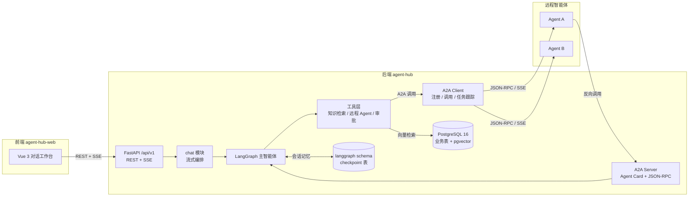

# Agent Hub（agent-hub）

> 面向用户的多智能体对话服务：LangGraph 负责编排，Google A2A 协议负责连接外部智能体，PostgreSQL + pgvector 负责业务数据、会话记忆与知识检索。

配套前端：[agent-hub-web](../../NodeJsProjects/agent-hub-web)（Vue 3 + TypeScript + Vite）。

> **当前状态：M2 A2A 出站已实现（2026-11-10）。**
> 已包含认证、会话/消息、聊天 SSE、运行与事件回放、审批、系统信息、个人能力层
> （指令/记忆/技能/MCP/附件），以及 M2 的远程 Agent 注册表（Card 拉取/校验/健康检查）、
> 统一 `send_message` 委派工具（含 HITL 等待与 SSE 事件）与任务查询/动作 API。
> 测试 101 个全绿；迁移 `8a2f7c31e9d5` 已应用到 agent_hub。
> M3 入站 Server（A2A_ENABLED）与 M4–M6 仍未实现，对应能力开关明确返回 `false`。

## 1. 项目定位

用户在前端与主智能体对话；主智能体在 LangGraph 状态图中自主决定：

- **直接回答**：通用对话，不调用外部能力；
- **查知识库**：通过 `search_knowledge` 工具做 RAG 检索，回答附来源；
- **调用远程智能体**：通过 A2A 协议把任务委派给其他智能体（如代码助手、数据分析、翻译），再把结果整合给用户；
- **请求人工确认**：高风险动作（写操作、外部副作用）触发 HITL 审批，用户确认后继续。

同时，本服务自身也是一个 A2A Server：发布 Agent Card，暴露 JSON-RPC 端点，允许其他智能体反向调用。

平台另提供**个人能力层**：账号级的 MCP 接入、Skill 技能包、长期记忆与自定义 Instruction。配置采用「系统默认 + 用户自定义」两层模型，运行时合并；会话内可以显式点名使用某个 Skill 或某个 MCP 服务器，只影响当次请求。设计见 [个人能力层设计](docs/superpowers/specs/2026-11-05-agent-capabilities-design.md)。

## 2. 架构（设计）



## 3. 技术选型（设计基线）

| 层 | 选型 | 说明 |
|---|---|---|
| Web 框架 | FastAPI + Uvicorn | `create_app()` 工厂，REST + SSE |
| 智能体编排 | LangChain 1.x + LangGraph 1.x | 状态图、工具调用、中断、流式事件 |
| A2A 协议 | `a2a-sdk[fastapi]` 1.x | 实现 A2A 1.0 规范，兼容 0.3 |
| 业务库 | PostgreSQL 16 + SQLAlchemy 2（异步） + Alembic | 统一承载业务表 |
| 向量检索 | pgvector（HNSW，cosine） | 与业务表同库同事务 |
| 会话记忆 | `langgraph-checkpoint-postgres` | checkpoint 表放独立 `langgraph` schema |
| 模型 | OpenAI 兼容接口（默认 DeepSeek） | base_url / model 可配置 |
| Embedding | OpenAI 兼容接口 | 可切硅基流动、阿里百炼、本地 vLLM |
| 认证 | JWT + pwdlib(argon2) | access/refresh 双令牌 |
| 前端 | Vue 3 + TypeScript + Vite + Pinia + Vue Router | 见 `agent-hub-web` |
| 包管理 | uv（Python 3.13） / pnpm | 与现有项目保持一致 |

> 以上为设计选择，依赖已安装并锁定在 `uv.lock`；后续里程碑可在不破坏 M1 的前提下调整。

## 4. 目录结构

```text
agent-hub/
├── app/
│   ├── main.py              # create_app() / lifespan / CORS / 异常与请求 ID
│   ├── api/v1/              # /api/v1 聚合路由
│   ├── core/                # 配置、日志、错误、JWT、游标、限流、依赖
│   ├── db/                  # 数据库层（目录化，替代单文件 db.py）
│   │   ├── models/          # users/conversations/messages/runs/run_events/approvals...
│   │   └── vector/          # 向量存储抽象与 pgvector 实现（M4）
│   ├── agents/              # LangGraph 图、提示词、checkpoint、假模型
│   │   └── tools/
│   └── modules/             # 业务模块
│       ├── auth/            # 注册、登录、刷新轮换、账号资料
│       ├── conversations/   # 会话、消息历史与分页
│       ├── chat/            # SSE、run、事件、取消
│       ├── approvals/       # 审批查询与决定
│       ├── agents/          # 远程智能体（M2）
│       ├── a2a/             # A2A Server/Client（M2/M3）
│       ├── knowledge/       # 知识库（M4）
│       ├── tasks/           # A2A Task（M2）
│       └── system/          # 系统信息与健康检查
├── alembic/                 # 异步 env.py + M1 初始迁移
├── docker/initdb/           # 可选：使用 docker compose 时的扩展/schema 初始化 SQL
├── docker-compose.yml       # 可选：本机没有 PostgreSQL 时的备用编排
├── scripts/                 # 运维/导出脚本（grant_admin、export_openapi）
├── tests/                   # 单元 + 集成契约测试
├── data/                    # 知识库原始文档（规划）
├── docs/                    # 架构、数据库、A2A、API、开发、路线图
├── pyproject.toml           # 依赖声明（uv.lock 已生成）
├── .env.example             # 环境变量模板
└── README.md
```

说明：

- `app/db/` 是本次相对 `customer-service` 的关键调整：不再用单文件 `app/db.py`，而是 `base / engine / session / mixins / models / vector` 分目录；
- M1 已实现 `app/core`、`app/db`、`app/agents`、`app/modules/{auth,conversations,chat,approvals,system}`；
- 模块边界与后续文件规划见 `app/modules/README.md`、`app/agents/README.md` 和 `docs/architecture.md`。

## 5. 环境准备

> 本项目**不依赖 Docker**：默认使用使用方本机已有的 PostgreSQL。
> `DATABASE_URL` 指向已有实例即可；`docker-compose.yml` 仅作为没有现成 PostgreSQL 时的可选项。
> `pgvector` 扩展在 M4 才需要，M1 用普通 PostgreSQL 即可。

```bash
# 1. 配置环境变量
cp .env.example .env
# 把 DATABASE_URL 改成你本机已有 PostgreSQL 的连接串；
# 再填 JWT_SECRET；没有模型密钥时保持 LLM_PROVIDER=fake

# 2. 安装依赖
uv sync

# 3. 创建业务库（如果本机还没有 agent_hub 库）
createdb -h localhost -p 5432 -U postgres agent_hub   # 按实际用户/端口修改

# 4. 执行迁移
uv run alembic upgrade head

# 5. 启动服务
uv run uvicorn app.main:app --reload
curl http://localhost:8000/healthz
curl http://localhost:8000/api/v1/system/info   # 需要先登录拿 Bearer token
```

## 6. 当前状态（M2 · A2A 出站）

M1（2026-11-09）与 M1.5「个人能力层」（2026-11-09）已完成，M2「A2A 出站」已实现（2026-11-10）：

- [x] M1 全部：认证、会话、聊天 SSE、运行、审批数据层、系统信息
- [x] M1.5 全部：附件/指令/记忆/技能/MCP/HITL 审批/工具轨迹与审计
- [x] `remote_agents`/`a2a_tasks` 模型 + 可逆迁移（`8a2f7c31e9d5`，测试库 upgrade/downgrade/upgrade 通过）
- [x] Agent Card 拉取/校验（SSRF 防护、同源校验、协议版本/技能校验，dev 可放行回环）
- [x] `/agents` 全端点：preview/create（幂等）/list（stats）/detail/patch/delete（软删）/refresh/health
- [x] A2A 客户端（自研 JSON-RPC 2.0：message/send、message/stream SSE、tasks/get、tasks/cancel，超时与错误映射）
- [x] 统一 `send_message` 工具：仅注入 enabled Agent，HITL 等待（input_required/auth_required）复用审批式进程内 waiter
- [x] SSE 事件：`a2a.task` / `a2a.artifact` / `a2a.input_required` / `a2a.auth_required`
- [x] `/tasks` 全端点：列表（多状态过滤 + stats）/详情/取消/补充输入/授权/拒绝 + 等待超时懒过期
- [x] `system/info.capabilities.agents/tasks = true`；`GET /runs/{id}` 的 pending/agents 支持 A2A
- [x] 101 个 pytest 用例（85 基线 + 16 新增）；ruff 通过；8000 实例真实联调通过（注册→预览→健康→对话委派→任务查询）

明确未包含（按路线图后续交付）：

- [ ] M1.5 管理端路由（`/api/v1/admin/…`，数据模型已就绪）
- [ ] M3：A2A 入站 Server（Agent Card 发布 + JSON-RPC 端点，`A2A_ENABLED` 仍为 false）
- [ ] M4：知识库 + pgvector（记忆语义检索、`q` 升级为向量检索）
- [ ] M5+：工作流、管理控制台、RBAC
- [ ] CI、Dockerfile、生产可观测性

本地假 Agent 联调（详见 [M2 交付报告](docs/feedback/2026-11-09-m2-backend-report.md)）：

```bash
uv run python scripts/mock_a2a_agent.py                      # 127.0.0.1:9100
curl -X POST http://127.0.0.1:8000/api/v1/agents \
  -H "Authorization: Bearer <token>" -H "Content-Type: application/json" \
  -d '{"url": "http://127.0.0.1:9100"}'
```

## 7. 与 customer-service 的结构差异

| 维度 | customer-service | agent-hub |
|---|---|---|
| 数据库连接层 | 单文件 `app/db.py` | 目录 `app/db/`（base / engine / session / mixins / models / vector） |
| ORM 模型 | 各业务模块内 `models.py` | 统一 `app/db/models/<领域>.py`，按领域拆分 |
| 业务模型 | 客服：订单、审批、RBAC | 对话平台：会话、消息、run、远程 Agent、A2A Task、知识库 |
| 向量存储 | FAISS 本地索引 | PostgreSQL + pgvector，与业务同库 |
| 会话记忆 | SqliteSaver | LangGraph PostgresSaver（独立 schema） |
| 多智能体 | 单 agent + 工具 | 主图 + A2A 出站/入站 |
| 前端 | 无 | 独立 Vue 项目 `agent-hub-web` |

## 8. 文档索引

| 文档 | 内容 |
|---|---|
| [架构设计](docs/architecture.md) | 组件、时序、分层规则、关键决策 |
| [数据库设计](docs/database.md) | ER 图、表结构、pgvector 索引、迁移规范 |
| [A2A 集成](docs/a2a.md) | Agent Card、服务端/客户端、任务状态、安全 |
| [API 契约](docs/api.md) | REST 端点、SSE 事件、错误码 |
| [开发指南](docs/development.md) | 环境、命令、编码规范、联调、FAQ |
| [路线图](docs/roadmap.md) | M0–M6 里程碑与验收标准（含 M1.5 个人能力层） |
| [初始化设计稿](docs/superpowers/specs/2026-11-04-agent-hub-init-design.md) | 本次初始化的决策记录 |
| [个人能力层设计](docs/superpowers/specs/2026-11-05-agent-capabilities-design.md) | MCP / Skill / 长期记忆 / Instruction 的设计与决策 |
| [M1 前端契约反馈](docs/feedback/2026-11-09-frontend-contract-feedback.md) | 与前端交接包的差异、待拍板决策、联调步骤 |
| [前端联调反馈](docs/feedback/2026-11-09-frontend-integration-response.md) | 前端真实联调结果、12 个契约点逐项回复、后端待处理问题 |
| [后端热修响应](docs/feedback/2026-11-09-backend-hotfix-response.md) | 分页 500 修复、OpenAPI/文档补齐、500 request_id、限流配置与复验结果 |
| [OpenAPI](docs/openapi.json) | M1 实际接口契约（由 FastAPI 导出） |

## 9. 下一步

M1 已完成，按 `docs/roadmap.md` 继续：

1. 与前端对齐 [M1 契约反馈](docs/feedback/2026-11-09-frontend-contract-feedback.md) 中的 12 个点；
2. 进入 M1.5-A：指令、长期记忆、技能（`system_settings` / `user_settings` / `skills` / `skill_files` 已建基础表）；
3. 再做 M1.5-B：MCP + 附件 + 完整审批链路；
4. 每一步先更新设计文档与 `docs/openapi.json`，再写代码。

编码前建议阅读：

1. 本 README 第 4–6 节；
2. `docs/architecture.md` 第 4、6 节；
3. `docs/database.md` 第 4 节；
4. `app/modules/README.md` 与 `app/agents/README.md`。
