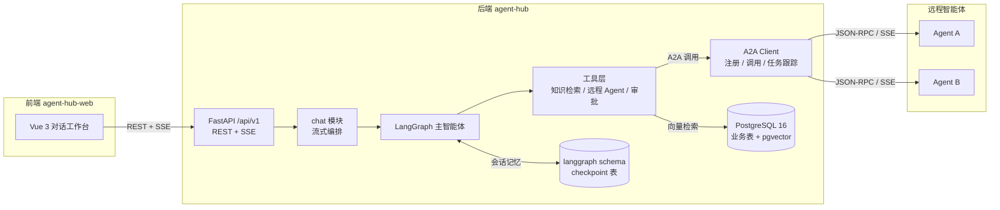

# Agent Hub（agent-hub）

> 面向用户的多智能体对话服务：LangGraph 负责编排，Google A2A 协议负责连接外部智能体，PostgreSQL + pgvector 负责业务数据、会话记忆与知识检索。

配套前端：[agent-hub-web](../../NodeJsProjects/agent-hub-web)（Vue 3 + TypeScript + Vite）。

> **当前状态：M7 契约补齐与安全收口已完成（2026-11-11）。**
> M6 生产化与可观测已完成（结构化日志 / Prometheus 指标 / OTel Trace、`/readyz`、
> Dockerfile + 生产 Compose、优雅停机、启动恢复、数据清理、流式实时过滤、CI）。
> M7 新增：运行事件 SSE 续流端点、回放 `event` 字段、agents/tasks 写操作管理员 RBAC、
> `approval.required` 5 个展示字段、A2A `authorization_url` 后端白名单；
> M7 Task 7 全量回归 **733 passed, 1 skipped**（含全部 DB 集成用例）；ruff 全绿；
> `alembic check` 无漂移；OpenAPI 无 diff；迁移 head `2d8f6a1c3e70`（M7 无迁移）。
> 前端 M4/M5/M6 已完成并联调（2026-11-11）；M7 后端契约已交付，前端待按
> [M7 前端交接](docs/feedback/2026-11-11-m7-frontend-handoff.md) 接入（「逐字续流」尚未前端验收）。
> 后续 **M8（管理台）/ M9（工作流）已于 2026-11-11 立项、未开始**，
> 见 [M7–M9 立项](docs/superpowers/specs/2026-11-11-m7-m9-backend-roadmap-design.md)。

## 1. 项目定位

用户在前端与主智能体对话；主智能体在 LangGraph 状态图中自主决定：

- **直接回答**：通用对话，不调用外部能力；
- **查知识库**：通过 `search_knowledge` 工具做 RAG 检索，回答附来源；
- **调用远程智能体**：通过 A2A 协议把任务委派给其他智能体（如代码助手、数据分析、翻译），再把结果整合给用户；
- **请求人工确认**：高风险动作（写操作、外部副作用）触发 HITL 审批，用户确认后继续。

本服务只做 A2A 出站 Client：不发布 Agent Card、不暴露 JSON-RPC 入站端点，也不接受其他智能体反向调用（2026-11-10 需求变更）。

平台另提供**个人能力层**：账号级的 MCP 接入、Skill 技能包、长期记忆与自定义 Instruction。配置采用「系统默认 + 用户自定义」两层模型，运行时合并；会话内可以显式点名使用某个 Skill 或某个 MCP 服务器，只影响当次请求。设计见 [个人能力层设计](docs/superpowers/specs/2026-11-05-agent-capabilities-design.md)。

## 2. 架构（设计）



## 3. 技术选型（设计基线）

| 层 | 选型 | 说明 |
|---|---|---|
| Web 框架 | FastAPI + Uvicorn | `create_app()` 工厂，REST + SSE |
| 智能体编排 | LangChain 1.x + LangGraph 1.x | 状态图、工具调用、中断、流式事件 |
| A2A 协议 | `a2a-sdk[fastapi]` >=1.3.0,<2.0（当前锁定 1.3.0） | 出站协议层用 SDK JSON-RPC 传输（0.3 兼容 + 1.0）；Card 拉取/SSRF 校验与 SDK schema 校验并存 |
| 业务库 | PostgreSQL 16 + SQLAlchemy 2（异步） + Alembic | 统一承载业务表 |
| 向量检索 | pgvector（HNSW，cosine） | 与业务表同库同事务 |
| 会话记忆 | `langgraph-checkpoint-postgres` | checkpoint 表放独立 `langgraph` schema |
| 模型 | OpenAI 兼容接口（默认 DeepSeek） | base_url / model 可配置 |
| Embedding | OpenAI 兼容接口 | 可切硅基流动、阿里百炼、本地 vLLM |
| 认证 | JWT + pwdlib(argon2) | access/refresh 双令牌 |
| 前端 | Vue 3 + TypeScript + Vite + Pinia + Vue Router | 见 `agent-hub-web` |
| 包管理 | uv（Python 3.13） / pnpm | 与现有项目保持一致 |

> 以上为设计选择，依赖已安装并锁定在 `uv.lock`；后续里程碑可在不破坏 M1 的前提下调整。

## 4. 目录结构

```text
agent-hub/
├── app/
│   ├── main.py              # create_app() / lifespan / CORS / 异常与请求 ID
│   ├── api/v1/              # /api/v1 聚合路由
│   ├── core/                # 配置、日志、错误、JWT、游标、限流、依赖
│   ├── db/                  # 数据库层（目录化，替代单文件 db.py）
│   │   ├── models/          # users/conversations/messages/runs/run_events/approvals...
│   │   └── vector/          # 向量存储抽象与 pgvector 实现（M4）
│   ├── agents/              # LangGraph 图、提示词、checkpoint、假模型
│   │   └── tools/
│   └── modules/             # 业务模块
│       ├── auth/            # 注册、登录、刷新轮换、账号资料
│       ├── conversations/   # 会话、消息历史与分页
│       ├── chat/            # SSE、run、事件、取消
│       ├── approvals/       # 审批查询与决定
│       ├── agents/          # 远程智能体（M2）
│       ├── a2a/             # A2A Client（M2，仅出站）
│       ├── knowledge/       # 知识库（M4）
│       ├── tasks/           # A2A Task（M2）
│       └── system/          # 系统信息与健康检查
├── alembic/                 # 异步 env.py + M1 初始迁移
├── docker/initdb/           # 可选：使用 docker compose 时的扩展/schema 初始化 SQL
├── docker-compose.yml       # 可选：本机没有 PostgreSQL 时的备用编排
├── scripts/                 # 运维/导出脚本（grant_admin、export_openapi）
├── tests/                   # 单元 + 集成契约测试
├── data/                    # 知识库原始文档（规划）
├── docs/                    # 架构、数据库、A2A、API、开发、路线图
├── pyproject.toml           # 依赖声明（uv.lock 已生成）
├── .env.example             # 环境变量模板
└── README.md
```

说明：

- `app/db/` 是本次相对 `customer-service` 的关键调整：不再用单文件 `app/db.py`，而是 `base / engine / session / mixins / models / vector` 分目录；
- M1 已实现 `app/core`、`app/db`、`app/agents`、`app/modules/{auth,conversations,chat,approvals,system}`；
- 模块边界与后续文件规划见 `app/modules/README.md`、`app/agents/README.md` 和 `docs/architecture.md`。

## 5. 环境准备

> 本项目**不依赖 Docker**：默认使用使用方本机已有的 PostgreSQL。
> `DATABASE_URL` 指向已有实例即可；`docker-compose.yml` 仅作为没有现成 PostgreSQL 时的可选项。
> `pgvector` 扩展在 M4 才需要，M1 用普通 PostgreSQL 即可。

```bash
# 1. 配置环境变量
cp .env.example .env
# 把 DATABASE_URL 改成你本机已有 PostgreSQL 的连接串；
# 再填 JWT_SECRET；没有模型密钥时保持 LLM_PROVIDER=fake

# 2. 安装依赖
uv sync

# 3. 创建业务库（如果本机还没有 agent_hub 库）
createdb -h localhost -p 5432 -U postgres agent_hub   # 按实际用户/端口修改

# 4. 执行迁移
uv run alembic upgrade head

# 5. 启动服务
uv run uvicorn app.main:app --reload
curl http://localhost:8000/healthz
curl http://localhost:8000/api/v1/system/info   # 需要先登录拿 Bearer token
```

## 6. 当前状态（M7 · 契约补齐与安全收口，已完成）

后端里程碑 M0–M7 已完成（M3 入站按 2026-11-10 需求变更取消）：

| 里程碑 | 状态 |
|---|---|
| M1 对话最小闭环 | 已完成 |
| M1.5 个人能力层 | 已完成 |
| M2 A2A 出站 | 已完成 |
| M3 A2A 入站 | 已取消（仅出站） |
| M4 知识库 RAG | 后端已完成；前端已联调（2026-11-10） |
| M5 审批与安全加固 | 后端已完成；前端已联调（2026-11-11） |
| M6 生产化与可观测 | 后端已完成（2026-11-11） |
| M7 契约补齐与安全收口 | 已完成（2026-11-11；后端契约已交付，前端待接入） |

M6 交付：

- 结构化日志（`LOG_FORMAT=json`，含 request/run/conversation/trace 字段）；
- `prometheus-client` 指标（HTTP/SSE/chat/LLM/tool/A2A/检索/审批/限流/清理）与 `/metrics`；
- OpenTelemetry Trace（OTLP/HTTP，未配置 no-op；`http.request → chat.run → llm.chat/tool.execute`）；
- `/readyz` 检查 DB/迁移/checkpoint/存储/排水；DB 不可用返回 503 `database_unavailable`；
- Dockerfile（非 root、健康检查）+ `docker-compose.prod.yml` + Prometheus/Grafana/Nginx 配置；
- 优雅停机排水、启动恢复（running→failed、interrupted 恢复/restart_lost 取消）、数据清理 CLI/调度；
- 流式输出实时打码（密钥跨 chunk、危险 HTML）；
- 50 并发 SSE 压测、数据库故障演练、优雅停机演练脚本与实测证据；
- GitHub Actions：lint + test + 迁移检查 + OpenAPI diff + 镜像构建。

详细证据见 [M6 后端交付报告](docs/feedback/2026-11-11-m6-backend-report.md)，
设计与计划见 [M6 设计](docs/superpowers/specs/2026-11-11-m6-production-observability-design.md)、
[M6 实施计划](docs/superpowers/plans/2026-11-11-m6-production-observability.md)。

M7 交付（已完成，2026-11-11；全量回归 733 passed, 1 skipped，证据见交付报告）：

- `GET /runs/{id}/events` 每项新增 `event`；新增 `GET /runs/{id}/stream?after_seq=` SSE 续流
  （回放已落库事件 + 实时跟随、回放上限 1000、终态关闭、`interrupted` 等待恢复、15s 心跳、单实例；
  `message.delta` 不落库，断线窗口的增量不补，终态后以消息历史终稿为准）；
- agents 写接口（注册/修改/删除/刷新/健康检查）与 tasks 动作接口（取消/补输入/授权/拒绝）
  收紧为管理员：非管理员 403 `forbidden` + `details.required_role="admin"`，拒绝写审计
  `security.rbac_denied`；读接口与 `POST /agents/preview` 不变；
- `approval.required` 新增 `tool_display_name` / `executor` / `target` / `side_effect` / `payload_preview`；
- A2A `authorization_url` 后端白名单（仅 https 公网主机，dev/test 允许本地回环；违规置 `null`
  且任务继续运行，审计 `security.auth_url_rejected`）；新增 `A2A_AUTH_URL_ALLOWED_HOSTS` 配置；
- 契约文档、OpenAPI 与前端交接同步（[M7 前端交接](docs/feedback/2026-11-11-m7-frontend-handoff.md)）；
  无数据库迁移；
- 全量回归 733 passed / 1 skipped，ruff 全绿，`alembic check` 无漂移，OpenAPI 无 diff；
  证据见 [M7 后端交付报告](docs/feedback/2026-11-11-m7-backend-report.md)。

明确未包含：

- [-] M3：A2A 入站 Server（需求变更取消）；
- [-] 前端 M4/M5/M6：已完成并联调（2026-11-10 ~ 2026-11-11）；
- [ ] 多实例（Redis 事件总线/共享限流/跨实例 resume）、Helm；
- [ ] 真实 Grafana/Tempo 可视化与滚动发布 LB 演练（配置已交付，受「不新起容器」约束未实测）；
- [ ] M7 前端接入：后端契约已交付，前端待按
      [M7 前端交接](docs/feedback/2026-11-11-m7-frontend-handoff.md) 接入 SSE 续流、写操作 403
      与审批新字段（「逐字续流」尚未前端验收）；
- [ ] M8（管理台后端）/ M9（工作流后端）：已立项、未开始（见 [路线图](docs/roadmap.md) 与
      [立项文档](docs/superpowers/specs/2026-11-11-m7-m9-backend-roadmap-design.md)）。

本地假 Agent 联调（详见 [M2 交付报告](docs/feedback/2026-11-09-m2-backend-report.md)）：

```bash
uv run python scripts/mock_a2a_agent.py                      # 127.0.0.1:9100
curl -X POST http://127.0.0.1:8000/api/v1/agents \
  -H "Authorization: Bearer <token>" -H "Content-Type: application/json" \
  -d '{"url": "http://127.0.0.1:9100"}'
```

## 7. 与 customer-service 的结构差异

| 维度 | customer-service | agent-hub |
|---|---|---|
| 数据库连接层 | 单文件 `app/db.py` | 目录 `app/db/`（base / engine / session / mixins / models / vector） |
| ORM 模型 | 各业务模块内 `models.py` | 统一 `app/db/models/<领域>.py`，按领域拆分 |
| 业务模型 | 客服：订单、审批、RBAC | 对话平台：会话、消息、run、远程 Agent、A2A Task、知识库 |
| 向量存储 | FAISS 本地索引 | PostgreSQL + pgvector，与业务同库 |
| 会话记忆 | SqliteSaver | LangGraph PostgresSaver（独立 schema） |
| 多智能体 | 单 agent + 工具 | 主图 + A2A 出站（仅 Client） |
| 前端 | 无 | 独立 Vue 项目 `agent-hub-web` |

## 8. 文档索引

| 文档 | 内容 |
|---|---|
| [架构设计](docs/architecture.md) | 组件、时序、分层规则、关键决策 |
| [数据库设计](docs/database.md) | ER 图、表结构、pgvector 索引、迁移规范 |
| [A2A 集成](docs/a2a.md) | Agent Card、服务端/客户端、任务状态、安全 |
| [API 契约](docs/api.md) | REST 端点、SSE 事件、错误码 |
| [开发指南](docs/development.md) | 环境、命令、编码规范、联调、FAQ |
| [路线图](docs/roadmap.md) | M0–M9 里程碑与验收标准（含 M1.5 个人能力层） |
| [可观测性](docs/observability.md) | 日志字段、指标目录、PromQL、Trace 目录 |
| [生产部署](docs/deployment.md) | 镜像、Compose、迁移、排水、滚动发布、清理 |
| [初始化设计稿](docs/superpowers/specs/2026-11-04-agent-hub-init-design.md) | 本次初始化的决策记录 |
| [个人能力层设计](docs/superpowers/specs/2026-11-05-agent-capabilities-design.md) | MCP / Skill / 长期记忆 / Instruction 的设计与决策 |
| [M1 前端契约反馈](docs/feedback/2026-11-09-frontend-contract-feedback.md) | 与前端交接包的差异、待拍板决策、联调步骤 |
| [前端联调反馈](docs/feedback/2026-11-09-frontend-integration-response.md) | 前端真实联调结果、12 个契约点逐项回复、后端待处理问题 |
| [后端热修响应](docs/feedback/2026-11-09-backend-hotfix-response.md) | 分页 500 修复、OpenAPI/文档补齐、500 request_id、限流配置与复验结果 |
| [OpenAPI](docs/openapi.json) | 实际接口契约（由 FastAPI 导出） |
| [M6 交付报告](docs/feedback/2026-11-11-m6-backend-report.md) | M6 实测证据、决策、未做项 |
| [项目整理（2026-11-11）](docs/feedback/2026-11-11-project-status-review.md) | M6 收尾后的未做项、风险、前端对齐清单与文档修正记录 |
| [M7–M9 立项](docs/superpowers/specs/2026-11-11-m7-m9-backend-roadmap-design.md) | 契约补齐/管理台/工作流的目标、范围、验收与依赖 |
| [M7 实施计划](docs/superpowers/plans/2026-11-11-m7-contract-security.md) | 事件续流、RBAC、审批字段、授权 URL 白名单的任务拆分 |
| [M7 前端交接](docs/feedback/2026-11-11-m7-frontend-handoff.md) | SSE 续流接入、审批新字段、写操作 403、`authorization_url=null` 与兼容性清单 |
| [M7 后端交付报告](docs/feedback/2026-11-11-m7-backend-report.md) | M7 全量回归证据、关键决策、验收对照与已知缺口 |

## 9. 下一步

后端 M0–M7 已完成；后续工作交给部署与前端：

1. 按 [生产部署](docs/deployment.md) 在目标环境执行 `alembic upgrade head`、配置 JWT/LLM/OTLP 与 Compose；
2. 在部署环境验证 Grafana 看板、告警与真实 LB 滚动发布（本地只做了排水与故障演练）；
3. 前端 M4/M5/M6 已完成；M7 后端契约已交付，前端按
   [M7 前端交接](docs/feedback/2026-11-11-m7-frontend-handoff.md) 接入 SSE 续流、写操作 403 与审批新字段；
   后端测试已覆盖契约，但「断线逐字续流」尚待前端联调验收（见
   [M7 后端交付报告](docs/feedback/2026-11-11-m7-backend-report.md) §5）；
4. 需要多实例时再单独设计 Redis 事件总线/共享限流/跨实例 resume，不在 M6/M7 范围；
5. M8（管理台后端）与 M9（工作流后端）按立项顺序启动，均需先冻结契约。

编码前建议阅读：

1. 本 README 第 4–6 节；
2. `docs/architecture.md` 第 4、6 节；
3. `docs/database.md` 第 4 节；
4. `app/modules/README.md` 与 `app/agents/README.md`。
