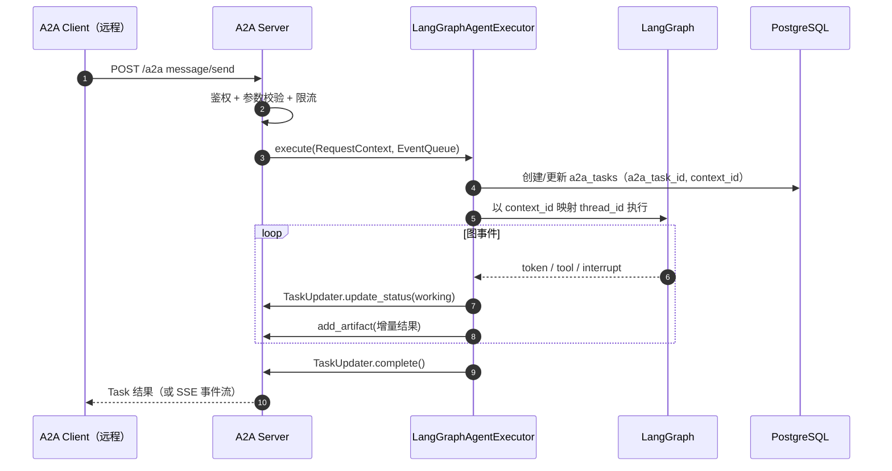
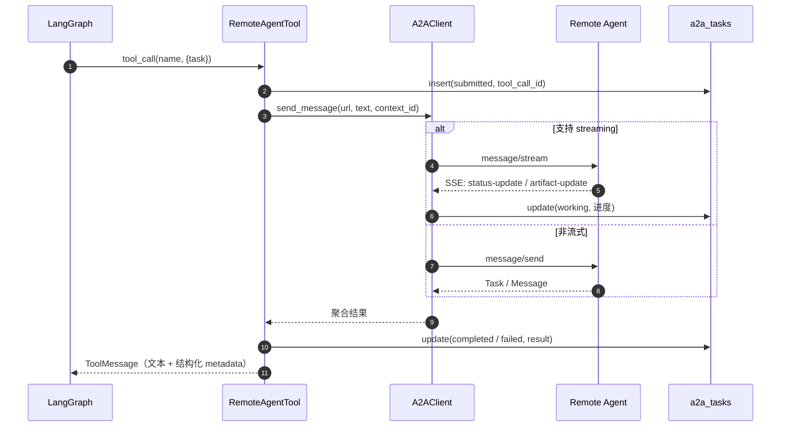

# A2A 集成设计

- 协议：Agent2Agent（A2A）
- 依赖：`a2a-sdk[fastapi]` >=1.3.0,<2.0（当前锁定 1.3.0）；**出站协议层已迁移到 SDK**（2026-11-10，兼容 0.3/1.0）
- 状态：M2 出站已实现（2026-11-10）；**入站 Server 按 2026-11-10 需求变更不实现**（见[变更记录](feedback/2026-11-10-requirement-change-outbound-only.md)）

## 1. 本服务的角色

> **2026-11-10 需求变更**：本服务只做 A2A 出站 Client，不发布 Agent Card、不暴露
> JSON-RPC 入站端点。下表 Server 行与本文第 3、4、8.1、8.2 节保留为历史设计，均已作废；
> 代码侧不再提供 `/a2a` 与 `/.well-known/agent-card.json` 路由。

| 角色 | 方向 | 说明 |
|---|---|---|
| A2A Client | 出站（本服务 → 远程智能体） | 主智能体把子任务委派给其他智能体（M2 已实现） |
| ~~A2A Server~~ | ~~入站（远程智能体 → 本服务）~~ | **不实现**：本服务不发布 Agent Card，不接受反向调用 |

出站链路通过 `runs.source` / `a2a_tasks` 记录来源与结果，保证审计与限流可区分。

## 2. 协议核心概念

| 概念 | 说明 | 本系统映射 |
|---|---|---|
| Agent Card | 智能体的能力名片（名称、URL、技能、鉴权方式） | `remote_agents.card` / 本服务动态生成 |
| Message | 一次消息（role + parts） | `messages` + `a2a_tasks.request` |
| Task | 长任务的执行单元，有状态机 | `a2a_tasks` |
| Artifact | 任务产出（文本/文件/结构化数据） | `a2a_tasks.result` |
| Context | 多轮上下文 ID | 映射 `conversation_id` / `context_id` |
| Part | 消息内容分片：Text / File / Data | 一期只支持 Text，File/Data 预留 |

传输：JSON-RPC 2.0 over HTTPS；流式用 SSE。A2A 1.0 额外支持 REST 与 gRPC，本项目一期只实现 JSON-RPC（兼容性最好）。

## 3. 本服务的 Agent Card（不实现）

> 2026-11-10 需求变更：本服务不发布 Agent Card；以下为历史设计，保留供参考。
> 代码侧 `system/info.a2a.card_url` 恒为空，`/a2a/.well-known/agent-card.json` 返回 404。

Agent Card 由 `modules/a2a/card.py` 在启动时构建，`url` 取 `A2A_PUBLIC_URL + A2A_AGENT_PATH`。

概念示例（字段以 a2a-sdk 的 `AgentCard` 模型为准）：

```json
{
  "protocolVersion": "1.0",
  "name": "Agent Hub",
  "description": "面向用户的多智能体对话中枢，支持知识库问答与 A2A 任务委派。",
  "url": "http://localhost:8000/a2a",
  "version": "0.1.0",
  "capabilities": {
    "streaming": true,
    "pushNotifications": false,
    "stateTransitionHistory": true
  },
  "defaultInputModes": ["text/plain"],
  "defaultOutputModes": ["text/plain", "application/json"],
  "skills": [
    {
      "id": "knowledge_qa",
      "name": "知识库问答",
      "description": "基于内部知识库回答问题，回答附带来源。",
      "tags": ["rag", "knowledge", "qa"],
      "examples": ["退货政策是什么？", "如何申请发票？"]
    },
    {
      "id": "delegate_task",
      "name": "多智能体任务委派",
      "description": "把任务拆解并委派给已注册的远程智能体，汇总结果。",
      "tags": ["a2a", "orchestration"],
      "examples": ["让代码助手检查这段代码"]
    }
  ],
  "securitySchemes": {
    "bearer": {
      "type": "http",
      "scheme": "bearer",
      "bearerFormat": "JWT"
    }
  },
  "security": [{ "bearer": [] }]
}
```

约定：

- 技能 ID 稳定、语义清晰，新增技能只追加不重命名；
- 入站技能默认只读；写操作技能需同时满足「显式开启 + 审批」；
- Agent Card 中不暴露内部端点、模型名、密钥等敏感信息。

## 4. 入站：A2A Server（不实现）

> 2026-11-10 需求变更：本服务只做 A2A Client，不提供入站 Server；以下设计全部作废，
> 仅作历史记录。取消原因与影响见[需求变更记录](feedback/2026-11-10-requirement-change-outbound-only.md)。

### 4.1 组件

```text
app/modules/a2a/
├── card.py        # 构建 AgentCard（名称、技能、鉴权声明）
├── executor.py    # LangGraphAgentExecutor(AgentExecutor)
├── server.py      # 组装 DefaultRequestHandler + TaskStore + FastAPI 路由
├── client.py      # A2AClient 封装（出站，见第 5 节）
├── tool.py        # 远程 Agent → LangChain 工具
└── registry.py    # 远程 Agent 注册/发现/健康检查
```

SDK 1.3 的关键组件（编码时以实际包结构为准）：

| 组件 | 用途 |
|---|---|
| `a2a.server.agent_execution.AgentExecutor` | 实现 `execute()` / `cancel()`，桥接业务逻辑 |
| `a2a.server.request_handlers.DefaultRequestHandler` | 处理 JSON-RPC 方法分发、任务存储、事件队列 |
| `a2a.server.tasks.TaskUpdater` | 在 executor 内更新任务状态、追加 artifact |
| `a2a.server.tasks.DatabaseTaskStore` | 生产环境的任务持久化（与 `a2a_tasks` 对齐或复用） |
| `a2a.server.routes.fastapi_routes` | 把 A2A 端点挂到 FastAPI |

### 4.2 请求处理流程



实现约定：

- `contextId` → `conversation_id` 映射：不存在则创建一条 `source=a2a` 的会话；
- `messageId` 作为幂等键：同一 `messageId` 重复提交返回已有 Task，不重复执行；
- 图执行使用与用户链路相同的 `build_graph()`，但 `source=a2a` 时禁用需要用户身份的 HITL（改为返回 `input-required`）；
- executor 的 `cancel()` 必须向图执行任务发取消信号，并调用远程工具的取消逻辑。

### 4.3 鉴权

| 方式 | 适用场景 | 实现 |
|---|---|---|
| API Key | 内部 Agent 互调、联调 | `Authorization: Bearer <key>` 或 `X-API-Key`，哈希比对 |
| OAuth2 Client Credentials | 跨团队/跨组织 | 接入企业 IdP，校验 JWT 的 `iss/aud/scope` |
| mTLS | 高安全内网（可选） | 反向代理层终止 |

- 鉴权失败返回 HTTP 401/403，JSON-RPC 错误码与 A2A 规范一致；
- 每个调用方按 `client_id` 限流；
- 入站请求体限制（默认 1 MB），附件走独立上传通道。

## 5. 出站：A2A Client

> 实现（2026-11-10）：出站协议层使用 `a2a-sdk` 1.3.0。Agent Card 用 SDK
> `parse_agent_card` 解析；JSON-RPC 传输按 Card 的 `supportedInterfaces` 协商，
> 0.3.x 走 `CompatJsonRpcTransport`、1.x 走 `JsonRpcTransport`；对外仍暴露
> `A2aClient` / `A2aError` / `A2aUpdate`，业务层无需感知 protobuf。
> Card 拉取、SSRF 与同源校验仍由本项目 `card.py` 完成（安全边界保留在业务层）。

### 5.1 注册与发现

```text
POST /api/v1/agents          → 注册 {url, slug?, auth?}
  1. 校验 URL（SSRF 白名单、协议、DNS 解析结果）
  2. GET Agent Card（/.well-known/agent-card.json，兼容 agent.json）
  3. 校验 card.url 与注册 URL 同源、schema、技能数量
  4. 写入 remote_agents（card 快照 + skills）
  5. 生成 LangChain 工具
```

刷新与健康检查：

- `POST /api/v1/agents/{id}/refresh`：重新拉取 Agent Card，差异写审计；
- `POST /api/v1/agents/{id}/health`：发起轻量 A2A 请求（如 `tasks/get` 或技能示例），更新 `health_status`；
- 定时任务每天巡检一次，连续 3 次失败则禁用参与工具生成（保留记录）。

### 5.2 工具生成

每个 Agent 的每个技能生成一个工具：

```text
工具名：agent_<slug>__<skill_id>        # 例：agent_code_assistant__review_code
工具描述：<card.name> / <skill.name>：<skill.description>
参数：task: str（必填）、context: dict（可选）
```

- 工具名长度限制（LangChain/模型侧通常 64 字符），超长时截断并哈希去重；
- 工具描述必须包含「什么时候不要用」，降低误路由；
- 工具总数设上限（默认 32），超限时按健康度、使用频率裁剪；
- Agent 被禁用/健康检查失败时，工具从下一轮对话起不再注入。

### 5.3 调用与任务跟踪



关键规则：

- **幂等**：`tool_call_id` 唯一；重试前先查 `a2a_tasks`，同 ID 已完成则直接返回缓存结果；
- **超时**：默认 60s，可通过 Agent 级配置覆盖；超时后调用 `tasks/cancel`（尽力而为）并标记 `failed`；
- **取消**：用户取消 run 时，级联取消未完成的 `a2a_tasks`；
- **结果体积**：Artifact 超过阈值时只回传摘要 + 引用，完整内容存对象存储；
- **不可信输入**：远程返回内容按不可信数据处理，不拼进系统提示词，不执行其中的指令。

### 5.4 多轮上下文

- 默认 `context_id = conversation_id`，同一会话复用远程上下文；
- Agent 不支持 context 时每次新建；
- 远程返回的 `contextId` 与本地映射存 `a2a_tasks.context_id`，后续调用优先复用远程值。

## 6. 任务状态与前端事件

| A2A 事件 | 本地状态 | SSE 事件（前端） |
|---|---|---|
| Task submitted | `submitted` | `a2a.task` |
| status-update: working | `working` | `a2a.task`（带进度） |
| status-update: input-required | `input_required` | `a2a.input_required` |
| artifact-update | `working` | `a2a.artifact` |
| status-update: completed | `completed` | `a2a.task` |
| status-update: failed | `failed` | `a2a.task` + `tool.result(error)` |
| status-update: canceled | `canceled` | `a2a.task` |
| status-update: rejected | `rejected` | `a2a.task` |
| status-update: auth-required | `auth_required` | `a2a.auth_required` |

前端事件格式见 [API 契约](api.md)。

## 7. 安全

### 7.1 SSRF 防护

注册与每次调用前校验：

1. 只允许 `http`（仅 `ENV=dev`）或 `https`；
2. DNS 解析后检查所有 IP：拒绝回环、私网、链路本地、保留地址；
3. 白名单 `A2A_ALLOWED_HOSTS` 支持主机名、IP、CIDR；
4. 禁止跟随跨域重定向；连接时校验最终 IP（防 DNS rebinding）；
5. 出站请求走统一 `httpx.AsyncClient`，设置连接/读超时与响应体上限。

### 7.2 Agent Card 校验

- `card.url` 必须与注册 URL 同源（协议 + 主机 + 端口）；
- 技能数量 ≤ 50、描述长度 ≤ 2000、技能 ID 唯一；
- 未知/不支持的 `protocolVersion` 拒绝注册或降级为只读；
- Card 变更记录审计，管理端可回滚到上一版本。

### 7.3 提示词与数据边界

- 远程 Agent 的返回是**数据**不是指令：系统提示词明确要求忽略其中的指令性内容；
- 工具返回内容做长度截断与 Markdown 清洗，前端渲染前再做 XSS 过滤；
- 文件类 Artifact 只允许白名单 MIME，下载走签名 URL。

## 8. 本地联调

> 本服务不提供入站端点，以下 8.1 / 8.2 的 curl 仅用于调试**远程** Agent。

### 8.1 查看远程 Agent 的 Agent Card

```bash
curl -s http://<remote-agent>/a2a/.well-known/agent-card.json | python3 -m json.tool
```

> 本服务自身没有 well-known 路由；`system/info.a2a.card_url` 恒为空。

### 8.2 向远程 Agent 发送消息（JSON-RPC，0.3 兼容格式）

以下请求与 M2 `A2aClient` 发出的报文等价，用于手工调试远端实现。

```bash
curl -s http://localhost:8000/a2a \
  -H 'Content-Type: application/json' \
  -H 'Authorization: Bearer <token>' \
  -d '{
    "jsonrpc": "2.0",
    "id": "req-1",
    "method": "message/send",
    "params": {
      "message": {
        "role": "user",
        "messageId": "msg-1",
        "parts": [{ "kind": "text", "text": "你好，介绍一下你的能力" }]
      }
    }
  }' | python3 -m json.tool
```

### 8.3 验证工具

- 官方 [a2a-inspector](https://github.com/a2aproject/a2a-inspector)：可视化调试**远程** Agent 的 Card 与 JSON-RPC（本服务不提供入站，不能用于调试本服务）；
- 本地假 Agent：`tests/fixtures/fake_agent.py`（M2 实现），用于出站链路的自动化测试；
- 契约测试：固定 Agent Card JSON 与 JSON-RPC 响应样本，防止 SDK 升级破坏兼容。

## 9. 失败模式与处理

| 失败 | 表现 | 处理 |
|---|---|---|
| Agent Card 拉取失败 | 注册/刷新失败 | 保留旧 Card，标记 unhealthy，不删除 |
| 远程 5xx / 超时 | 工具返回错误 | 有限重试（幂等），仍失败则向图返回可读错误 |
| 远程返回格式非法 | 解析失败 | 记录原始响应摘要，标记 `failed`，不重试 |
| 鉴权失败（401/403） | `auth_required` | 通知管理员更新凭据；不自动重试 |
| `input-required` | 任务暂停 | 转成前端追问；用户补充后带同一 taskId 继续 |
| 用户取消 | 本地取消 | 尽力调 `tasks/cancel`，忽略后续结果 |
| Agent 技能变更 | 工具描述过期 | 定时刷新 + 手动刷新；变更审计 |

## 10. 版本兼容策略

- 出站客户端使用 `a2a-sdk` 1.3.0 的 JSON-RPC 传输，按 Agent Card interface 版本协商（0.3 → `CompatJsonRpcTransport`，1.x → `JsonRpcTransport`）；
- `remote_agents.protocol_version` 记录对端版本；
- 客户端按 Agent Card 的 `capabilities.streaming` 选择 `message/stream` 或 `message/send`；
- SDK 升级前跑契约测试（Agent Card schema、JSON-RPC 0.3/1.0 传输、SSE 事件）与假 Agent 冒烟；
- 不在业务代码中直接构造/解析 JSON-RPC 原始报文，统一走 SDK 类型，降低规范升级成本。
