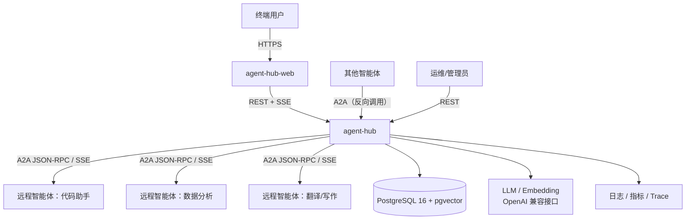
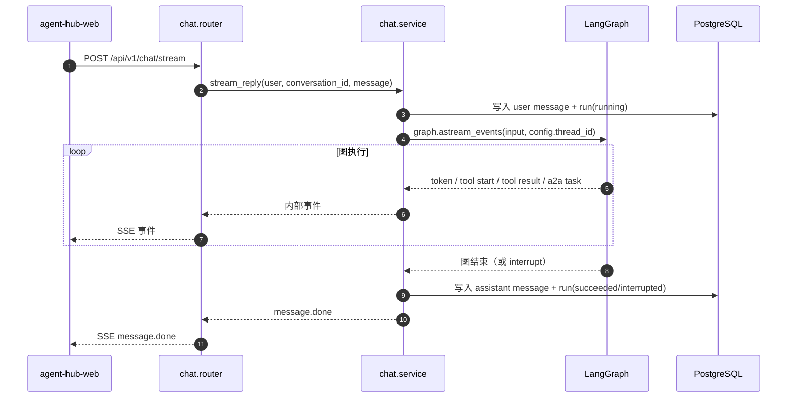
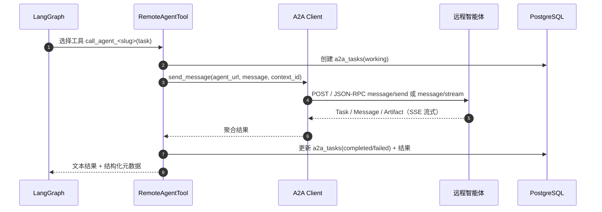
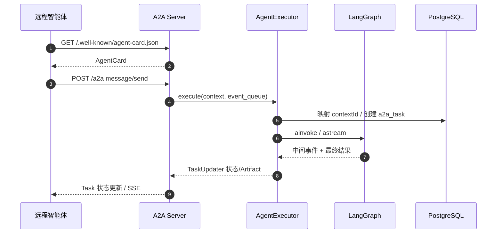
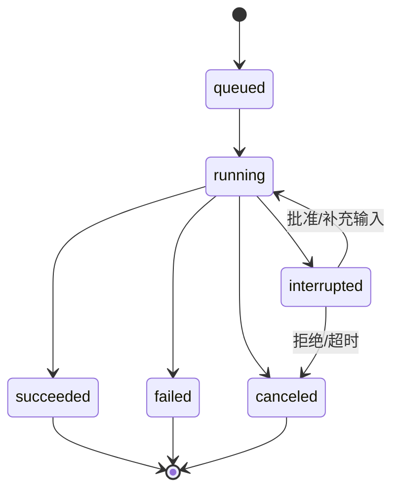
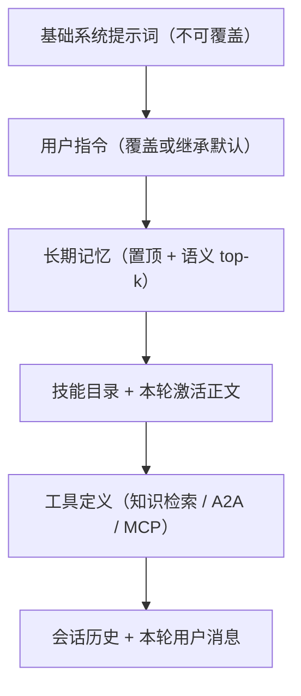

# 架构设计

- 项目：Agent Hub（`agent-hub`）
- 状态：设计稿；当前仓库只有目录与文档，代码未实现
- 更新时间：2026-11-04

## 1. 目标与非目标

### 目标

1. 用户通过 Web 前端与主智能体多轮对话，回答流式输出。
2. 主智能体可自主检索知识库，并在需要时通过 **Google A2A 协议**调用其他智能体完成任务。
3. 本服务同时作为 A2A Server，向其他智能体暴露自己的能力。
4. 所有会话、消息、图执行、远程任务、工具调用可追踪、可审计、可恢复。
5. 高风险动作支持人工确认（HITL），避免智能体自主产生不可逆副作用。

### 非目标（当前阶段）

- 不做通用工作流编排器（BPMN/低代码画布）；
- 不做 Agent 训练/微调平台；
- 不做多租户计费；
- 不追求单机百万并发；先按团队级/部门级规模设计，保留横向扩展路径。

## 2. 系统上下文



## 3. 组件与职责

| 组件 | 职责 | 不负责 |
|---|---|---|
| `api/v1` | 用户侧 REST 边界、鉴权、DTO 校验 | 业务规则、SQL |
| `modules/chat` | SSE 编排、run 生命周期、取消 | LangGraph 图内部逻辑 |
| `agents/` | LangGraph 图、状态、提示词、工具定义 | HTTP、数据库事务 |
| `modules/a2a` | A2A Server/Client、Agent Card、远程任务映射 | 用户鉴权、UI |
| `modules/agents` | 远程 Agent 注册、发现、健康检查 | 具体协议传输细节 |
| `modules/knowledge` | 文档入库、切分、Embedding、检索 | 向量 SQL（由 `db/vector` 实现） |
| `modules/approvals` | 审批工单、恢复图执行 | 决定何时需要审批（由工具声明） |
| `modules/mcp` | MCP 服务器注册、连接管理、工具发现、工具桥接 | 用户凭据的加密原语（由 `core/` 提供） |
| `modules/skills` | 本地技能包导入、校验、存储、激活 | 脚本执行（v2） |
| `modules/memories` | 长期记忆的写入策略、检索、管理接口 | 单次会话上下文（由 checkpoint 负责） |
| `modules/instructions` | 指令解析、覆盖合并、审计 | 基础系统提示词（代码内置） |
| `db/` | ORM 模型、会话、迁移、向量存储实现 | 业务规则 |
| `core/` | 配置、日志、中间件、异常、鉴权原语 | 业务模块依赖 |

## 4. 核心链路

### 4.1 用户对话（主链路）



关键点：

- `thread_id = conversation_id`，LangGraph 通过 PostgresSaver 恢复历史；
- 用户消息先落库再执行图，保证断线后仍可追溯；
- assistant 消息在图结束后一次性落库（流式 token 不逐条写库，降低写入放大）；
- 图执行在请求协程内完成；SSE 断开时通过 `asyncio.shield`/后台任务决定继续或取消（规划：默认继续并落库）。

### 4.2 A2A 出站（主智能体调用远程智能体）



设计要点：

- 远程 Agent 在注册时拉取 Agent Card，按技能生成一个或多个 LangChain 工具；
- 工具名稳定（`agent_<slug>__<skill_id>`），描述来自 Agent Card，便于模型路由；
- `context_id` 用于远程侧的多轮上下文，默认映射 `conversation_id`；
- 远程返回的 Task 状态、Artifact、错误统一归档到 `a2a_tasks`；
- 超时、重试、取消由客户端封装统一处理，工具层只关心结果。

### 4.3 A2A 入站（其他智能体调用本服务）



设计要点：

- 入站请求的鉴权独立于用户 JWT：支持 API Key / OAuth2（按 Agent Card 的 `securitySchemes` 声明）；
- `contextId` 与 `conversation_id` 建立映射，远程侧多轮对话可复用同一图线程；
- 入站任务与用户发起的 run 共用图，但通过 `source=user|a2a` 区分来源，避免审计混淆；
- 入站默认只暴露只读/低风险技能；写操作技能需显式开启并走审批。

### 4.4 审批（HITL）

- 工具或远程 Agent 声明 `requires_approval=true`；
- 图内调用 `interrupt()` 暂停，返回审批载荷；
- `modules/approvals` 创建工单，前端展示 `approval.required` 事件；
- 用户批准/拒绝后，服务端用 `Command(resume=...)` 恢复图执行；
- 超时未处理的工单由定时任务标记 `expired`，并让 run 进入 `canceled`。

## 5. 状态模型

### 5.1 run 状态



### 5.2 A2A Task 状态映射

| A2A 状态 | 本系统 `a2a_tasks.state` | 前端展示 |
|---|---|---|
| `submitted` | `submitted` | 已提交 |
| `working` | `working` | 执行中 |
| `input-required` | `input_required` | 等待补充信息 |
| `completed` | `completed` | 已完成 |
| `failed` | `failed` | 失败 |
| `canceled` | `canceled` | 已取消 |
| `rejected` | `rejected` | 被拒绝 |
| `auth-required` | `auth_required` | 需要授权 |

## 6. 分层与依赖规则

```
modules/*/router.py  →  modules/*/service.py  →  modules/*/repo.py  →  db/models
        │                     │
        └→ schemas.py         └→ agents/（仅 chat、a2a）
```

- `router` 不写业务规则，不直接访问 ORM；
- `service` 不依赖 FastAPI 的 `Request`/`Response`，便于单测与复用；
- `repo` 只做持久化，复杂查询集中在此；
- `agents/` 不 import `modules/`，保持可被两种入口复用；
- `db/` 不 import `modules/`；
- 跨模块调用通过 service 接口，禁止 import 其他模块的 router。

## 7. 关键设计决策

| 决策 | 选择 | 理由 | 代价/触发重审条件 |
|---|---|---|---|
| 业务库 | PostgreSQL | 事务、JSONB、扩展生态、生产成熟 | 需要 PostgreSQL 运维；Docker 只是可选方案 |
| 向量库 | pgvector（同库） | 业务元数据与向量同事务，删除/权限过滤简单，备份统一 | 千万级以上或高 QPS 检索可能成为瓶颈；届时切 Qdrant |
| 会话记忆 | LangGraph PostgresSaver | 与业务库同源，支持多实例；避免 SQLite 单机限制 | checkpoint 表增长快，需要定期归档 |
| 多智能体编排 | 单主图 + 远程 Agent 工具 | 实现简单、可解释、调试成本低；A2A 天然适合工具化 | 复杂 DAG 任务需要 planner/executor 子图（M5 后评估） |
| A2A Server | 与主服务同进程 | 少一个部署单元，Agent Card 与图共享配置 | 入站流量大时拆独立服务 |
| 流式协议 | SSE（服务端→前端） | 浏览器原生、简单、易调试；A2A 内部用 JSON-RPC/SSE | 需要双向实时（语音）时评估 WebSocket |
| DB 目录化 | `app/db/{base,engine,session,models,vector}` | 避免单文件膨胀，模型按领域拆分，迁移边界清晰 | 文件增多，需要 `models/__init__.py` 汇总导入 |
| 认证 | JWT（access + refresh） | 前后端分离标准方案，无状态易扩展 | 需要吊销能力时引入 token 黑名单/短 TTL |
| 前端 | Vue 3 + TS + Vite | 与现有 Node 项目技术栈一致，生态成熟 | — |
| 个人能力配置 | 账号级「系统默认 + 用户覆盖」 | 会话级独立配置 / 仅允许用户自建 | 用户明确要求；系统默认可更新，覆盖表避免批量回填 | 系统项正文不可改，只能在启停层覆盖；会话级覆盖留待后续 |
| 长期记忆 | LangGraph `AsyncPostgresStore` | 自建 `memories` 表 / 外部记忆服务 | 框架原生、自带 pgvector 语义检索、少写存储代码 | 业务字段只能放 value、无外键；表由框架 `setup()` 管理，不进 Alembic |
| 本地 Skill | v1 纯指令包（`SKILL.md`） | v1 支持可执行脚本 | 多用户 Web 服务执行上传代码风险过高 | 需要动作时走 MCP/A2A；脚本方案需沙箱，列为 v2 |
| 用户 MCP 传输 | 仅远程 URL；stdio 只允许系统项 | 全部允许 stdio | 进程隔离、资源限制、进程清理与密钥注入成本高 | 需要本地工具时由管理员配置系统 MCP |

## 8. 失败处理与幂等

### 8.1 超时

| 环节 | 默认超时 | 处理 |
|---|---|---|
| LLM 调用 | `LLM_TIMEOUT_SECONDS`（60s） | 重试 1 次（仅幂等请求），仍失败则 run=failed |
| A2A 远程调用 | `A2A_CLIENT_TIMEOUT_SECONDS`（60s） | 标记 a2a_task=failed，向图返回可读错误 |
| 数据库 | 连接池 + `pool_pre_ping` | 连接断开会自动重建 |
| SSE 心跳 | 15s | 前端断线重连，按 run 恢复 |

### 8.2 重试

- 仅对**幂等**操作重试：读操作、带 `Idempotency-Key` 的写操作；
- 远程 A2A 调用重试前先查 `a2a_tasks` 是否已有同 `tool_call_id` 记录；
- 重试用指数退避 + 抖动，最多 2 次；
- 非幂等写操作不自动重试，转为 `input-required` 或审批。

### 8.3 取消

- 用户取消 → 取消当前 run 的 asyncio task → 向 LangGraph 发送取消信号 → 对进行中的 A2A Task 调 `tasks/cancel`；
- 远程不支持取消时，标记本地 `canceled` 并忽略后续结果；
- 所有取消动作写审计日志。

### 8.4 断线恢复

- 前端 SSE 断开不影响后端执行（默认策略）；
- 前端重连后通过 `GET /api/v1/runs/{run_id}` 获取最终状态，或 `GET /api/v1/runs/{run_id}/events` 回放（规划）；
- 图执行状态由 checkpointer 保证，进程崩溃后可基于 thread 恢复（需要 run 状态对账任务）。

## 9. 安全边界

| 边界 | 措施 |
|---|---|
| 用户认证 | JWT access/refresh；密码 argon2；登录限流 |
| 用户授权 | 会话/消息按 `user_id` 过滤；管理员接口单独角色 |
| A2A 入站 | API Key / OAuth2；按技能授权；请求体大小限制；限流 |
| A2A 出站 | SSRF 防护（默认拒绝内网/回环，白名单放行）；Agent Card URL 校验；TLS 校验 |
| MCP 出站 | SSRF 校验（拒绝私网/回环/云元数据地址，`MCP_ALLOWED_HOSTS` 白名单）；TLS 校验；超时与响应大小限制 |
| 能力凭据 | MCP 请求头/Token 用 AES-GCM 加密存储，接口只回脱敏 hint；日志脱敏 |
| 技能包 | 只接受文本文件；zip 路径穿越/符号链接/压缩炸弹校验；大小、数量、正文 token 上限 |
| 长期记忆 | 按用户命名空间隔离；禁止保存敏感类别；用户可删除/清空/导出；管理员无正文读取接口 |
| 工具执行 | 白名单工具；参数 schema 校验；高风险动作审批；超时 |
| 提示词注入 | 检索内容与远程结果作为不可信数据，提示词明确隔离；输出过滤 |
| 密钥管理 | `.env` 不进仓库；数据库只存密钥引用/加密值；日志脱敏 |
| 数据 | 消息内容可能含隐私，按保留策略清理；审计只存摘要 |

## 10. 可观测性

- **日志**：JSON 结构化（后续从标准 logging 切换），字段包含 `request_id`、`run_id`、`conversation_id`、`a2a_task_id`、`tool_call_id`。
- **指标**：请求量/延迟/错误率、SSE 连接数、图执行时长、LLM token、A2A 调用成功率和 P95、向量检索延迟。
- **Trace**：接入 OpenTelemetry（a2a-sdk 自带 telemetry extra），把一次用户请求串成 trace。
- **审计**：`audit_logs` 记录登录、会话删除、Agent 注册、审批决定、远程调用等关键动作。

## 11. 部署拓扑

### 开发/单机

```text
使用方本机已有的 PostgreSQL（DATABASE_URL 指向它；不要求 Docker）
uvicorn app.main:app :8000
vite dev server :5173（/api 代理到 8000）
```

### 生产（推荐起点）

```text
                  ┌──────────────┐
   HTTPS  ───────►│  反向代理/Nginx │
                  └──────┬───────┘
                         │
              ┌──────────┴──────────┐
              │                     │
        agent-hub-web         agent-hub (N 实例)
        (静态资源/CDN)         │
                               ├─ PostgreSQL 主从 + pgvector
                               ├─ 可选 Redis（限流/缓存/事件总线）
                               └─ 对象存储（附件）
```

- 服务无状态，图状态在 PostgreSQL，可水平扩展；
- 多实例时 SSE 连接需要会话粘性或共享事件总线（后续）；
- checkpoint 表与业务表同库，建议独立表空间/定期归档；
- 数据库迁移在发布前以单实例 Job 执行。

## 12. 演进方向

1. **检索增强**：BM25 + 向量混合检索、RRF、reranker、按文档权限过滤。
2. **多智能体编排**：从「主图 + 工具」演进到 planner/executor/reflection 子图，支持并行子任务与失败重规划。
3. **A2A 生态**：Agent 市场式注册、能力自动发现、跨组织鉴权（OAuth2 client credentials）、计费。
4. **可观测**：OpenTelemetry + Prometheus + Grafana，LLM trace 接入 LangSmith（可选）。
5. **企业能力**：多租户、RBAC、审计导出、数据脱敏、私有化部署。

## 13. 个人能力层（M1.5，设计）

> 详细设计、数据模型与接口见 [个人能力层设计](superpowers/specs/2026-11-05-agent-capabilities-design.md)。

四项能力（MCP / Skill / 长期记忆 / Instruction）共享「系统默认 + 用户自定义」模型，账号级生效；会话内可显式选择 Skill/MCP，只影响当次请求。

### 13.1 组件

| 组件 | 职责 |
|---|---|
| `modules/mcp` | 服务器 CRUD、连通性检查、工具发现与缓存、调用桥接、健康巡检 |
| `modules/skills` | 技能包导入与校验、目录、激活、参考文件读取 |
| `modules/memories` | `AsyncPostgresStore` 封装、保存去重、检索注入、管理 CRUD |
| `modules/instructions` | 平台默认/用户覆盖解析、长度校验、生效预览 |
| `agents/` | 提示词装配、`save_memory` / `read_skill_file` 工具、MCP 工具目录 |

### 13.2 每轮装配顺序



### 13.3 关键约束

- **MCP**：系统项可 stdio，用户项仅远程 URL；工具名 `mcp__<slug>__<tool>`；破坏性工具强制审批；系统 MCP 的写/破坏性工具仅管理员可用；调用写 `tool_invocations(source='mcp')`；
- **Skill**：v1 只接受文本指令包；显式激活最多 3 个；正文按不可信数据包裹；脚本执行列为 v2；
- **记忆**：存 `langgraph` schema 的 `store`；按 `("memories", user_id)` 隔离；v1 只做显式保存（`save_memory`）与手动管理，自动提取列为 v2；
- **Instruction**：用户文本整段覆盖平台默认，`null` 表示继承；基础系统提示词与安全规则不可覆盖；
- **降级**：MCP 不可达、Store 故障都只降级不阻断对话，并发 `notice` 事件。
