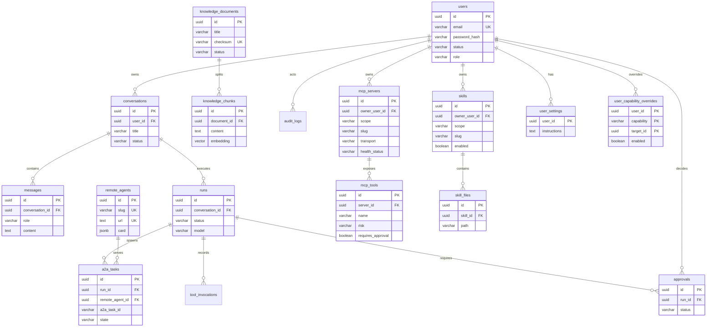

# 数据库设计

- 数据库：PostgreSQL 16
- 扩展：`vector`（pgvector）、`pg_trgm`（可选，用于标题模糊搜索）
- 迁移：Alembic（异步 SQLAlchemy）
- 状态：M1 / M1.5 / M2 表结构已落迁移；M3 入站取消；M4 起待落

## 1. 存储架构

一个 PostgreSQL 实例、一个数据库 `agent_hub`，按 schema 划分职责：

| Schema | 内容 | 管理方 |
|---|---|---|
| `public` | 业务表（用户、会话、消息、run、Agent 注册表、A2A 任务、知识库、审批、审计、个人能力配置） | Alembic |
| `langgraph` | LangGraph checkpoint 表（`checkpoints`、`checkpoint_blobs`、`checkpoint_writes`、`checkpoint_migrations`）与长期记忆 Store（`store`、`store_vectors`） | `PostgresSaver.setup()` / `AsyncPostgresStore.setup()` |
| `public.vector` 扩展 | pgvector 类型与索引 | 本机 PostgreSQL 手动建 / 可选 compose initdb |

选择同库的理由：

1. 删除知识文档时，向量块可通过外键级联删除，不会出现双库不一致；
2. 检索可以 join 业务元数据（分类、权限、状态）后再排序；
3. 备份、恢复、监控、连接池只需一套；
4. 事务内可同时写业务记录与向量，失败自动回滚。

## 2. 命名与类型约定

| 约定 | 规则 |
|---|---|
| 表名 | 小写下划线、复数（`conversations`、`a2a_tasks`） |
| 主键 | `id uuid`，应用侧 `uuid4()` 生成（`UUIDPrimaryKeyMixin`） |
| 时间 | `timestamptz`，UTC 存储；`created_at` / `updated_at` 由数据库默认值维护 |
| 金额/计数 | `numeric` / `bigint`，不用浮点 |
| 枚举 | 用 `varchar` + `CHECK` 约束（便于演进，不用 PG enum） |
| JSON | `jsonb`，只存弱结构扩展字段，常用过滤字段必须提升为列 |
| 外键 | 显式命名（`fk_<table>_<column>_<reftable>`），删除策略按业务选择 |
| 软删除 | 仅会话使用 `status='deleted'`；其余表物理删除 |

## 3. ER 图



## 4. 表设计

### 4.1 `users`

| 字段 | 类型 | 约束 | 说明 |
|---|---|---|---|
| `id` | uuid | PK | 用户 ID |
| `email` | varchar(255) | not null | 登录邮箱，唯一性用 `lower(email)` 索引保证 |
| `password_hash` | varchar(255) | not null | argon2 哈希（pwdlib） |
| `display_name` | varchar(64) | not null default '' | 展示名 |
| `status` | varchar(16) | not null default 'active' | `active` / `disabled` |
| `role` | varchar(16) | not null default 'user' | M1.5：`user` / `admin` |
| `last_login_at` | timestamptz | null | 最近登录时间 |
| `created_at` / `updated_at` | timestamptz | not null | 审计时间 |

索引：`UNIQUE (lower(email))`、`(status)`。

### 4.2 `conversations`

| 字段 | 类型 | 约束 | 说明 |
|---|---|---|---|
| `id` | uuid | PK | 会话 ID，同时作为 LangGraph `thread_id` |
| `user_id` | uuid | FK users, on delete restrict | 归属用户 |
| `title` | varchar(200) | not null default '新对话' | 可由首条消息异步生成 |
| `status` | varchar(16) | not null default 'active' | `active` / `archived` / `deleted` |
| `last_message_at` | timestamptz | null | 列表排序字段 |
| `metadata` | jsonb | not null default '{}' | 扩展信息（来源、标签） |
| `created_at` / `updated_at` | timestamptz | not null | |

索引：`(user_id, status, last_message_at desc)`。

### 4.3 `messages`

| 字段 | 类型 | 约束 | 说明 |
|---|---|---|---|
| `id` | uuid | PK | 消息 ID |
| `conversation_id` | uuid | FK conversations, cascade | 所属会话 |
| `role` | varchar(16) | check in (`user`,`assistant`,`tool`,`system`) | 角色 |
| `content` | text | not null default '' | 文本内容 |
| `content_type` | varchar(16) | not null default 'text' | `text` / `markdown` / `json` |
| `run_id` | uuid | null, FK runs (set null) | 关联的图执行 |
| `tool_call_id` | varchar(64) | null | 工具结果消息对应的调用 ID |
| `metadata` | jsonb | not null default '{}' | 来源、token、附件引用 |
| `created_at` | timestamptz | not null | |

索引：`(conversation_id, created_at)`、`(run_id)`。

> 流式 token 不逐条入库；assistant 消息在图结束后写一条完整消息，`metadata.stream=true` 标记。

### 4.4 `runs`（一次 LangGraph 图执行）

| 字段 | 类型 | 约束 | 说明 |
|---|---|---|---|
| `id` | uuid | PK | run ID，返回给前端用于追踪/取消 |
| `conversation_id` | uuid | FK conversations, cascade | 所属会话 |
| `user_message_id` | uuid | FK messages (set null) | 触发消息 |
| `assistant_message_id` | uuid | FK messages (set null) | 产出消息 |
| `source` | varchar(16) | not null default 'user' | `user` / `a2a` / `system` |
| `status` | varchar(16) | not null | 见状态机 |
| `model` | varchar(64) | not null default '' | 实际模型名 |
| `input_tokens` / `output_tokens` | integer | not null default 0 | 用量统计 |
| `error_code` / `error_message` | varchar/text | null | 失败原因（脱敏） |
| `capabilities` | jsonb | not null default '{}' | M1.5：本轮显式选择的技能/MCP |
| `idempotency_key` | varchar(128) | null | 客户端幂等键 |
| `started_at` / `finished_at` | timestamptz | null | 执行时间 |
| `created_at` | timestamptz | not null | |

索引：`(conversation_id, created_at desc)`、`(status)`（partial：排队/运行/中断）、`UNIQUE (conversation_id, idempotency_key)`。

状态：`queued` → `running` → `succeeded` / `failed` / `canceled` / `interrupted`（可恢复）。

### 4.5 `remote_agents`（远程 A2A Agent 注册表，M2 已落地）

| 字段 | 类型 | 约束 | 说明 |
|---|---|---|---|
| `id` | uuid | PK | 注册 ID |
| `owner_user_id` | uuid | null, FK users (set null) | v1 全局注册表，保留归属字段 |
| `slug` | varchar(64) | not null | 工具名前缀；`deleted_at IS NULL` 上部分唯一索引 |
| `name` | varchar(128) | not null | Agent Card 的 name（可被用户改写） |
| `description` | text | not null default '' | 能力描述 |
| `url` | text | not null | A2A 端点 |
| `protocol_version` | varchar(16) | not null default '' | 从 Agent Card 读取 |
| `card` | jsonb | not null default '{}' | 原始 Agent Card 快照 |
| `skills` | jsonb | not null default '[]' | 规范化后的技能列表 |
| `capabilities` | jsonb | not null default '{}' | streaming / pushNotifications 等 |
| `auth_type` | varchar(16) | not null default 'none' | `none` / `api_key` / `oauth2` |
| `auth_scheme` | varchar(32) | not null default 'none' | 展示用 `bearer` / `header` / `oauth2` / `none` |
| `auth_hint` | varchar(160) | not null default '' | 凭据提示（不回显明文） |
| `secret_ref` | varchar(200) | null | 凭据引用（`env:NAME`） |
| `headers` | jsonb | not null default '{}' | 普通头明文；敏感头只存 secret_ref 或 AES-GCM 密文 |
| `requires_approval` | boolean | not null default false | 写操作技能需审批 |
| `enabled` | boolean | not null default true | 是否参与工具生成 |
| `health_status` | varchar(16) | not null default 'unknown' | `unknown` / `healthy` / `degraded` / `unhealthy` |
| `consecutive_failures` | integer | not null default 0 | 连续失败计数（≥3 标 unhealthy） |
| `last_checked_at` | timestamptz | null | 最近一次健康检查 |
| `last_latency_ms` | integer | null | 最近一次健康检查延迟 |
| `last_error` | text | null | 最近一次错误摘要 |
| `name_edited` | boolean | not null default false | 用户改过 name 后 refresh 不覆盖 |
| `deleted_at` | timestamptz | null | 软删 |
| `created_at` / `updated_at` | timestamptz | not null | |

索引：`uq_remote_agents_slug_active(slug) WHERE deleted_at IS NULL`、`(owner_user_id)`、`(enabled, health_status)`。

### 4.6 `a2a_tasks`（A2A 任务，M2 已落地）

| 字段 | 类型 | 约束 | 说明 |
|---|---|---|---|
| `id` | uuid | PK | 本地任务 ID |
| `a2a_task_id` | varchar(128) | not null default '' | 远程返回的 task id（空串表示尚未拿到） |
| `remote_agent_id` | uuid | not null, FK remote_agents (restrict) | 目标 Agent |
| `run_id` | uuid | null, FK runs (set null) | 所属图执行 |
| `conversation_id` | uuid | null, FK conversations (set null) | 所属会话 |
| `tool_call_id` | varchar(64) | not null default '' | LangChain tool call ID，用于幂等 |
| `context_id` | varchar(128) | null | 远程上下文 ID |
| `state` | varchar(16) | not null default 'submitted' | 8 态，见下 |
| `progress` | float | null | 远程进度 0–1 |
| `request` | jsonb | not null default '{}' | `{tool,args,summary}` 请求快照 |
| `result` | jsonb | null | `{artifact,summary}` 终态结果 |
| `error` | jsonb | null | `{code,message,retryable,at}` |
| `input_request` | jsonb | null | 远程要求补充输入 |
| `auth_request` | jsonb | null | 远程要求授权 |
| `timeline` | jsonb | not null default '[]' | `[{state,at,duration_ms,note}]` |
| `started_at` / `finished_at` | timestamptz | null | |
| `created_at` / `updated_at` | timestamptz | not null | |

索引：`(state, created_at desc)`、`(remote_agent_id, created_at desc)`、`(run_id, created_at desc)`、`(conversation_id, created_at desc)`。

状态：`submitted` / `working` / `input_required` / `auth_required` / `completed` / `failed` / `canceled` / `rejected`。

### 4.7 `tool_invocations`

| 字段 | 类型 | 约束 | 说明 |
|---|---|---|---|
| `id` | uuid | PK | |
| `run_id` | uuid | FK runs, cascade | |
| `tool_call_id` | varchar(64) | not null | 模型生成的调用 ID |
| `tool_name` | varchar(128) | not null | 工具名 |
| `source` | varchar(16) | not null default 'native' | M1.5：`native` / `mcp` / `a2a` / `knowledge` / `skill` |
| `source_id` | varchar(128) | null | 服务器/技能等来源 ID |
| `args` | jsonb | not null | 参数摘要（脱敏、截断） |
| `result` | jsonb | null | 结果摘要（截断） |
| `status` | varchar(16) | not null | `ok` / `error` |
| `error_type` | varchar(64) | null | 异常类型 |
| `latency_ms` | integer | null | 耗时 |
| `created_at` | timestamptz | not null | |

索引：`(run_id)`、`(tool_name, created_at desc)`。

### 4.8 `knowledge_documents`

> M4 实现后更新。owner 为空的系统文档与用户私有文档共用本表，checksum 唯一性按归属分域。

| 字段 | 类型 | 约束 | 说明 |
|---|---|---|---|
| `id` | uuid | PK | |
| `owner_user_id` | uuid | FK `users(id)` ON DELETE CASCADE, null | `NULL` = 系统文档（仅管理员可写） |
| `title` | varchar(200) | not null | 文档标题 |
| `filename` | varchar(255) | not null default '' | 原始文件名；供检索命中与脚本使用，**不对外返回** |
| `source_uri` | text | not null default '' | 原始文件路径/URL |
| `category` | varchar(64) | not null default '' | 分类，用于过滤 |
| `checksum` | varchar(64) | not null | SHA-256，防重复入库 |
| `size_bytes` | integer | not null default 0 | 原始字节数 |
| `storage_key` | varchar(255) | not null default '' | 后端无关的对象键，如 `knowledge/<id>.md` |
| `status` | varchar(16) | not null default 'pending' | `pending` / `indexing` / `ready` / `failed`（CHECK） |
| `chunk_count` | integer | not null default 0 | 块数 |
| `error` | text | null | 失败原因（脱敏、截断 500 字符）；成功时为 `NULL` |
| `metadata` | jsonb | not null default '{}' | 页数、mime 等 |
| `created_at` / `updated_at` | timestamptz | not null | |

索引与约束：

```sql
CREATE INDEX ix_knowledge_documents_status ON knowledge_documents (status);
CREATE INDEX ix_knowledge_documents_category ON knowledge_documents (category);
CREATE INDEX ix_knowledge_documents_owner ON knowledge_documents (owner_user_id, updated_at DESC);

-- checksum 唯一性按归属分域（与 mcp_servers 的 system/user slug 模式一致）
CREATE UNIQUE INDEX uq_knowledge_documents_system_checksum
    ON knowledge_documents (checksum) WHERE owner_user_id IS NULL;
CREATE UNIQUE INDEX uq_knowledge_documents_user_checksum
    ON knowledge_documents (owner_user_id, checksum) WHERE owner_user_id IS NOT NULL;
```

> 偏离说明：设计初期是全局 `UNIQUE(checksum)`；引入 owner 后全局唯一会让两个用户上传同一份文档互相冲突，故拆成两条部分唯一索引。

### 4.9 `knowledge_chunks`（pgvector）

| 字段 | 类型 | 约束 | 说明 |
|---|---|---|---|
| `id` | uuid | PK | |
| `document_id` | uuid | FK knowledge_documents ON DELETE CASCADE, not null | |
| `chunk_index` | integer | not null | 文档内序号，从 0 开始 |
| `content` | text | not null | 文本块（**不含 Markdown 标题行**，标题存 `metadata.heading`） |
| `embedding` | `vector(1536)` | not null | 维度由 `EMBEDDING_DIM` 决定；**改维度必须重建表** |
| `token_count` | integer | not null default 0 | 保守估算 |
| `metadata` | jsonb | not null default '{}' | `{heading, page, char_start}` |
| `created_at` | timestamptz | not null | |

> 本表**没有** `updated_at`：分块创建后不再变化，检索与引用统一取 `knowledge_documents.updated_at`。

约束/索引：

```sql
UNIQUE (document_id, chunk_index);

CREATE INDEX ix_knowledge_chunks_embedding
    ON knowledge_chunks USING hnsw (embedding vector_cosine_ops)
    WITH (m = 16, ef_construction = 64);

CREATE INDEX ix_knowledge_chunks_metadata
    ON knowledge_chunks USING gin (metadata jsonb_path_ops);
```

### 4.10 `approvals`

| 字段 | 类型 | 约束 | 说明 |
|---|---|---|---|
| `id` | uuid | PK | |
| `run_id` | uuid | FK runs, cascade | 关联执行 |
| `a2a_task_id` | uuid | FK a2a_tasks (set null) | 若审批针对远程调用 |
| `tool_name` | varchar(128) | not null | 待执行工具 |
| `reason` | text | not null | 为什么需要审批 |
| `payload` | jsonb | not null | 待确认的调用参数 |
| `status` | varchar(16) | not null default 'pending' | `pending` / `approved` / `rejected` / `expired` |
| `decided_by` | uuid | FK users (set null) | 审批人 |
| `decision_note` | text | not null default '' | 审批意见 |
| `expires_at` | timestamptz | null | 超时时间 |
| `created_at` / `decided_at` | timestamptz | not null / null | |

索引：`(status, created_at)`、`(run_id)`。

### 4.11 `audit_logs`

| 字段 | 类型 | 约束 | 说明 |
|---|---|---|---|
| `id` | bigserial | PK | 高写入量，用自增 |
| `actor_type` | varchar(16) | not null | `user` / `agent` / `system` |
| `actor_id` | varchar(64) | not null default '' | 用户/Agent ID |
| `action` | varchar(64) | not null | `login` / `conversation.delete` / `agent.register` / `approval.decide` … |
| `resource_type` | varchar(64) | not null default '' | 资源类型 |
| `resource_id` | varchar(64) | not null default '' | 资源 ID |
| `detail` | jsonb | not null default '{}' | 变更摘要（脱敏） |
| `request_id` | varchar(64) | not null default '' | 请求追踪 ID |
| `ip` | inet | null | 来源 IP |
| `created_at` | timestamptz | not null | |

索引：`(created_at desc)`、`(actor_id, created_at desc)`、`(action, created_at desc)`。

### 4.12 `mcp_servers`（MCP 服务器注册表）

| 字段 | 类型 | 约束 | 说明 |
|---|---|---|---|
| `id` | uuid | PK | |
| `scope` | varchar(16) | check `('system','user')` | 系统默认 / 用户自建 |
| `owner_user_id` | uuid | FK users, cascade, null | 系统项为空 |
| `slug` | varchar(64) | not null | 工具名前缀，`[a-z0-9_-]` |
| `name` | varchar(128) | not null | 展示名 |
| `description` | text | not null default '' | |
| `transport` | varchar(24) | check `('streamable_http','sse','stdio')` | 传输方式 |
| `url` | text | null | 远程传输必填 |
| `command` | varchar(512) | null | stdio 必填 |
| `args` | jsonb | not null default '[]' | stdio 参数 |
| `env_refs` | jsonb | not null default '[]' | 只存环境变量名，不存值 |
| `credentials_ciphertext` | bytea | null | AES-GCM 加密的请求头/Token |
| `credentials_hint` | varchar(160) | not null default '' | 脱敏提示 |
| `enabled` | boolean | not null default true | 系统默认启停 |
| `auto_inject` | boolean | not null default true | 是否自动进入每轮工具目录 |
| `force_disabled` | boolean | not null default false | 管理员强制停用，优先级高于用户覆盖 |
| `health_status` | varchar(16) | not null default 'unknown' | `unknown/healthy/unhealthy/disabled` |
| `last_checked_at` | timestamptz | null | 最近一次检查 |
| `last_error` | text | null | 脱敏错误 |
| `tools_synced_at` | timestamptz | null | 工具缓存时间 |
| `created_at` / `updated_at` | timestamptz | not null | |

约束/索引：

```sql
CHECK ((scope = 'system' AND owner_user_id IS NULL)
    OR (scope = 'user' AND owner_user_id IS NOT NULL));
CHECK ((transport = 'stdio' AND command IS NOT NULL)
    OR (transport <> 'stdio' AND url IS NOT NULL));
CREATE UNIQUE INDEX uq_mcp_servers_system_slug ON mcp_servers (slug) WHERE scope = 'system';
CREATE UNIQUE INDEX uq_mcp_servers_user_slug ON mcp_servers (owner_user_id, slug) WHERE scope = 'user';
CREATE INDEX ix_mcp_servers_owner ON mcp_servers (owner_user_id, enabled);
```

### 4.13 `mcp_tools`（工具发现缓存与策略）

| 字段 | 类型 | 约束 | 说明 |
|---|---|---|---|
| `id` | uuid | PK | |
| `server_id` | uuid | FK mcp_servers, cascade | |
| `name` | varchar(128) | not null | 服务器原始工具名 |
| `exposed_name` | varchar(64) | not null | `mcp__<slug>__<tool>`，同一用户目录内唯一 |
| `description` | text | not null default '' | |
| `input_schema` | jsonb | not null default '{}' | JSON Schema |
| `annotations` | jsonb | not null default '{}' | readOnly/destructive 等 |
| `risk` | varchar(16) | not null default 'unknown' | `read/write/destructive/unknown` |
| `requires_approval` | boolean | not null default true | 审批策略 |
| `enabled` | boolean | not null default true | 工具级启停 |
| `discovered_at` / `updated_at` | timestamptz | not null | |

索引：`UNIQUE (server_id, name)`、`UNIQUE (server_id, exposed_name)`、`(server_id, enabled)`；用户自建 slug 不得与系统项 slug 重名，保证单个用户的工具目录内 `exposed_name` 不冲突。

### 4.14 `skills`（本地技能包）

| 字段 | 类型 | 约束 | 说明 |
|---|---|---|---|
| `id` | uuid | PK | |
| `scope` | varchar(16) | check `('system','user')` | |
| `owner_user_id` | uuid | FK users, cascade, null | 系统项为空 |
| `slug` | varchar(64) | not null | 来自 frontmatter `name` |
| `name` | varchar(128) | not null | 展示名 |
| `description` | text | not null | 路由描述，参与技能目录 |
| `content` | text | not null | `SKILL.md` 正文 |
| `metadata` | jsonb | not null default '{}' | frontmatter 其余字段 |
| `source` | varchar(16) | check `('builtin','upload','manual')` | |
| `enabled` | boolean | not null default true | |
| `force_disabled` | boolean | not null default false | 管理员强制停用，优先级高于用户覆盖 |
| `size_bytes` | integer | not null default 0 | |
| `file_count` | integer | not null default 0 | 参考文件数 |
| `created_at` / `updated_at` | timestamptz | not null | |

索引：系统/用户 slug 部分唯一索引（同 `mcp_servers`）、`(owner_user_id, enabled)`。

### 4.15 `skill_files`（技能参考文件）

| 字段 | 类型 | 约束 | 说明 |
|---|---|---|---|
| `id` | uuid | PK | |
| `skill_id` | uuid | FK skills, cascade | |
| `path` | varchar(512) | not null | 相对路径，禁止 `..` |
| `content` | text | not null | 文本内容 |
| `size_bytes` | integer | not null | |
| `created_at` | timestamptz | not null | |

索引：`UNIQUE (skill_id, path)`。

### 4.16 `system_settings` / `user_settings`

`system_settings`（管理员维护的平台默认值）：

| 字段 | 类型 | 约束 | 说明 |
|---|---|---|---|
| `key` | varchar(128) | PK | 如 `instruction.default` |
| `value` | jsonb | not null | |
| `updated_by` | uuid | FK users, set null | |
| `updated_at` | timestamptz | not null | |

启动时若 `instruction.default` 不存在，写入代码内置默认文本。

`user_settings`（账号级覆盖）：

| 字段 | 类型 | 约束 | 说明 |
|---|---|---|---|
| `user_id` | uuid | PK, FK users, cascade | |
| `instructions` | text | null | `null` = 继承平台默认 |
| `created_at` / `updated_at` | timestamptz | not null | |

### 4.17 `user_capability_overrides`（系统项按用户启停）

| 字段 | 类型 | 约束 | 说明 |
|---|---|---|---|
| `user_id` | uuid | FK users, cascade | |
| `capability` | varchar(16) | check `('mcp_server','skill')` | |
| `target_id` | uuid | 无外键（跨两张表） | 系统项 ID |
| `enabled` | boolean | not null | |
| `created_at` / `updated_at` | timestamptz | not null | |

主键 `(user_id, capability, target_id)`；删除系统项时后台清理孤儿覆盖。有效启停 = `NOT force_disabled AND COALESCE(overrides.enabled, 自身 enabled)`。

### 4.18 既有表变更

| 表 | 变更 | 说明 |
|---|---|---|
| `users` | 新增 `role varchar(16) not null default 'user' check ('user','admin')` | 管理端鉴权 |
| `runs` | 新增 `capabilities jsonb not null default '{}'` | 本轮显式选择的技能/MCP，供审计与回放 |
| `tool_invocations` | 新增 `source varchar(16) not null default 'native'`、`source_id varchar(128) null` | `source ∈ native/mcp/a2a/knowledge/skill` |

`tool_invocations` 补索引 `(source, created_at desc)`。

## 5. 向量检索设计

### 5.1 索引选择

| 指标 | HNSW | IVFFlat |
|---|---|---|
| 查询延迟 | 低 | 中 |
| 召回率 | 高 | 依赖训练/分桶 |
| 构建成本 | 高 | 低 |
| 增量写入 | 友好 | 需要重建/维护 |

本项目选择 **HNSW + cosine**：知识库规模通常在十万到千万级，HNSW 查询稳定、增量写入友好。

参数起点：`m=16`、`ef_construction=64`；查询时 `SET hnsw.ef_search = 64`（可按 P95 调整）。

### 5.2 查询

```sql
SELECT
    id,
    document_id,
    content,
    1 - (embedding <=> :query_embedding) AS score
FROM knowledge_chunks
WHERE document_id = ANY(:allowed_document_ids)
ORDER BY embedding <=> :query_embedding
LIMIT :top_k;
```

注意：

- `<=>` 是 cosine distance，`score = 1 - distance`；
- **阈值过滤放在应用层**：先在数据库取 `top_k`，再用 `VECTOR_SCORE_THRESHOLD` 过滤，避免 SQL 中的阈值条件破坏索引扫描路径；
- 元数据过滤条件要有对应 B-tree/GIN 索引，过滤后结果过少时启用 pgvector 的迭代扫描；
- 查询向量维度必须与列维度一致，否则 PostgreSQL 直接报错。

### 5.3 维度变更

`EMBEDDING_DIM` 一旦上线不可原地修改：

1. 新建 `knowledge_chunks_v2` 表与对应向量列；
2. 全量重算 embedding 写入新表；
3. 双读校验后切换；
4. 删除旧表。

迁移脚本不得直接 `ALTER COLUMN ... TYPE vector(N)`，向量类型不支持隐式转换到不同维度。

## 6. LangGraph 持久化（checkpoint + store）

### 6.1 checkpoint

- 表由 `langgraph-checkpoint-postgres` 的 `PostgresSaver.setup()` 创建；
- 放独立 schema `langgraph`，避免与业务表混；
- 连接时指定 search_path：

```python
import psycopg
from langgraph.checkpoint.postgres import PostgresSaver

with psycopg.connect(settings.checkpoint_dsn, options="-csearch_path=langgraph") as conn:
    saver = PostgresSaver(conn)
    saver.setup()
```

- `thread_id = conversation_id`，同一会话的多轮消息共享状态；
- checkpoint 表增长较快，建议按 `thread_id` 的最近活跃时间归档（规划脚本 `scripts/prune_checkpoints.py`）；
- 多实例部署时所有实例必须连同一数据库，禁止使用 InMemorySaver。

### 6.2 长期记忆 Store（`store` / `store_vectors`）

- 使用 `langgraph-checkpoint-postgres` 提供的 `AsyncPostgresStore`（模块 `langgraph.store.postgres`）；
- 与 checkpoint 同库、同 schema `langgraph`；连接 `search_path=langgraph,public`（`vector` 类型在 `public`）；
- `setup()` 幂等创建 `store`、`store_vectors`，与 checkpoint 一样由框架管理，**不进 Alembic**；
- 命名空间 `("memories", "<user_id>")`，key `mem_<uuid4hex>`，value 为 JSONB（`kind/content/pinned/status/source/tags`）；
- 配置 `index={"dims": EMBEDDING_DIM, "embed": ..., "fields": ["content"]}` 获得 pgvector 语义检索；
- `search()` 无 query 时按 `updated_at DESC` 返回，供设置页「最近更新」；`filter` 可过滤 `kind/status/pinned`；
- 应用启动时调用 `setup()`（幂等），与 checkpointer 同时初始化；`EMBEDDING_DIM` 变更需重建 `store_vectors` 并重算记忆；
- 备份覆盖 `langgraph` schema；恢复后对 `store_vectors` 执行 `REINDEX` 重建向量索引。

## 7. 并发与一致性

| 场景 | 策略 |
|---|---|
| 同一会话并发发消息 | `runs` 上按 conversation 加 advisory lock，串行执行；前端提示“上一条还在生成” |
| 同一 A2A Task 重复回调 | `UNIQUE (remote_agent_id, a2a_task_id)` + upsert |
| 知识库重建 | `knowledge_documents.status='indexing'`；旧块在新块写完后事务内替换 |
| 审批并发 | `UPDATE ... WHERE status='pending'` 乐观更新，影响行数为 0 则返回冲突 |
| 删除会话 | 软删除会话 + 异步清理消息/向量/checkpoint |
| 记忆保存去重 | 先按 content 语义查重（≥0.92 更新），再写入；并发以 Store key 唯一性兜底，重复整理列为 v2 |
| MCP 工具发现 | 同一服务器并发 check/refresh 用 advisory lock 串行，发现结果覆盖式写入 `mcp_tools` |
| 系统技能同步 | 启动时按 slug upsert；仓库中删除的内置技能标记 `force_disabled=true`，不物理删除 |
| 指令更新 | `user_settings` 单行更新，最后写入生效；变更写审计 |

## 8. 迁移规范

1. 迁移由 Alembic 管理，`app/db/models/__init__.py` 必须导入所有模型；
2. 每次迁移只做一件事，命名 `YYYYMMDD_HHMM_<rev>_<slug>`；
3. 已合并的迁移禁止修改，修复用新迁移；
4. 生产环境破坏性变更分两步：先加新列/双写，再切读，最后删旧列；
5. 大表加索引使用 `CREATE INDEX CONCURRENTLY`（Alembic 中需 `autocommit_block`）；
6. 向量扩展与 schema 由本机 PostgreSQL 初始化（或可选 compose 的 `docker/initdb`），迁移中只建表/索引；
7. 迁移前备份，发布流程中由单实例 Job 执行 `alembic upgrade head`。

常用命令：

```bash
uv run alembic revision --autogenerate -m "add users and conversations"
uv run alembic upgrade head                 # 应用迁移
uv run alembic downgrade -1                 # 本地回滚
uv run alembic current
uv run alembic history
```

> 当前仓库尚未包含 `alembic/env.py` 与迁移脚本，以上命令在 M1 编码阶段补齐后可用。

## 9. 数据生命周期

| 数据 | 保留策略 | 清理方式 |
|---|---|---|
| `messages` | 随会话保留；用户删除后 30 天物理清理 | 定时任务 |
| `runs` / `tool_invocations` | 180 天 | 分区/批量删除 |
| `a2a_tasks` | 90 天 | 批量删除 |
| `audit_logs` | 365 天 | 按月分区/归档 |
| `knowledge_*` | 随文档 | 外键级联 |
| `store`（长期记忆） | 随用户；删除/清空立即生效 | 管理接口 / 账号删除后台清理命名空间 |
| `mcp_tools` | 随服务器；每次发现覆盖 | 级联 / 覆盖写 |
| `skills` / `skill_files` | 随用户；系统技能随仓库版本 | 级联 / 启动同步 |
| `user_settings` / `user_capability_overrides` | 随用户 | 级联 |
| checkpoint | 会话最近活跃 30 天 | `scripts/prune_checkpoints.py` |
| 上传附件 | 30 天或随消息删除 | 对象存储生命周期 |

## 10. 备份与恢复

- 每日全量 `pg_dump`（含 `public` 与 `langgraph`），保留 14 天；
- 生产启用 WAL 归档，支持 PITR；
- 恢复演练每季度一次，重点验证向量索引可重建（`REINDEX INDEX ...`）；
- `pgvector` 索引不进入逻辑备份，恢复后需要重建（数据量大时耗时，需纳入 RTO 评估）。

## 11. 演进：切换独立向量库

当出现以下任一情况时，评估把向量检索迁到 Qdrant：

- 向量规模 > 5000 万，或检索 QPS 持续 > 200；
- 需要多路向量、稀疏向量、复杂 payload 过滤、分布式分片；
- pgvector 索引构建/更新影响业务库写入。

迁移路径（已预留 `VectorStore` 抽象）：

1. 新增 `app/db/vector/qdrant_store.py` 实现同一 Protocol；
2. 通过配置 `VECTOR_BACKEND=pgvector|qdrant` 装配；
3. 双写 + 结果对比，逐步切读；
4. PostgreSQL 中的 `knowledge_chunks` 保留为元数据源，向量列可下线。

---

## 12. M1 实现备注（2026-11-09）

### 12.1 新增 `refresh_tokens`

设计稿只写了 JWT，但「刷新轮换 / 登出 / 改密后旧令牌失效」必须落库，因此新增：

| 字段 | 类型 | 说明 |
|---|---|---|
| `id` | uuid PK | |
| `user_id` | uuid FK users cascade | |
| `jti` | varchar(64) unique | refresh token 的 JWT ID |
| `expires_at` | timestamptz | |
| `revoked_at` | timestamptz null | 轮换/登出/改密时置值 |
| `replaced_by_jti` | varchar(64) null | 轮换后的新 jti |
| `user_agent` / `ip` | varchar | 审计辅助 |
| `created_at` | timestamptz | |

索引：`(user_id, expires_at)`；`jti` 唯一。

### 12.2 既有表落地差异

| 表 | 差异 |
|---|---|
| `messages` | 增加 `updated_at`；`status` 增加内部值 `streaming`（API 不返回）；按交接包落地 `client_message_id`、`citations`、`attachments`、`artifacts`、`capabilities`、`usage`、`error` |
| `runs` | 按交接包落地 `reasoning_effort`、`workflow_id/version`、`reasoning_tokens`、`first_token_ms`、`duration_ms`、`active_duration_ms`、`canceled_at`；`idempotency_key` 与 `(conversation_id, idempotency_key)` 唯一约束 |
| `approvals` | 落地展示字段 `tool_display_name/source/executor/target/side_effect/risk/payload_preview` |
| `conversations` | 落地 `message_count`、`last_message_preview`、`archived_at` |
| `run_events` | 按交接包建表；`payload` 内部含 `_event` 键，API 返回前剥离 |

### 12.3 约束与迁移注意事项

1. 同一会话只能有一个未结束 run：

```sql
CREATE UNIQUE INDEX uq_runs_active_conversation ON runs (conversation_id)
WHERE status IN ('queued', 'running', 'interrupted');
```

2. `messages` 与 `runs` 互相引用，Alembic 迁移里先建表、再 `op.create_foreign_key`，降级时先删 `fk_messages_run_id_runs` 再删 `runs`；
3. LangGraph checkpoint/Store 表由框架 `setup()` 创建在 `langgraph` schema，不进 Alembic；
4. M1 迁移已通过 `upgrade → downgrade base → upgrade` 与 `alembic check`。
