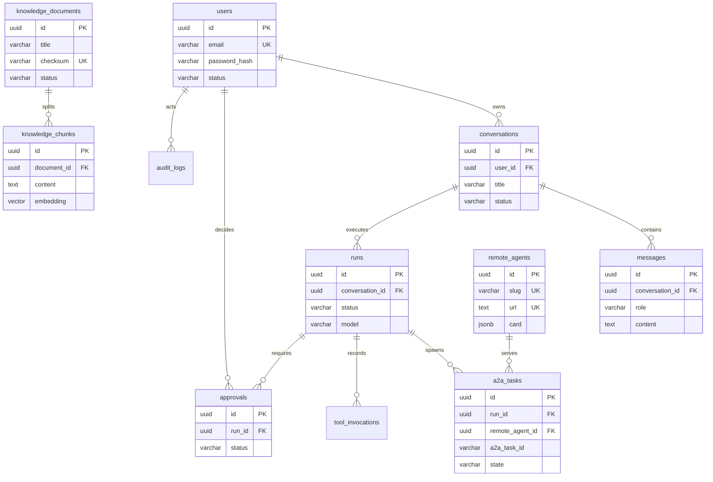

# 数据库设计

- 数据库：PostgreSQL 16
- 扩展：`vector`（pgvector）、`pg_trgm`（可选，用于标题模糊搜索）
- 迁移：Alembic（异步 SQLAlchemy）
- 状态：表结构为设计稿，M1 起按里程碑落迁移

## 1. 存储架构

一个 PostgreSQL 实例、一个数据库 `agent_hub`，按 schema 划分职责：

| Schema | 内容 | 管理方 |
|---|---|---|
| `public` | 业务表（用户、会话、消息、run、Agent 注册表、A2A 任务、知识库、审批、审计） | Alembic |
| `langgraph` | LangGraph checkpoint 表（`checkpoints`、`checkpoint_blobs`、`checkpoint_writes`、`checkpoint_migrations`） | `PostgresSaver.setup()` |
| `public.vector` 扩展 | pgvector 类型与索引 | `docker/initdb` / 迁移 |

选择同库的理由：

1. 删除知识文档时，向量块可通过外键级联删除，不会出现双库不一致；
2. 检索可以 join 业务元数据（分类、权限、状态）后再排序；
3. 备份、恢复、监控、连接池只需一套；
4. 事务内可同时写业务记录与向量，失败自动回滚。

## 2. 命名与类型约定

| 约定 | 规则 |
|---|---|
| 表名 | 小写下划线、复数（`conversations`、`a2a_tasks`） |
| 主键 | `id uuid`，应用侧 `uuid4()` 生成（`UUIDPrimaryKeyMixin`） |
| 时间 | `timestamptz`，UTC 存储；`created_at` / `updated_at` 由数据库默认值维护 |
| 金额/计数 | `numeric` / `bigint`，不用浮点 |
| 枚举 | 用 `varchar` + `CHECK` 约束（便于演进，不用 PG enum） |
| JSON | `jsonb`，只存弱结构扩展字段，常用过滤字段必须提升为列 |
| 外键 | 显式命名（`fk_<table>_<column>_<reftable>`），删除策略按业务选择 |
| 软删除 | 仅会话使用 `status='deleted'`；其余表物理删除 |

## 3. ER 图



## 4. 表设计

### 4.1 `users`

| 字段 | 类型 | 约束 | 说明 |
|---|---|---|---|
| `id` | uuid | PK | 用户 ID |
| `email` | varchar(255) | not null | 登录邮箱，唯一性用 `lower(email)` 索引保证 |
| `password_hash` | varchar(255) | not null | argon2 哈希（pwdlib） |
| `display_name` | varchar(64) | not null default '' | 展示名 |
| `status` | varchar(16) | not null default 'active' | `active` / `disabled` |
| `last_login_at` | timestamptz | null | 最近登录时间 |
| `created_at` / `updated_at` | timestamptz | not null | 审计时间 |

索引：`UNIQUE (lower(email))`、`(status)`。

### 4.2 `conversations`

| 字段 | 类型 | 约束 | 说明 |
|---|---|---|---|
| `id` | uuid | PK | 会话 ID，同时作为 LangGraph `thread_id` |
| `user_id` | uuid | FK users, on delete restrict | 归属用户 |
| `title` | varchar(200) | not null default '新对话' | 可由首条消息异步生成 |
| `status` | varchar(16) | not null default 'active' | `active` / `archived` / `deleted` |
| `last_message_at` | timestamptz | null | 列表排序字段 |
| `metadata` | jsonb | not null default '{}' | 扩展信息（来源、标签） |
| `created_at` / `updated_at` | timestamptz | not null | |

索引：`(user_id, status, last_message_at desc)`。

### 4.3 `messages`

| 字段 | 类型 | 约束 | 说明 |
|---|---|---|---|
| `id` | uuid | PK | 消息 ID |
| `conversation_id` | uuid | FK conversations, cascade | 所属会话 |
| `role` | varchar(16) | check in (`user`,`assistant`,`tool`,`system`) | 角色 |
| `content` | text | not null default '' | 文本内容 |
| `content_type` | varchar(16) | not null default 'text' | `text` / `markdown` / `json` |
| `run_id` | uuid | null, FK runs (set null) | 关联的图执行 |
| `tool_call_id` | varchar(64) | null | 工具结果消息对应的调用 ID |
| `metadata` | jsonb | not null default '{}' | 来源、token、附件引用 |
| `created_at` | timestamptz | not null | |

索引：`(conversation_id, created_at)`、`(run_id)`。

> 流式 token 不逐条入库；assistant 消息在图结束后写一条完整消息，`metadata.stream=true` 标记。

### 4.4 `runs`（一次 LangGraph 图执行）

| 字段 | 类型 | 约束 | 说明 |
|---|---|---|---|
| `id` | uuid | PK | run ID，返回给前端用于追踪/取消 |
| `conversation_id` | uuid | FK conversations, cascade | 所属会话 |
| `user_message_id` | uuid | FK messages (set null) | 触发消息 |
| `assistant_message_id` | uuid | FK messages (set null) | 产出消息 |
| `source` | varchar(16) | not null default 'user' | `user` / `a2a` / `system` |
| `status` | varchar(16) | not null | 见状态机 |
| `model` | varchar(64) | not null default '' | 实际模型名 |
| `input_tokens` / `output_tokens` | integer | not null default 0 | 用量统计 |
| `error_code` / `error_message` | varchar/text | null | 失败原因（脱敏） |
| `idempotency_key` | varchar(128) | null | 客户端幂等键 |
| `started_at` / `finished_at` | timestamptz | null | 执行时间 |
| `created_at` | timestamptz | not null | |

索引：`(conversation_id, created_at desc)`、`(status)`（partial：排队/运行/中断）、`UNIQUE (conversation_id, idempotency_key)`。

状态：`queued` → `running` → `succeeded` / `failed` / `canceled` / `interrupted`（可恢复）。

### 4.5 `remote_agents`（远程 A2A Agent 注册表）

| 字段 | 类型 | 约束 | 说明 |
|---|---|---|---|
| `id` | uuid | PK | 注册 ID |
| `slug` | varchar(64) | unique, not null | 工具名前缀，`[a-z0-9_-]` |
| `name` | varchar(128) | not null | Agent Card 的 name |
| `description` | text | not null default '' | 能力描述 |
| `url` | text | unique, not null | A2A 端点 |
| `protocol_version` | varchar(16) | not null default '' | 从 Agent Card 读取 |
| `card` | jsonb | not null | 原始 Agent Card 快照 |
| `skills` | jsonb | not null default '[]' | 规范化后的技能列表 |
| `auth_type` | varchar(16) | not null default 'none' | `none` / `api_key` / `oauth2` |
| `auth_config` | jsonb | not null default '{}' | 密钥引用（不存明文） |
| `enabled` | boolean | not null default true | 是否参与工具生成 |
| `health_status` | varchar(16) | not null default 'unknown' | `unknown` / `healthy` / `unhealthy` |
| `last_seen_at` | timestamptz | null | 最近一次成功拉取 Card/调用 |
| `created_at` / `updated_at` | timestamptz | not null | |

索引：`(enabled)`、`(health_status)`。

### 4.6 `a2a_tasks`（远程 A2A 任务）

| 字段 | 类型 | 约束 | 说明 |
|---|---|---|---|
| `id` | uuid | PK | 本地任务 ID |
| `run_id` | uuid | FK runs, cascade | 所属图执行 |
| `remote_agent_id` | uuid | FK remote_agents, restrict | 目标 Agent |
| `tool_call_id` | varchar(64) | not null | LangChain tool call ID，用于幂等 |
| `a2a_task_id` | varchar(128) | null | 远程返回的 task id |
| `context_id` | varchar(128) | null | 远程上下文 ID |
| `state` | varchar(24) | not null | 状态映射见下表 |
| `request` | jsonb | not null | 请求摘要（脱敏） |
| `result` | jsonb | null | artifact/最终消息摘要 |
| `error` | jsonb | null | 错误码/消息/是否可重试 |
| `started_at` / `finished_at` | timestamptz | null | |
| `created_at` / `updated_at` | timestamptz | not null | |

索引：`(run_id)`、`(state)`、`UNIQUE (remote_agent_id, a2a_task_id)`。

状态：`submitted` / `working` / `input_required` / `completed` / `failed` / `canceled` / `rejected` / `auth_required`。

### 4.7 `tool_invocations`

| 字段 | 类型 | 约束 | 说明 |
|---|---|---|---|
| `id` | uuid | PK | |
| `run_id` | uuid | FK runs, cascade | |
| `tool_call_id` | varchar(64) | not null | 模型生成的调用 ID |
| `tool_name` | varchar(128) | not null | 工具名 |
| `args` | jsonb | not null | 参数摘要（脱敏、截断） |
| `result` | jsonb | null | 结果摘要（截断） |
| `status` | varchar(16) | not null | `ok` / `error` |
| `error_type` | varchar(64) | null | 异常类型 |
| `latency_ms` | integer | null | 耗时 |
| `created_at` | timestamptz | not null | |

索引：`(run_id)`、`(tool_name, created_at desc)`。

### 4.8 `knowledge_documents`

| 字段 | 类型 | 约束 | 说明 |
|---|---|---|---|
| `id` | uuid | PK | |
| `title` | varchar(200) | not null | 文档标题 |
| `source_uri` | text | not null default '' | 原始文件路径/URL |
| `category` | varchar(64) | not null default '' | 分类，用于过滤 |
| `checksum` | varchar(64) | unique, not null | SHA-256，防重复入库 |
| `status` | varchar(16) | not null default 'pending' | `pending` / `indexing` / `ready` / `failed` |
| `chunk_count` | integer | not null default 0 | 块数 |
| `metadata` | jsonb | not null default '{}' | 页数、作者、标签 |
| `created_at` / `updated_at` | timestamptz | not null | |

索引：`(status)`、`(category)`、`UNIQUE (checksum)`。

### 4.9 `knowledge_chunks`（pgvector）

| 字段 | 类型 | 约束 | 说明 |
|---|---|---|---|
| `id` | uuid | PK | |
| `document_id` | uuid | FK knowledge_documents, cascade | |
| `chunk_index` | integer | not null | 文档内序号 |
| `content` | text | not null | 文本块 |
| `embedding` | `vector(1536)` | not null | 维度由 `EMBEDDING_DIM` 决定 |
| `token_count` | integer | not null default 0 | |
| `metadata` | jsonb | not null default '{}' | 标题、分类、页码 |
| `created_at` | timestamptz | not null | |

约束/索引：

```sql
UNIQUE (document_id, chunk_index);

CREATE INDEX ix_knowledge_chunks_embedding
    ON knowledge_chunks USING hnsw (embedding vector_cosine_ops)
    WITH (m = 16, ef_construction = 64);

CREATE INDEX ix_knowledge_chunks_metadata
    ON knowledge_chunks USING gin (metadata jsonb_path_ops);
```

### 4.10 `approvals`

| 字段 | 类型 | 约束 | 说明 |
|---|---|---|---|
| `id` | uuid | PK | |
| `run_id` | uuid | FK runs, cascade | 关联执行 |
| `a2a_task_id` | uuid | FK a2a_tasks (set null) | 若审批针对远程调用 |
| `tool_name` | varchar(128) | not null | 待执行工具 |
| `reason` | text | not null | 为什么需要审批 |
| `payload` | jsonb | not null | 待确认的调用参数 |
| `status` | varchar(16) | not null default 'pending' | `pending` / `approved` / `rejected` / `expired` |
| `decided_by` | uuid | FK users (set null) | 审批人 |
| `decision_note` | text | not null default '' | 审批意见 |
| `expires_at` | timestamptz | null | 超时时间 |
| `created_at` / `decided_at` | timestamptz | not null / null | |

索引：`(status, created_at)`、`(run_id)`。

### 4.11 `audit_logs`

| 字段 | 类型 | 约束 | 说明 |
|---|---|---|---|
| `id` | bigserial | PK | 高写入量，用自增 |
| `actor_type` | varchar(16) | not null | `user` / `agent` / `system` |
| `actor_id` | varchar(64) | not null default '' | 用户/Agent ID |
| `action` | varchar(64) | not null | `login` / `conversation.delete` / `agent.register` / `approval.decide` … |
| `resource_type` | varchar(64) | not null default '' | 资源类型 |
| `resource_id` | varchar(64) | not null default '' | 资源 ID |
| `detail` | jsonb | not null default '{}' | 变更摘要（脱敏） |
| `request_id` | varchar(64) | not null default '' | 请求追踪 ID |
| `ip` | inet | null | 来源 IP |
| `created_at` | timestamptz | not null | |

索引：`(created_at desc)`、`(actor_id, created_at desc)`、`(action, created_at desc)`。

## 5. 向量检索设计

### 5.1 索引选择

| 指标 | HNSW | IVFFlat |
|---|---|---|
| 查询延迟 | 低 | 中 |
| 召回率 | 高 | 依赖训练/分桶 |
| 构建成本 | 高 | 低 |
| 增量写入 | 友好 | 需要重建/维护 |

本项目选择 **HNSW + cosine**：知识库规模通常在十万到千万级，HNSW 查询稳定、增量写入友好。

参数起点：`m=16`、`ef_construction=64`；查询时 `SET hnsw.ef_search = 64`（可按 P95 调整）。

### 5.2 查询

```sql
SELECT
    id,
    document_id,
    content,
    1 - (embedding <=> :query_embedding) AS score
FROM knowledge_chunks
WHERE document_id = ANY(:allowed_document_ids)
ORDER BY embedding <=> :query_embedding
LIMIT :top_k;
```

注意：

- `<=>` 是 cosine distance，`score = 1 - distance`；
- **阈值过滤放在应用层**：先在数据库取 `top_k`，再用 `VECTOR_SCORE_THRESHOLD` 过滤，避免 SQL 中的阈值条件破坏索引扫描路径；
- 元数据过滤条件要有对应 B-tree/GIN 索引，过滤后结果过少时启用 pgvector 的迭代扫描；
- 查询向量维度必须与列维度一致，否则 PostgreSQL 直接报错。

### 5.3 维度变更

`EMBEDDING_DIM` 一旦上线不可原地修改：

1. 新建 `knowledge_chunks_v2` 表与对应向量列；
2. 全量重算 embedding 写入新表；
3. 双读校验后切换；
4. 删除旧表。

迁移脚本不得直接 `ALTER COLUMN ... TYPE vector(N)`，向量类型不支持隐式转换到不同维度。

## 6. LangGraph checkpoint

- 表由 `langgraph-checkpoint-postgres` 的 `PostgresSaver.setup()` 创建；
- 放独立 schema `langgraph`，避免与业务表混；
- 连接时指定 search_path：

```python
import psycopg
from langgraph.checkpoint.postgres import PostgresSaver

with psycopg.connect(settings.checkpoint_dsn, options="-csearch_path=langgraph") as conn:
    saver = PostgresSaver(conn)
    saver.setup()
```

- `thread_id = conversation_id`，同一会话的多轮消息共享状态；
- checkpoint 表增长较快，建议按 `thread_id` 的最近活跃时间归档（规划脚本 `scripts/prune_checkpoints.py`）；
- 多实例部署时所有实例必须连同一数据库，禁止使用 InMemorySaver。

## 7. 并发与一致性

| 场景 | 策略 |
|---|---|
| 同一会话并发发消息 | `runs` 上按 conversation 加 advisory lock，串行执行；前端提示“上一条还在生成” |
| 同一 A2A Task 重复回调 | `UNIQUE (remote_agent_id, a2a_task_id)` + upsert |
| 知识库重建 | `knowledge_documents.status='indexing'`；旧块在新块写完后事务内替换 |
| 审批并发 | `UPDATE ... WHERE status='pending'` 乐观更新，影响行数为 0 则返回冲突 |
| 删除会话 | 软删除会话 + 异步清理消息/向量/checkpoint |

## 8. 迁移规范

1. 迁移由 Alembic 管理，`app/db/models/__init__.py` 必须导入所有模型；
2. 每次迁移只做一件事，命名 `YYYYMMDD_HHMM_<rev>_<slug>`；
3. 已合并的迁移禁止修改，修复用新迁移；
4. 生产环境破坏性变更分两步：先加新列/双写，再切读，最后删旧列；
5. 大表加索引使用 `CREATE INDEX CONCURRENTLY`（Alembic 中需 `autocommit_block`）；
6. 向量扩展与 schema 由 `docker/initdb` 初始化，迁移中只建表/索引；
7. 迁移前备份，发布流程中由单实例 Job 执行 `alembic upgrade head`。

常用命令：

```bash
uv run alembic revision --autogenerate -m "add users and conversations"
uv run alembic upgrade head                 # 应用迁移
uv run alembic downgrade -1                 # 本地回滚
uv run alembic current
uv run alembic history
```

> 当前仓库尚未包含 `alembic/env.py` 与迁移脚本，以上命令在 M1 编码阶段补齐后可用。

## 9. 数据生命周期

| 数据 | 保留策略 | 清理方式 |
|---|---|---|
| `messages` | 随会话保留；用户删除后 30 天物理清理 | 定时任务 |
| `runs` / `tool_invocations` | 180 天 | 分区/批量删除 |
| `a2a_tasks` | 90 天 | 批量删除 |
| `audit_logs` | 365 天 | 按月分区/归档 |
| `knowledge_*` | 随文档 | 外键级联 |
| checkpoint | 会话最近活跃 30 天 | `scripts/prune_checkpoints.py` |
| 上传附件 | 30 天或随消息删除 | 对象存储生命周期 |

## 10. 备份与恢复

- 每日全量 `pg_dump`（含 `public` 与 `langgraph`），保留 14 天；
- 生产启用 WAL 归档，支持 PITR；
- 恢复演练每季度一次，重点验证向量索引可重建（`REINDEX INDEX ...`）；
- `pgvector` 索引不进入逻辑备份，恢复后需要重建（数据量大时耗时，需纳入 RTO 评估）。

## 11. 演进：切换独立向量库

当出现以下任一情况时，评估把向量检索迁到 Qdrant：

- 向量规模 > 5000 万，或检索 QPS 持续 > 200；
- 需要多路向量、稀疏向量、复杂 payload 过滤、分布式分片；
- pgvector 索引构建/更新影响业务库写入。

迁移路径（已预留 `VectorStore` 抽象）：

1. 新增 `app/db/vector/qdrant_store.py` 实现同一 Protocol；
2. 通过配置 `VECTOR_BACKEND=pgvector|qdrant` 装配；
3. 双写 + 结果对比，逐步切读；
4. PostgreSQL 中的 `knowledge_chunks` 保留为元数据源，向量列可下线。
