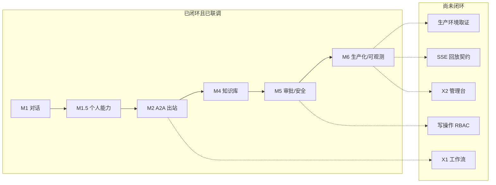

# Agent Hub 项目整理：未做项、风险与前端对齐清单

- 日期：2026-11-11
- 范围：后端 `agent-hub`（M0–M6）+ 前端 `agent-hub-web`（M1–M6），M6 收尾之后
- 方法：对照 `docs/roadmap.md`、各里程碑交付报告、当前代码与配置、前端仓库文档与提交，
  并实跑测试/静态检查/迁移检查；不能当场复验的项标注来源，不把历史结论当现状
- 结论一句话：**除 M3 入站按需求变更取消外，M0–M6 的功能主干已交付，前后端 M4/M5/M6
  都已落地；前端 M6 完成了自动重连/诊断/E2E，但「断线期间逐字续流」仍未闭环。剩下的主要是
  「生产环境取证」「几处跨端契约补齐」「长期悬空的工作流/管理台立项」和「仓库卫生」四类问题。**

## 1. 基线事实（本次复核，2026-11-11）

| 项目 | 结果 |
|---|---|
| 后端分支 | `master` = `13d1571`，**领先 `origin/master` 26 个提交（未推送）**；本地 `m4-knowledge-rag` 已合并未删除 |
| 前端分支 | `master` = `ea789ce`，**领先 `origin/master` 14 个提交（未推送）**；`feat/m4-knowledge`、`feat/m6-production` 已合并未删除 |
| 后端测试 | `582 passed, 1 skipped`（85.71s）；skip 为知识库语义评测（需真实 Embedding key） |
| 静态检查 | `ruff check .` → All checks passed |
| 迁移 | 开发库 `alembic current` = **`2d8f6a1c3e70`（当前 head）**；`alembic check` → 无漂移；开发库已有 `knowledge_documents`（4 行）、`knowledge_chunks`、`platform_secrets`；pgvector 0.8.7 |
| OpenAPI | 62 条路径 / 86 个操作；`scripts/export_openapi.py` 重新导出无 diff，仓库文件与代码一致；`/readyz` 已在契约内，`/metrics` 按设计不在 |
| 配置模板 | `.env.example` 与 `Settings` **144 项一一对应**，无缺项/多项 |
| 本地密钥 | `LLM_API_KEY`、`EMBEDDING_API_KEY` 均为占位符；`CAPABILITY_SECRET_KEY`、`JWT_SECRET` 已配置；`METRICS_TOKEN`、OTLP endpoint 为空 |
| 本地容器 | `dev_postgres`(54321)、`dev_redis`、`dev_minio`、`dev_nginx` 等 7 个容器在运行（复用，未新起） |
| 前端测试 | 前端报告 `232` 单测 + `10` 条 Playwright E2E 通过（本报告未复跑前端） |
| 仓库卫生 | 后端 **81 个 `.dsh/` 文件被 Git 跟踪**（32 记忆 + 49 会话，最大单文件 7.2 MiB）；`.gitignore` 未覆盖 `session.v4.jsonl`，本会话仍在改写；前端跟踪 54 个（34 + 20），约 88.3 MiB，最大单文件 21.1 MiB |
| CI | 后端 5 个 job（lint/test/migrations/contract/docker）、前端 Playwright workflow 均只有配置，**无远端运行记录**；前端 `sessions:check` 是手动脚本，未接 pre-commit hook |
| 立项 | **M7（契约补齐与安全收口）、M8（管理台）、M9（工作流）已于 2026-11-11 立项，未开始**；见 [M7–M9 立项](../superpowers/specs/2026-11-11-m7-m9-backend-roadmap-design.md) |

> 迁移 head 口径：修正前 `README.md` 与 M6 报告写的是 `c4e7a91b2f36`（M4 的迁移号），
> **2026-11-11 已更正为当前真实 head `2d8f6a1c3e70`**（M5 的最后一个迁移）。
> 空库执行 `alembic upgrade head` 会依次经过 `c4e7a91b2f36 → 9c1d4e7a2b60 → 2d8f6a1c3e70`，
> 但**已停在旧 head 的环境**拿到新代码后仍必须重新核对版本表，不能只看文档判断。

## 2. 完成度总览

| 能力面 | 后端 | 前端 | 说明 |
|---|---|---|---|
| 认证/会话/SSE/运行回放 | 已完成 | 已联调 | M1 |
| 指令/记忆/技能/MCP/附件/HITL | 已完成 | 已联调 | M1.5 |
| A2A 出站（智能体/任务） | 已完成 | 已联调 | M2；入站已取消 |
| 知识库 RAG | 已完成 | 已联调 | M4；语义召回未取证 |
| 审批与安全加固 | 已完成 | 已联调 | M5；写操作 RBAC 未做 |
| 生产化与可观测 | 已完成 | 已完成 | 后端 M6=部署/观测/恢复；前端 M6=断线续传/E2E/诊断 |
| 工作流 | **M9 已立项，未开始** | 仅骨架 + mock | X1 → M9 |
| 完整管理控制台 | **M8 已立项，未开始**；当前仅密钥/审计 | 仅 v8 原型 | X2 → M8 |
| 多实例 | **不做（单实例）** | 单实例假设 | 候选 M10+，需求触发 |



## 3. 还没做的

### 3.1 上线门槛（P0，不补就会「功能不可用」或「查不出问题」）

| # | 事项 | 现状 | 为什么必须 | 责任方 |
|---|---|---|---|---|
| P0-1 | 生产配置与密钥就位 | 本机 `LLM_API_KEY`/`EMBEDDING_API_KEY` 是占位符；`METRICS_TOKEN` 为空 | 没有真实 LLM key，聊天直接 401；没有真实 Embedding key，语义检索不可用；`/metrics` 裸奔 | 运维/用户 |
| P0-2 | 目标环境执行迁移并核对版本 | 文档 head 写错（见 §5.6）；开发库已到 `2d8f6a1c3e70` | 未迁移时上传 500；生产 Compose 开启 `READINESS_CHECK_MIGRATIONS=true` 时 `/readyz` 503（该开关默认 false）；`create_all` 的测试全绿会掩盖问题 | 运维/后端 |
| P0-3 | 单实例硬约束落到部署单 | 进程内事件总线/run 注册表/限流/审批恢复 | 开多 worker 或多副本会出现 SSE 丢事件、审批无法唤醒、限流失真 | 运维 |
| P0-4 | 首次生产部署演练 + 真实模型容量验证 | 只有本机 Compose config 校验与双进程演练；50 并发是「本机单实例 + 假模型、1 轮」 | 镜像、卷、`stop_grace_period`、`READINESS_CHECK_MIGRATIONS` 的真实组合未跑过；真实 LLM 的长流/并发容量没有基线 | 运维/后端 |
| P0-5 | 确认知识库是否启用及 Embedding 策略 | `ENV=prod` + `auto` 缺 key 会拒绝启动；显式 `fake` 才允许降级 | 不确认会「启动失败」，或误以为有语义检索能力 | 用户/运维 |

### 3.2 后端功能与契约遗留（P1）

> **归属（2026-11-11 立项）**：P1-1/P1-2/P1-3/P1-8/P1-9 → **M7**；
> P1-4/P1-5 → **M8**；P1-7 → **M9**；P1-6（通用 resume）→ 候选池，等 ask_user 类能力需求。
> 立项见 [M7–M9 立项](../superpowers/specs/2026-11-11-m7-m9-backend-roadmap-design.md)，
> M7 计划见 [M7 实施计划](../superpowers/plans/2026-11-11-m7-contract-security.md)。

| # | 事项 | 现状与证据 | 影响 |
|---|---|---|---|
| P1-1 | **SSE 回放补 `event` 字段或新增 SSE 续接端点** | `RunEventOut` 无 `event`；`payload` 剔除 `_event`；`GET /runs/{id}/events` 只是分页查询，不「继续跟随」；`stream_run_events()` 先回放已落库事件再跟随实时事件，但同时服务首次建连与 `POST /chat/stream` 的幂等重放 | 断线期间尚未落库的 `message.delta` 无法逐字补齐；前端重连能继续收到后续增量，终态后仍需 `refreshHistory()` 补缺口；前端 M5/M6 两次记录该诉求 |
| P1-2 | **agents/tasks 写操作 RBAC** | `app/modules/agents/router.py`、`tasks/router.py` 全部 `CurrentUser`；`require_admin`/`AdminUser` 已在 `app/core/deps.py` 定义并被 knowledge/audit/secrets 使用，但 agents/tasks 未接 | 普通用户可注册/删除/启停远程 Agent、取消/授权任务；前端只能隐藏入口，不能真正拦 |
| P1-3 | `approval.required` 事件字段少于审批详情 | 事件只有 8 字段；`ApprovalOut` 还有 `tool_display_name/executor/target/side_effect/payload_preview` | 前端需额外 `GET /approvals?run_id=` 补卡；事件卡与审批中心字段不一致 |
| P1-4 | 管理端用户/系统设置接口 | `/admin/*` 只有 `audit-logs` 与 `secrets`；无用户列表、角色调整、系统设置 | X2 管理控制台无契约可接 |
| P1-5 | 系统 MCP/A2A 的管理员配置接口 | 当前用运维脚本/DB 配置 `secret:` | 系统级能力无法在界面运维 |
| P1-6 | 通用 `POST /runs/{id}/resume` | 恒 409 `run_not_resumable` 占位 | 仅影响「ask_user 类」未来能力；审批恢复不走它 |
| P1-7 | 工作流后端 | `capabilities.workflows` 恒 false；无任何 workflow 端点 | X1 无法立项开工 |
| P1-8 | 回放文档与实现不一致 | `docs/api.md` §10.2 与 `_SSE_DESCRIPTION`（`app/modules/chat/router.py:44-46`）写「回放并继续跟随」，实际不跟随；§7.7 只描述分页查询 | 前端会按错误契约设计重连；已在 P1-1 一并修 |
| P1-9 | A2A `authorization_url` 无后端白名单 | M2 报告 §6 遗留；`tasks/service.py:128` 只截断存储，前端只允许 `https` 与 localhost `http`，但任意 https 地址仍可展示/打开 | 钓鱼链接风险；应补协议/域名白名单，或留下明确的风险接受记录 |

### 3.3 数据、性能与技术债（P2）

| # | 事项 | 来源/现状 | 建议 |
|---|---|---|---|
| P2-1 | 对象存储真实 MinIO 端到端未验证 | M4 报告 §4.2：只有 S3 单元测试与注入 client | 上线若用 `STORAGE_BACKEND=s3`，必须先做一次真实上传/下载/删除联调 |
| P2-2 | 对象存储孤儿文件巡检 | M4 遗留，M6 只做附件过期清理 | 增加对账脚本（storage key ↔ DB 引用） |
| P2-3 | 消息/运行正文保留策略 | M6 明确不清理用户数据，产品未定 | 上线前给出口径（保留 N 天/永不删/用户可删） |
| P2-4 | 上传同步入库 | 大文件 + 真实 Embedding 可能接近请求超时 | 异步化（状态机四态已保留） |
| P2-5 | 混合检索/reranker/OCR | architecture 列为演进方向；OCR 明确不做 | 按检索质量需求再排期 |
| P2-6 | 语义召回率 ≥90% 无证据 | 本机无真实 Embedding key；逃生舱已就绪 | 配好 key 后跑 `KNOWLEDGE_EVAL_REAL=1` 命令（见 M4 报告） |
| P2-7 | M4 两个 Low 未修 | ①「短显式 title + 长 filename」过度拦截 422；② `search` 的 `except ValueError` 过宽 | 低风险，随手修 |
| P2-8 | M4 重复代码未收口 | `_estimate_tokens` 在 `knowledge/service.py`、`memories/service.py`、`agents/prompts.py` 各一份；扩展名常量在 `knowledge/parsing.py`、`skills/importer.py` 各一份；`_commit_failed` 二次提交路径复杂 | 抽公共工具，降低后续漂移 |
| P2-9 | A2A 任务轮询固定 0.2s、无定时健康巡检 | M2 报告 §6 | 任务量大时增加退避与巡检 |
| P2-10 | MCP 每次调用重建连接、复杂 JSON Schema 退化 | M1.5 报告 §6 | 高频工具场景再加连接池 |
| P2-11 | `system/info` 注释过时 | `app/modules/system/schemas.py:38` 仍写「M1.5 未实现」 | 纯注释，改文档时一起修 |
| P2-12 | MCP stdio 无进程隔离保证 | M1.5 报告 §6：默认关闭（`MCP_USER_STDIO_ENABLED=false`） | 启用即信任命令，不做沙箱；需在安全说明里明确边界 |
| P2-13 | 非管理员 403 路径缺前端证据 | M5 前端联调 §4.5：开发账号已提为 admin，未构造第二个普通账号 | 补「普通用户 + 403 文案/入口隐藏」联调用例 |

### 3.4 前端遗留（P3，另一仓库）

| # | 事项 | 现状 |
|---|---|---|
| P3-1 | F1 体验与可访问性 | 虚拟滚动、a11y 审计、⌘K、空态统一、移动端回归、性能预算二次收口 |
| P3-2 | v7 原型像素级还原 | 排在 F1 之后 |
| P3-3 | 登录失败文案被 401 拦截器吞掉 | 登录请求不应进入 refresh 流程；前端自身修复 |
| P3-4 | 全局 503 文案未统一 | 知识库检索面板已有专用文案（「检索服务暂不可用」）；缺的是全局 `database_unavailable`/通用 `service_unavailable` 的统一提示 |
| P3-5 | 真实后端 E2E | E2E 只跑 mock 构建（编译期常量决定），真实链路靠 smoke/test:real |
| P3-6 | 真实长流重连证据 | 本机无真实 LLM key，只有 store 单测与 reducer 去重单测 |

### 3.5 已明确不做（取舍结论，留档避免反复讨论）

| 项 | 结论 | 来源 |
|---|---|---|
| A2A 入站 Server / Agent Card 发布 | 取消，本服务只做出站 Client | 2026-11-10 需求变更 |
| 多实例 / Redis 事件总线 / 共享限流 / 跨实例 resume | 需求触发后再评估，候选 M10+ | M6 报告 §5；2026-11-11 立项调整 |
| Helm / K8s 清单 | 不交付 | 用户拍板 Compose |
| 崩溃 `running` run 的断点续跑 | 一律标 failed，不恢复 LLM 流 | M6 设计 |
| 消息正文保留/自动清理 | 不自动清理，产品策略待定 | M6 报告 §5 |
| 计费与配额 | 暂不做 | roadmap 待决策表 |
| 管理员读取用户记忆正文 | v1 不提供 | roadmap 待决策表 |
| 系统 MCP 按用户凭据 | v1 平台凭据，v2 再做 | roadmap 待决策表 |
| 技能自动触发（`load_skill`） | v1 仅显式 `@` | roadmap 待决策表 |
| 长期记忆语义检索 | 评估后不做 | M4 报告 §4.2 |
| 混合检索（BM25+RRF）/reranker/OCR | 未做，非 M4 目标 | M4 报告 §4.2 |
| 自动清理孤儿对象 | 推迟到后续 | M4 报告 §4.2 |

## 4. 与前端对齐清单

### 4.1 已对齐，无需再讨论

| 项 | 结论 |
|---|---|
| 里程碑语义 | 后端 M3 取消、M4 RAG、M5 审批、M6 生产化；前端已按同义 M 编号重写 roadmap，体验项进 F1，工作流/管理台原进 X1/X2、2026-11-11 立项为 M9/M8 |
| M4 知识库契约 | 7 个端点、文档 11 字段、hit 10 字段、Citation 7 字段、stats 6 键、413/503 语义均已逐字段核对并真实联调 |
| M5 审批生命周期 | `approval.required → run.interrupted → run.resumed → message.done`；中间决定 `resumed=false`；超时 `canceled + approval_timeout`；前端已实现并 smoke 163 项 |
| M5 新端点 | 审批中心、`GET /audit-logs`、`GET /admin/audit-logs`、`/admin/secrets` CRUD 已接 |
| M6 可选字段 | `/readyz`、`/healthz`、`X-Trace-ID`、503 `database_unavailable`、流式实时打码；前端已采集 Trace ID，无破坏性变更 |
| A2A 入站展示 | `system/info.a2a` 恒 false/空串，前端设置页已移除入站分区 |
| 能力门控 | 前端读 `system/info.capabilities` 控制导航/路由；`workflows=false` 置灰 |

### 4.2 需要后端先做、前端再消费

| # | 事项 | 后端动作 | 前端后续动作 | 归属 / 优先级 |
|---|---|---|---|---|
| A-1 | 断线逐字续流 | `RunEventOut` 增加 `event`（事件名），或新增 `GET /runs/{id}/stream?after_seq=` 的 SSE 端点；同时修正文档「继续跟随」表述 | 重连时用 `event` 回放 reducer，或在降级路径改用 SSE 续接 | **M7-1** / 高 |
| A-2 | 写操作 RBAC | agents/tasks 写接口加 `require_admin`（或按产品定义的角色策略），并补 403 契约测试 | 普通用户隐藏/禁用对应按钮，接 403 文案；补「非管理员账号」联调用例 | **M7-2** / 高 |
| A-3 | 审批事件字段 | 补齐 `approval.required` 的展示字段；或维持 8 字段，改前端 M5 记录与 `docs/database.md` 的字段说明（`docs/api.md` §8.2 本身已与实现一致，不用改） | 若补齐可去掉「列表补卡」请求 | **M7-3** / 中 |
| A-4 | X2 管理台契约 | 用户列表/角色调整/系统设置接口与权限模型 | 按契约升级 v8 原型为页面 | **M8**（已立项） |
| A-5 | X1 工作流契约 | 表、API、里程碑 | 骨架 + mock 升级为真实页面 | **M9**（已立项） |

### 4.3 需要前端单独修（后端已就绪）

| # | 事项 | 说明 |
|---|---|---|
| B-1 | 登录失败文案 | 登录 401 不应触发全局 refresh 失败提示，需展示后端 `error.message` |
| B-2 | 全局 503 文案 | `database_unavailable` / 通用 `service_unavailable` 统一给「服务暂不可用，请稍后重试」；知识库检索面板已有专用文案，可复用其模式 |
| B-3 | 管理员入口 | RBAC 后端落地后，把「隐藏入口」升级为「按角色显示」；当前非管理员 403 路径没有前端联调证据 |
| B-4 | 文档状态 | 前端 README 状态段仍停在 M1.5/M2、测试数仍写 180、E2E 仍列为未做；roadmap 写后端 M6「进行中」，需同步为已完成/232/已覆盖 |

### 4.4 需要双方/产品决策

| # | 议题 | 选项 | 当前建议 |
|---|---|---|---|
| C-1 | 迁移到多实例 | 粘性会话 / Redis 事件总线 / 前端轮询 | 先单实例上线；扩容需求触发后再立项（候选 M10+），优先 Redis Stream |
| C-2 | 消息正文保留 | 永不删 / N 天 / 用户可删 | 上线前给出口径，涉及合规与存储成本 |
| C-3 | 工作流 X1 | 轻量步骤模板 / 外部工作流引擎 | 已立项为 **M9**（轻量步骤模板 MVP，先 spike，不引入外部引擎） |
| C-4 | 管理台 X2 | 只读概览 / 完整 RBAC 管理 | 已立项为 **M8**（先用户/系统项/概览，写操作规则见立项文档） |
| C-5 | 生产 Embedding | 真实 provider / 显式 fake | 生产必须真实 provider；演示环境显式 fake 并在界面标注 |

## 5. 项目注意事项

### 5.1 部署与迁移

1. **先迁移再启动**：`alembic upgrade head`；`READINESS_CHECK_MIGRATIONS=true` 时未迁移实例启动即失败。
2. **迁移 head 以命令为准**：当前 `2d8f6a1c3e70`；文档里的 `c4e7a91b2f36` 是 M4 迁移，不是 head。
3. **测试库用 `create_all`**：测试全绿不代表开发/生产库已迁移；上传 500 的经典原因就是开发库没跑迁移。
4. **单容器单 worker**：不要开 `--workers > 1`，也不要多副本；见 P0-3。
5. **停机预算**：uvicorn 90s + `registry.drain` 30s + finalize 10s + 余量 < Compose `stop_grace_period: 160s`；改任何一项要同步改 Compose。
6. **排水期间 `/readyz` 的 `draining` 通常不可观测**：发布必须先由 LB 摘流量，再发 SIGTERM。
7. **反代 SSE 读超时要大于应用空闲超时**：后端 `HITL_STREAM_TIMEOUT_SECONDS` 默认 900s，
   `deploy/nginx.conf` 也写 900s，边界上可能由 Nginx 先断（504）而不是应用优雅关闭；
   建议反代设为 960s 以上（前端 `deploy/nginx.conf` 用的是 3600s，可参考）。
8. **`/metrics` 默认无鉴权**：公网暴露前设 `METRICS_TOKEN` 或用反代保护。
9. **备份**：`public` + `langgraph` 两个 schema + `/app/data` 卷；pgvector 索引恢复后 `REINDEX`。

### 5.2 安全

1. `ENV=prod` 要求 `JWT_SECRET` ≥32 字节；`CAPABILITY_SECRET_KEY` 未配置时 `/admin/secrets` 写接口 503。
2. 平台密钥只存密文；审计/接口不返回明文。
3. 聊天限流默认 30 次/60s；登录/注册限流独立配置；多实例时进程内限流失真。
4. 流式过滤只处理「高置信密钥 + 危险 HTML」，正常 Markdown 不改写；落库前仍跑完整 `sanitize_output`。
5. `A2A_ALLOW_LOOPBACK` 仅 dev/test 默认放行；prod 需白名单。
6. `.env` 含真实 `JWT_SECRET`/`CAPABILITY_SECRET_KEY`，已被 `.gitignore` 忽略，不要改回跟踪。

### 5.3 仓库卫生（本次发现的最大隐患）

| 问题 | 现状 | 建议 |
|---|---|---|
| `.dsh/` 运行时数据被跟踪 | 后端 **81 个文件**（32 记忆 + 49 会话，最大单文件 7.2 MiB）；`.gitignore` 只忽略 `session.lock/*.tmp/.backup`，**不忽略 `session.v4.jsonl`**；本会话仍在改写 | 先止血：`.gitignore` 追加 `.dsh/` 并 `git rm -r --cached .dsh`；历史清理（force-push）另议 |
| 已推送历史含对话记录 | 2026-11-10 发现 `.dsh` 已被推到公开仓库（`notsocold/agent-hub`）；脱敏核查无密钥，但对话正文是隐私面 | 若不能接受，需要重写历史 + force-push（不可逆，先确认协作者/克隆）；否则至少止血 |
| 未推送提交 | 后端 26 个、前端 14 个 | 推送由用户执行（助手不自动推远端） |
| 残留本地分支 | 后端 `m4-knowledge-rag`、前端 `feat/m4-knowledge`/`feat/m6-production` 均已合并 | 删除由用户执行 |
| 本地缓存/数据目录 | `.pgdata-test*`、`.uv-cache`、`.uv-python`、`.superpowers` 已被忽略；`data/test-knowledge/` 已忽略，但 **`data/test-attachments/` 未忽略**（当前为空，写入文件后会变脏） | 补 `data/test-*/`；其余确认无用后手动清理 |
| 前端 `.dsh` | 前端 **54 个文件**（34 + 20），跟踪总量约 **88.3 MiB**，最大单文件 **21.1 MiB**；有脱敏脚本 `scripts/dsh-session-sanitize.mjs`，`sessions:check` 是手动脚本、未接 pre-commit hook | 前端应接 hook 或改 CI；后端若要继续提交 `.dsh`，应复用同样流程；否则统一改为不跟踪 |

### 5.4 本地环境

1. 本机 `LLM_API_KEY`/`EMBEDDING_API_KEY` 是占位符 → 无法做真实聊天、真实语义检索、真实审批全链路；相关「未取证」项都源于此。
2. 本机时钟曾出现 NTP 回退（70/200 次，最差 -494ms），已用 JWT leeway 与 `elapsed_ms()` 夹紧；若换机器仍要留意负耗时/401 偶发。
3. Docker 容器（`dev_postgres` 等 7 个）当前在跑；按用户偏好不要再新起容器，复用现有实例。
4. `dev_postgres` 是 `postgres:latest`（PG 18.4）+ 容器内装 pgvector；与生产 compose 的 `pgvector/pgvector:pg16` 版本不同，生产验证不要假设本机行为一致。

### 5.5 测试与 CI

1. 全量测试约 86s；唯一 skip 是语义评测，不是失败。
2. 测试库需要 `TEST_DATABASE_URL`；未配置时集成测试整体 skip，容易误判「全绿」。
3. CI 5 个 job 已写好，但**从未在远端跑过**；首次 push 后要检查 `migrations`（空库 upgrade）与 `contract`（OpenAPI diff）是否真的绿。
4. Docker job 只 `docker build`，不启动容器；Compose 运行仍需人工演练。
5. 前端 E2E 只跑 mock 构建，CI 里的 Playwright 需要浏览器依赖（CI 用 `--with-deps`）。

### 5.6 文档一致性修正记录（2026-11-11）

> 本节最初是「待修正清单」；2026-11-11 已按清单修正本仓库文档，下表改为修正记录。
> 前端仓库两项因文件沙箱只允许写本工作区，未在本次修改，需前端会话同步。

| 文件 | 问题 | 处置 |
|---|---|---|
| `README.md` | 迁移 head 写 `c4e7a91b2f36`；前端 M4/M5 写「待做」；未包含列表与下一步过时 | ✅ head 改为 `2d8f6a1c3e70`；前端 M4/M5/M6 改为已完成；补 M7/M8/M9 立项与下一步 |
| `docs/roadmap.md` | M4/M5 前端「待做」；M4 引用展示未勾选；多实例写「M6 评估」 | ✅ M4/M5 改为已完成并联调；勾选引用展示；多实例改为「需求触发后候选 M10+」；新增 M7/M8/M9 章节 |
| `docs/feedback/2026-11-11-m6-backend-report.md` | head 写 `c4e7a91b2f36`；前端 M4/M5 仍列为遗留 | ✅ head 改为「以 `alembic current` 为准（复核为 `2d8f6a1c3e70`）」；前端项标注已完成 |
| `docs/database.md` | 「M5 新增迁移」表缺 M4 的 `c4e7a91b2f36` | ✅ 补 M4 迁移行，标题改为 M4/M5 |
| `docs/api.md` | §8.2 审批超时写 `interrupted`；管理端表列假端点；`workflow.step` 待 M5+；管理端「M2 补」；回放写「继续跟随」 | ✅ 审批超时改 `canceled`；假端点标注「未实现，M8」；工作流标注 M9；管理端标注 M8；回放改为「分页查询，续流见 M7」 |
| `app/modules/chat/router.py` | SSE 描述写「回放并续接」 | ✅ 改为「分页回放，不跟随；续流端点已立项 M7」并重导 OpenAPI |
| `app/modules/system/schemas.py` | 注释「M1.5 未实现智能体与任务页」 | ✅ 删除过时注释，重导 OpenAPI |
| 前端 `README.md` / `docs/roadmap.md` | 状态停在 M1.5/M2；测试数 180；E2E 未做；后端 M6「进行中」 | ⏳ 待前端仓库同步（跨仓库，本次未改） |

> 原清单中的行号会随编辑漂移，本表改为按文件记录，避免二次误导。

## 6. 建议的下一步顺序

**已完成（2026-11-11）**

1. 文档一致性修正（§5.6 本仓库部分已全部落地；前端仓库待同步）。
2. M7/M8/M9 立项 + M7 实施计划就绪（见 [立项文档](../superpowers/specs/2026-11-11-m7-m9-backend-roadmap-design.md)、[M7 计划](../superpowers/plans/2026-11-11-m7-contract-security.md)）。

**第一优先（上线前）**

3. 补齐生产 `.env`：`ENV=prod`、JWT/`CAPABILITY_SECRET_KEY`、LLM/Embedding key、`METRICS_TOKEN`、OTLP endpoint。
4. 目标环境空库 `alembic upgrade head` + `/readyz` + 一次真实聊天 + 一次知识库检索。
5. 用真实 key 跑一遍：审批全链路、citations、`KNOWLEDGE_EVAL_REAL=1` 语义评测。
6. 起 observability profile，人工看一次 Grafana 看板与告警；做一次 LB 摘流/滚动演练。

**第二优先（上线后，按立项顺序）**

7. M7 契约补齐与安全收口（4–5 天）：事件 `event` + 续流端点、RBAC、审批字段、授权 URL 白名单。
8. M8 管理台后端（5–7 天）：用户/角色、系统项、概览。
9. M9 工作流后端：先 1 天 spike，再按 10–15 天 MVP 推进。

**第三优先（候选池，需求触发）**

10. 多实例（Redis 事件总线/共享限流/跨实例 resume）、对象存储孤儿巡检、上传异步入库、MCP 连接池、A2A 巡检退避。

**仓库卫生（可随时做）**

13. `.dsh` 停止跟踪并补 `.gitignore`；推送/分支清理由用户决定。

## 7. 附录：本次复核命令与结果

```bash
# 后端
.venv/bin/python -m pytest -q                      # 582 passed, 1 skipped (85.71s)
.venv/bin/python -m ruff check .                   # All checks passed
.venv/bin/python -m alembic current                # 2d8f6a1c3e70 (head)
.venv/bin/python -m alembic check                  # No new upgrade operations detected
.venv/bin/python scripts/export_openapi.py         # docs/openapi.json 无 diff
# 配置一致性：Settings 144 项 == .env.example 144 键
# OpenAPI：62 条路径 / 86 个操作（GET 36、POST 30、DELETE 9、PATCH 8、PUT 3）
# 数据库：knowledge_documents/knowledge_chunks/platform_secrets/approvals 均存在
# Git：master 13d1571，ahead origin/master 26；.dsh 跟踪 81 个（32 记忆 + 49 会话）
#      前端 .dsh 跟踪 54 个（34 + 20），约 88.3 MiB
```

> 未复跑：前端 `pnpm test/build/e2e`、真实 LLM/Embedding 链路、Grafana/Tempo、真实 LB 滚动。
> 这些项的结论来自前后端交付报告，已在文中标注来源。
