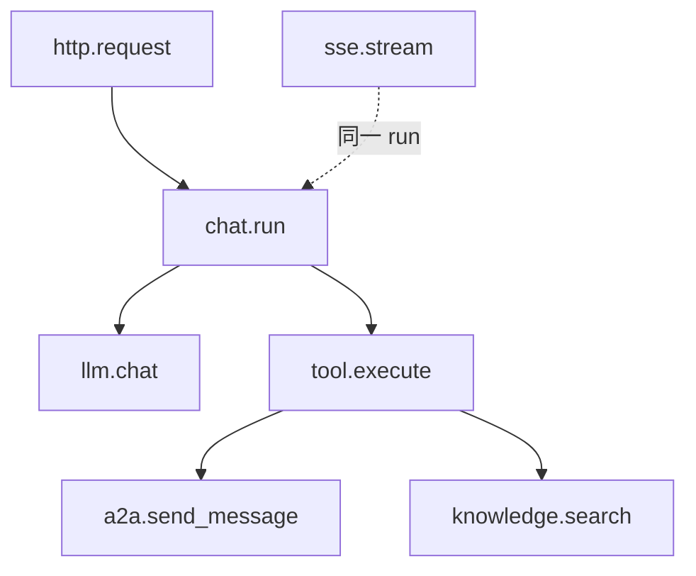

# 可观测性（M6）

> 实现：结构化日志 + Prometheus 指标 + OpenTelemetry Trace。默认全部可关闭；
> 未配置 OTLP 时不会发起任何网络请求。

## 1. 配置速查

| 配置 | 默认 | 说明 |
|---|---|---|
| `LOG_FORMAT` | `text` | `text` 可读；`json` 每行一个 JSON（生产建议） |
| `LOG_LEVEL` | `INFO` | DEBUG/INFO/WARNING/ERROR/CRITICAL |
| `OTEL_ENABLED` | `false` | 总开关 |
| `OTEL_EXPORTER` | `otlp` | `otlp` / `console` / `none` |
| `OTEL_EXPORTER_OTLP_TRACES_ENDPOINT` | `http://localhost:4318/v1/traces` | OTLP/HTTP 完整 URL |
| `OTEL_SERVICE_NAME` | `agent-hub` | resource `service.name` |
| `OTEL_SAMPLE_RATIO` | `0.1` | 0–1 采样率；本地排障设 `1.0` |
| `OTEL_EXPORT_TIMEOUT_SECONDS` | `5` | 导出超时 |
| `METRICS_ENABLED` | `true` | 关闭时 `/metrics` 返回 404 |
| `METRICS_PATH` | `/metrics` | 根路径；不能与健康检查冲突 |
| `METRICS_TOKEN` | 空 | 非空时要求 `Authorization: Bearer <token>` |

## 2. 结构化日志

JSON 示例：

```json
{"ts":"2026-11-11T10:00:00.123Z","level":"INFO","logger":"app.modules.chat.service",
 "message":"运行完成","service":"agent-hub","env":"prod","version":"0.1.0",
 "request_id":"4f2c...","run_id":"9a1b...","conversation_id":"c8d7...",
 "trace_id":"5b8e...","span_id":"2f1a...","status":"ok","duration_ms":1832}
```

字段：

| 字段 | 说明 |
|---|---|
| `ts` / `level` / `logger` / `message` | 标准 logging |
| `service` / `env` / `version` | 部署标识 |
| `request_id` | 与响应头 `X-Request-ID`、错误信封一致 |
| `run_id` / `conversation_id` | 聊天运行上下文（`bind_run_context`） |
| `trace_id` / `span_id` | 当前 OTel span；未启用为 `-` |
| `exception` | 异常堆栈（仅异常时） |
| `event` / `tool` / `status` / `duration_ms` 等 | 白名单 extra，禁止任意对象 |

不会写入日志：用户消息正文、工具参数、密钥、审计 detail 全文。

## 3. 指标目录

所有指标前缀 `agent_hub_`，标签均为有界值（路由模板、模型白名单、工具白名单、状态）。

| 指标 | 类型 | 标签 |
|---|---|---|
| `agent_hub_build_info` | Gauge | `version`、`env`、`build` |
| `agent_hub_http_requests_total` | Counter | `method`、`route`、`status` |
| `agent_hub_http_request_duration_seconds` | Histogram | `method`、`route` |
| `agent_hub_sse_connections_active` | Gauge | — |
| `agent_hub_sse_events_total` | Counter | `event` |
| `agent_hub_chat_active_runs` | Gauge | — |
| `agent_hub_chat_runs_total` | Counter | `status`（succeeded/failed/canceled） |
| `agent_hub_chat_run_duration_seconds` | Histogram | `status` |
| `agent_hub_chat_first_token_seconds` | Histogram | `model` |
| `agent_hub_llm_calls_total` | Counter | `model`、`status` |
| `agent_hub_llm_call_duration_seconds` | Histogram | `model` |
| `agent_hub_llm_tokens_total` | Counter | `model`、`kind`（input/output/reasoning） |
| `agent_hub_tool_invocations_total` | Counter | `tool`、`source`、`status` |
| `agent_hub_tool_duration_seconds` | Histogram | `tool`、`source` |
| `agent_hub_a2a_tasks_total` | Counter | `status` |
| `agent_hub_a2a_task_duration_seconds` | Histogram | `status` |
| `agent_hub_knowledge_search_total` | Counter | `status`（ok/empty/error） |
| `agent_hub_knowledge_search_duration_seconds` | Histogram | `status` |
| `agent_hub_knowledge_search_hits` | Histogram | — |
| `agent_hub_approvals_total` | Counter | `decision` |
| `agent_hub_rate_limited_total` | Counter | `scope` |
| `agent_hub_cleanup_deleted_total` | Counter | `kind` |
| `agent_hub_cleanup_runs_total` | Counter | `status` |
| `agent_hub_startup_recovery_total` | Counter | `kind` |

> SSE 的 `http_request_duration` 不记录（流式连接时长由 `chat_run` / `first_token` 指标覆盖），
> 但 `http_requests_total` 仍计数，方便看连接建立量。

## 4. PromQL 示例

```promql
# HTTP P95（按路由）
histogram_quantile(0.95, sum(rate(agent_hub_http_request_duration_seconds_bucket[5m])) by (le, route))

# HTTP 5xx 比例
sum(rate(agent_hub_http_requests_total{status=~"5.."}[5m]))
  / sum(rate(agent_hub_http_requests_total[5m]))

# 聊天 P95 时长 / 首 token P95
histogram_quantile(0.95, sum(rate(agent_hub_chat_run_duration_seconds_bucket[5m])) by (le))
histogram_quantile(0.95, sum(rate(agent_hub_chat_first_token_seconds_bucket[5m])) by (le, model))

# 当前 SSE 连接与活跃 run
agent_hub_sse_connections_active
agent_hub_chat_active_runs

# LLM token 速率（按 kind）
sum(rate(agent_hub_llm_tokens_total[5m])) by (kind)

# 工具错误率
sum(rate(agent_hub_tool_invocations_total{status="error"}[5m])) by (tool, source)

# 知识库检索 P95
histogram_quantile(0.95, sum(rate(agent_hub_knowledge_search_duration_seconds_bucket[5m])) by (le, status))
```

Grafana 预置看板：`deploy/grafana/dashboards/agent-hub-overview.json`，由 provisioning 自动加载。

## 5. Trace



- 入口从请求头提取 W3C `traceparent`，响应头回 `X-Trace-ID`（采样时）；
- 本地验证：

```bash
OTEL_ENABLED=true OTEL_EXPORTER=console OTEL_SAMPLE_RATIO=1.0 \
  .venv/bin/python -m uvicorn app.main:app --port 8000
```

- 生产指向 OTLP/HTTP collector（Tempo/Jaeger/Grafana Alloy 均可）；
- 初始化失败只记 warning，服务以 no-op 继续运行，不阻塞启动。

## 6. 排障入口

| 现象 | 先看 |
|---|---|
| 请求 500 | 日志 `request_id`；span `http.request` 的 `http.response.status_code` |
| 聊天慢 | `chat_first_token_seconds` / `chat_run_duration_seconds`；`llm.chat` span 时长 |
| 工具失败 | `tool_invocations_total{status="error"}`；`tool.execute` span 的 `app.tool.status` |
| 远程 Agent 失败 | `a2a_tasks_total{status="failed"}`；`a2a.send_message` span |
| SSE 卡住 | `sse_connections_active`、`chat_active_runs`；`GET /runs/{id}/events?after_seq=` 回放 |
| 数据被清理 | `cleanup_deleted_total`；审计 `maintenance.cleanup` |
| 启动后 run 仍 running | `/readyz` 组件；审计 `run.recovered_failed`；恢复巡检日志 |
