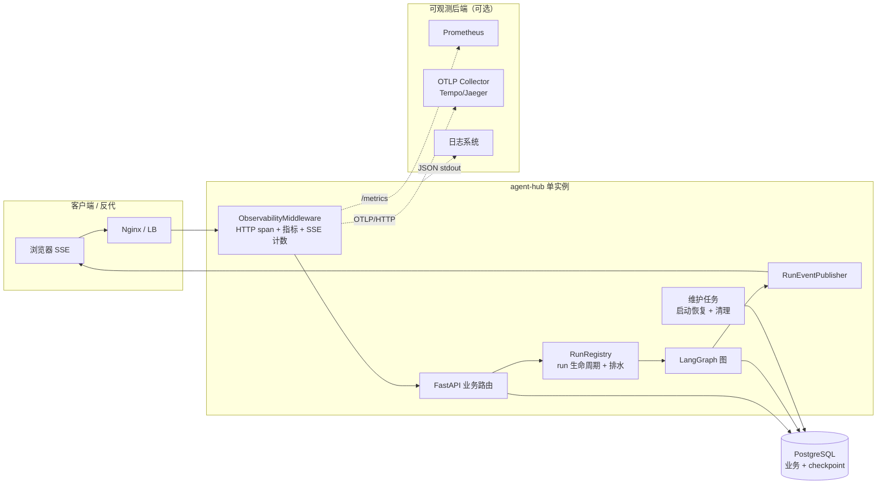
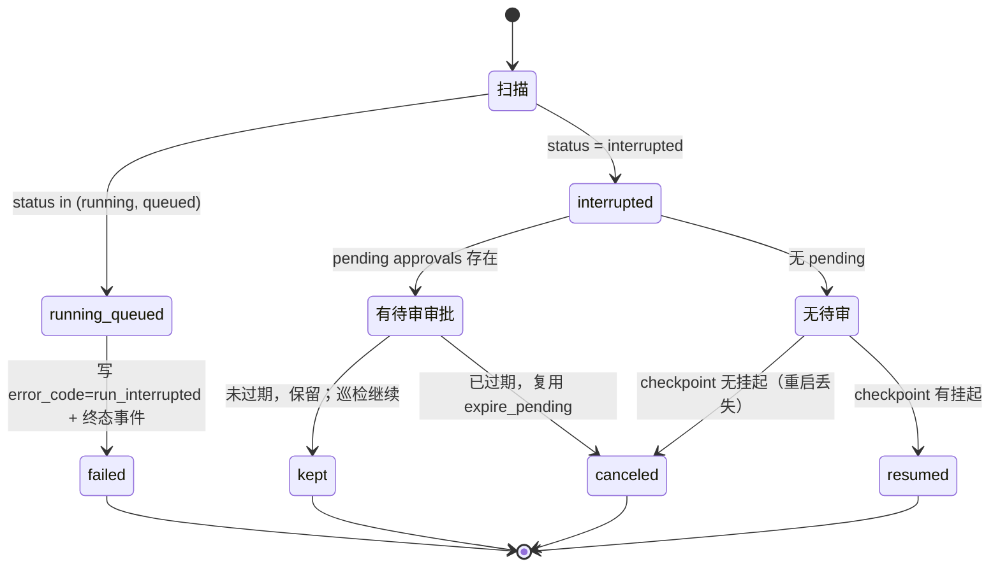

# Agent Hub 生产化与可观测设计（M6）

> 状态：已批准并实施（2026-11-11）
> 范围依据：[路线图 M6](../../roadmap.md)
> 用户拍板：2026-11-11 五项（见 §4.1）
> 承接：[M5 后端交付报告 §5](../../feedback/2026-11-10-m5-backend-report.md)

## 1. 背景与意图

M1–M5 已把功能闭环做完：对话、能力层、A2A 出站、知识库、审批与安全。当前代码能跑、测试能过，
但**没有生产运行所需的任何基础设施**：

1. 日志是文本格式，只有 `request_id`，无法按 `run_id` / `trace_id` 过滤，也无法被日志系统结构化采集；
2. 没有指标：SSE 并发、首 token 延迟、LLM token、工具失败率、A2A/检索延迟都只能从数据库事后拼；
3. 没有 Trace：一次聊天跨 HTTP → LangGraph → LLM → 工具 → 远程 A2A → pgvector，出问题无法串起来看；
4. `/readyz` 只查数据库，checkpoint schema、存储、迁移版本、停机排水都不在就绪判断里；
5. 没有镜像与生产编排，进程收到 SIGTERM 会直接取消在跑的 run，SSE 客户端看到连接断开；
6. checkpoint（`langgraph` schema）、`run_events`、`audit_logs`、过期附件、过期 refresh token 只增不删；
7. 没有 CI，lint/测试/迁移一致性靠人工；
8. M5 留下的两个行为缺口：进程重启后 `interrupted` / `running` 的 run 无人认领；流式 delta 不做实时过滤，
   密钥可能先发给前端再在落库时打码。

M6 的目标不是加业务能力，而是把现有能力变成**可部署、可观测、可运维**的服务，并把 M5 的两个行为缺口补上。

## 2. 目标与非目标

### 2.1 目标

- 结构化日志：`text` / `json` 可切换，JSON 字段含 `request_id`、`run_id`、`conversation_id`、`trace_id`、`span_id`；
- OpenTelemetry Trace：HTTP、聊天、LLM、工具、A2A、检索、清理任务有 span；OTLP/HTTP 导出，未配置时零开销 no-op；
- Prometheus 指标：HTTP/SSE/LLM/工具/A2A/检索/审批/限流/清理，标签有界；
- `/readyz` 覆盖数据库、迁移版本、checkpoint、存储、排水状态；`/healthz` 保持纯存活；
- Dockerfile（多阶段、非 root、健康检查）+ 生产 Compose（可选 Prometheus/Grafana profile）；
- 优雅停机：SIGTERM 后停止接新请求，给在跑 run 一个排水窗口，窗口耗尽再取消并写终态；
- 数据生命周期：checkpoint / run_events / audit_logs / 过期附件 / 过期 refresh token 的保留与清理任务，
  同时提供 CLI 与后台调度；
- 启动恢复：扫描 `running` / `queued` / `interrupted`，可恢复的恢复、不可恢复的写终态，避免会话被永久占锁；
- 流式实时过滤：`message.delta` / `reasoning.delta` 中的密钥与危险 HTML 在**发往前端前**处理，
  支持密钥跨 chunk 切割；
- 压测与容量基线：50 并发 SSE 脚本 + 结果；数据库短时不可用演练 + 自动恢复证据；
- CI：ruff + pytest + 迁移检查 + OpenAPI 一致性 + 镜像构建。

### 2.2 非目标（M6 不做）

- **多实例**：不引入 Redis 事件总线、共享限流、跨实例 resume；单实例语义写清楚（用户拍板）；
- **Helm / K8s**：只交付 Dockerfile + Compose（用户拍板）；
- **运行中 run 的跨进程迁移**：进程崩溃后不尝试续跑 `running` run，只写明确终态；
- **自动 instrumentation 全家桶**：不引入 `opentelemetry-instrumentation-*`，用受控的手写 span；
- **消息/会话正文的保留策略**：用户数据删除是产品策略，不在 M6 自动清理；
- **管理控制台/前端页面**：M6 只做后端与运维产物；
- **真实 Grafana/Tempo 容器验证**：只交付配置、PromQL 与本地指标/span 证据（用户拍板）。

### 2.3 反目标（做了就算失败）

- 指标标签带 `run_id` / `user_id` / 任意 MCP 工具名，导致 Prometheus 基数爆炸；
- `/metrics` 泄露密钥、审计 detail 或用户内容；生产暴露时无任何保护手段；
- 打开 Trace 后启动失败、测试访问外网、或每个请求都产生导出错误日志；
- 清理任务删掉仍在等待审批/正在运行会话的 checkpoint，或与在线 run 竞态；
- 启动恢复把仍在有效期内的审批 run 误取消；
- 流式过滤改变正常文本、明显增加首 token 延迟，或跨 chunk 的密钥仍泄漏；
- 优雅停机无限等待、SIGTERM 后进程不退出，或排水后仍留下 `running` run；
- 测试因为 OTel/Prometheus 全局状态互相污染。

## 3. 约束（已确认）

| 约束 | 结论 |
|---|---|
| 部署形态 | 单实例；`uvicorn` 单 worker（进程内事件总线与 run 注册表决定） |
| 新外部服务 | 不启动；复用本机已有 `dev_postgres`；Prometheus/Grafana 只给配置 |
| Compose 形态 | Dockerfile + `docker-compose.prod.yml`；不写 Helm |
| 可观测栈 | stdlib JSON 日志 + `prometheus-client` + `opentelemetry-sdk` + OTLP/HTTP；未配置 no-op |
| checkpoint | `AsyncPostgresSaver`（3.x），`adelete_thread(thread_id)` 可用；thread_id = `conversation_id` |
| 测试 | 零网络；OTel 默认关闭；Prometheus 用独立 registry 并在用例间重置 |
| 时间 | 沿用 `elapsed_ms` 夹紧；保留策略的 cutoff 允许毫秒级偏差 |

## 4. 已拍板决策

### 4.1 用户 2026-11-11 拍板

| # | 决策 | 结论 |
|---|---|---|
| D1 | 验收环境 | 只用已有服务 + 本地故障注入；Prometheus/Grafana/应用容器不实际启动 |
| D2 | 多实例 | 单实例生产化；跨实例 resume/共享限流写设计说明，不引入 Redis |
| D3 | 部署形态 | Dockerfile + 生产 Compose |
| D4 | M5 承接 | 启动 interrupted 保活 + 流式实时过滤都纳入 M6 |
| D5 | 可观测栈 | 按生产常规做法：JSON 日志 + Prometheus + OTel/OTLP，未配置 no-op |

### 4.2 本设计自行拍板（评审时可改）

| # | 决策 | 理由 |
|---|---|---|
| S1 | 日志用 stdlib `logging` + 自写 `JsonFormatter`，不引入 structlog | 现网只有标准库日志，换库收益低；JSON 字段可控 |
| S2 | 手写 span（HTTP 中间件 + 业务埋点），不装 `opentelemetry-instrumentation-*` | 避免中间件顺序、SSE 长连接、LangGraph 调用链的自动埋点不确定性；依赖更少 |
| S3 | Prometheus 用**独立 registry**，标签白名单化 | 测试可重置；从源头阻止高基数 |
| S4 | `/metrics` 默认开启、可关闭；可选 Bearer token | 单机内网默认可用；暴露到公网时至少有一道开关 |
| S5 | 就绪检查分「关键/非关键」：DB、迁移、checkpoint 关键；存储非关键（degraded） | 存储故障时对话仍可用，不应把实例摘掉 |
| S6 | 优雅停机由 `RunRegistry.drain()` 实现，lifespan 顺序固定 | 现有 `registry.shutdown()` 直接 cancel，必须先排水 |
| S7 | 清理任务不新增表，checkpoint 清理用 `conversations.metadata_` 打标 | 避免为运维功能加迁移；JSONB 标记足够幂等 |
| S8 | 启动恢复只续跑「有 checkpoint 挂起」的 interrupted run；running/queued 一律失败 | 运行中的 LLM 流无法跨进程续接，假装恢复比失败更危险 |
| S9 | 流式过滤只处理**密钥 + 危险 HTML**，最终落库前仍跑完整 `sanitize_output` | 与 M5 口径一致；双层防线，流式层不是唯一保障 |
| S10 | 单实例下 Compose 只跑一个 api 副本；滚动发布证据用「先摘流量再 SIGTERM」的本地演练 | Compose 本身做不到零停机滚动，不能虚假宣称 |
| S11 | 启动期依赖（DB / 迁移 / checkpoint）不可用直接失败退出，交给编排重启 | 带病启动会让 `readyz` 与真实能力不一致；Compose `restart: unless-stopped` 负责重试 |
| S12 | 启动恢复 = 启动时一次性 + 周期巡检；周期巡检排除本进程 `RunRegistry` 活跃 run，且只处理超过 grace 的 run | 一次性会漏掉超过上限的 run；不加互锁会误杀在线 run |
| S13 | checkpoint 清理标记存 `checkpoint_cleaned_at`，清理更新**不 bump** `conversations.updated_at`；选择条件为「无标记或 `updated_at` 晚于标记」 | 会话清理后再次对话会生成新 thread，标记必须自动失效 |
| S14 | 工具 span 的证据用脚本化假模型（测试注入），不要求真实 LLM | 现有假模型不产生 tool_calls；为取证接真实模型违背零网络测试原则 |

## 5. 总体结构



模块落点：

| 文件 | 职责 |
|---|---|
| `app/core/logging.py` | `configure_logging(settings)`、`JsonFormatter`、上下文过滤器 |
| `app/core/log_context.py` | `run_id` / `conversation_id` contextvar 与 `bind_run_context()` |
| `app/core/telemetry.py` | OTel provider/exporter、`tracer()`、`span()` 辅助、HTTP 传播 |
| `app/core/metrics.py` | 独立 registry、全部指标定义、`/metrics` 文本生成与重置 |
| `app/core/observability.py` | 纯 ASGI 中间件：HTTP span、HTTP 指标、SSE 连接数、`X-Trace-ID` |
| `app/agents/callbacks.py` | LangChain 回调：LLM span + 时延/token 指标 |
| `app/modules/system/metrics_router.py` | `/metrics` 端点（可关闭、可选 token） |
| `app/modules/system/health.py` | `/healthz`、`/readyz` 扩展 |
| `app/modules/maintenance/service.py` | 清理动作（checkpoint/审计/事件/附件/token） |
| `app/modules/maintenance/recovery.py` | 启动恢复 |
| `app/modules/maintenance/scheduler.py` | 后台清理循环 |
| `scripts/load_test_sse.py` | 50 并发 SSE 压测 |
| `scripts/db_outage_drill.py` | TCP 代理故障注入演练 |
| `scripts/graceful_shutdown_drill.py` | 双进程排水/重启演练 |
| `scripts/cleanup.py` | 清理 CLI（`--dry-run` / `--only`） |
| `.github/workflows/ci.yml` | lint + test + migration + OpenAPI + docker build |
| `Dockerfile`、`.dockerignore`、`docker-compose.prod.yml`、`deploy/` | 生产部署 |

## 6. 结构化日志

### 6.1 配置

| 配置 | 默认 | 说明 |
|---|---|---|
| `LOG_FORMAT` | `text` | `text` 保持现有可读格式；`json` 每行一个 JSON |
| `LOG_LEVEL` | `INFO` | 根 logger 级别；`DEBUG` 时同上 |

`configure_logging(settings)` 由 `main.py` 的 lifespan 调用；不在 import 阶段配置。

### 6.2 JSON 字段

| 字段 | 来源 |
|---|---|
| `ts` | UTC ISO8601（毫秒） |
| `level` / `logger` / `message` | 标准 logging |
| `service` / `env` / `version` | settings |
| `request_id` | 现有 `request_id_ctx` |
| `run_id` / `conversation_id` | 新增 contextvar，`bind_run_context()` 设置 |
| `trace_id` / `span_id` | 当前 OTel span；未启用时为 `-` |
| `exception` | `exc_info` 格式化后的文本（仅异常时） |
| 其他 `extra` | 白名单键（`event`、`tool`、`a2a_task_id`、`tool_call_id`、`status`、`duration_ms`），避免把任意对象写进日志 |

- 文本模式保持 `%(asctime)s %(levelname)s [%(request_id)s] %(name)s: %(message)s` 不变，避免破坏现有日志习惯；
- 上下文用 `contextvars`，`bind_run_context()` 是 `@contextmanager`，退出时 reset；
- `stream_run_events`（SSE 请求）与 `execute_run` / `resume_after_decision` / `halt_run` 绑定 run 上下文；
- 不记录用户消息正文、工具参数、密钥；结构化字段只放标识与状态。

## 7. OpenTelemetry Trace

### 7.1 配置

| 配置 | 默认 | 说明 |
|---|---|---|
| `OTEL_ENABLED` | `false` | 关闭时全部 `tracer()` 返回 no-op |
| `OTEL_EXPORTER` | `otlp` | `otlp` / `console` / `none` |
| `OTEL_EXPORTER_OTLP_TRACES_ENDPOINT` | `http://localhost:4318/v1/traces` | 完整 URL（OTLP/HTTP） |
| `OTEL_SERVICE_NAME` | `agent-hub` | resource `service.name` |
| `OTEL_SAMPLE_RATIO` | `0.1` | 0–1；`ParentBased(TraceIdRatioBased)` |
| `OTEL_EXPORT_TIMEOUT_SECONDS` | `5` | 导出超时 |

- 启动：`configure_tracing(settings)` 在 lifespan 最前面调用；`OTEL_ENABLED=false` 直接返回；
- exporter 构造失败（URL 非法/依赖缺失）只记 warning，服务继续以 no-op 运行，**不阻塞启动**；
- 关闭：lifespan 最后 `shutdown_tracing()`，带超时，不让导出阻塞退出；
- 测试：默认 `OTEL_ENABLED=false`；需要验证 span 的用例用 `InMemorySpanExporter` 单独构造 provider，不读取全局配置。

### 7.2 Span 目录

| Span | Kind | 关键属性 | 位置 |
|---|---|---|---|
| `http.request` | SERVER | `http.request.method`、`http.route`、`http.response.status_code`、`url.path`、`app.request_id` | `ObservabilityMiddleware` |
| `chat.run` | INTERNAL | `app.run_id`、`app.conversation_id`、`gen_ai.request.model`、`app.resumed`、`app.run.status`、`app.first_token_ms` | `_stream_graph` 外层 |
| `llm.chat` | CLIENT | `gen_ai.system`、`gen_ai.request.model`、`gen_ai.usage.input_tokens`、`output_tokens`、`app.stream` | `ObservabilityCallbackHandler` |
| `tool.execute` | INTERNAL | `app.tool.name`、`app.tool.source`、`app.tool.status`、`app.tool_call_id` | `ToolRunner._execute_one` |
| `a2a.send_message` | CLIENT | `app.a2a.agent_id`、`app.a2a.task_id`、`app.a2a.status` | `execute_send_message` |
| `knowledge.search` | INTERNAL | `app.knowledge.top_k`、`app.knowledge.hits`、`app.knowledge.categories_count` | `knowledge.service.search` |
| `sse.stream` | SERVER | `app.run_id`、`app.sse.events`、`app.sse.duration_ms` | `stream_run_events` |
| `maintenance.cleanup` | INTERNAL | `app.cleanup.kinds`、删除计数 | `maintenance.service.run_all` |
| `startup.recovery` | INTERNAL | 扫描/恢复/失败计数 | `maintenance.recovery.recover` |

- 入口读取 `traceparent`（W3C propagator），响应头加 `X-Trace-ID`（无有效 trace 时不加）；
- 业务 span 出错时 `record_exception()` + `set_status(ERROR)`；取消不记为错误；
- 属性禁止放用户消息、工具参数、密钥；ID 类只放 UUID/短 slug；
- 采样：默认 0.1；本地演练/排障可设 `1.0`。

## 8. Prometheus 指标

### 8.1 端点

- 默认 `METRICS_ENABLED=true`，路径 `METRICS_PATH=/metrics`（根路径，不在 `/api/v1` 下）；
- `METRICS_TOKEN` 非空时要求 `Authorization: Bearer <token>`，否则 401（错误信封 `unauthorized`）；
- 关闭时返回 404；端点不进 OpenAPI；
- 使用独立 `CollectorRegistry`，只注册本服务指标与 `process_*`/`python_*` 基础采集器；
- 测试 fixture `reset_metrics()` 在用例间清空计数。

### 8.2 指标目录

| 指标 | 类型 | 标签 | 说明 |
|---|---|---|---|
| `agent_hub_build_info` | Info | `version`、`env`、`build` | 启动时设置 |
| `agent_hub_http_requests_total` | Counter | `method`、`route`、`status` | 所有 HTTP；`route` 用路由模板 |
| `agent_hub_http_request_duration_seconds` | Histogram | `method`、`route` | 到响应头写出；SSE 另计 |
| `agent_hub_sse_connections_active` | Gauge | — | 当前打开的 SSE 连接 |
| `agent_hub_sse_events_total` | Counter | `event` | 发布的事件名（代码常量） |
| `agent_hub_chat_active_runs` | Gauge | — | 注册表中的活跃 run 任务 |
| `agent_hub_chat_runs_total` | Counter | `status` | succeeded / failed / canceled |
| `agent_hub_chat_run_duration_seconds` | Histogram | `status` | run 总时长 |
| `agent_hub_chat_first_token_seconds` | Histogram | `model` | 首 token 时延 |
| `agent_hub_llm_calls_total` | Counter | `model`、`status` | LLM 调用结果 |
| `agent_hub_llm_call_duration_seconds` | Histogram | `model` | LLM 调用时长 |
| `agent_hub_llm_tokens_total` | Counter | `model`、`kind` | prompt / completion / reasoning |
| `agent_hub_tool_invocations_total` | Counter | `tool`、`source`、`status` | 原生工具名白名单；MCP 归一为 `mcp` |
| `agent_hub_tool_duration_seconds` | Histogram | `tool`、`source` | 工具执行时长 |
| `agent_hub_a2a_tasks_total` | Counter | `status` | 远程任务终态 |
| `agent_hub_a2a_task_duration_seconds` | Histogram | `status` | 远程任务时长 |
| `agent_hub_knowledge_search_total` | Counter | `status` | ok / empty / error |
| `agent_hub_knowledge_search_duration_seconds` | Histogram | `status` | 检索 + embedding |
| `agent_hub_knowledge_search_hits` | Histogram | — | 命中条数（0–20） |
| `agent_hub_approvals_total` | Counter | `decision` | approved / rejected / expired / canceled |
| `agent_hub_rate_limited_total` | Counter | `scope` | register / login / chat |
| `agent_hub_cleanup_deleted_total` | Counter | `kind` | checkpoint / audit / run_events / attachments / tokens |
| `agent_hub_cleanup_runs_total` | Counter | `status` | ok / partial / error |
| `agent_hub_startup_recovery_total` | Counter | `kind` | resumed / canceled / failed_orphan |

### 8.3 基数控制

- `route` 取 `request.scope["route"].path`；未匹配固定 `unmatched`，绝不使用原始 URL；
- `tool` 只允许 `save_memory`、`read_skill_file`、`search_knowledge`、`send_message`、`mcp`、`other`；
- `model` 来自配置白名单（`LLM_MODELS` / `LLM_MODEL`），不接受请求头任意值；
- 任何 `user_id` / `run_id` / `conversation_id` / 工具参数**禁止**进指标标签；
- `event` 来自 `RunEventPublisher.emit` 的代码常量；新增事件时需评审是否加入白名单。

## 9. 健康检查

### 9.1 `/healthz`（存活）

- 不查任何依赖，恒 200；
- 返回 `{"status":"ok","app":"agent-hub","version":"...","build":"...","env":"..."}`。

### 9.2 `/readyz`（就绪）

返回：

```json
{
  "status": "ok",
  "version": "0.1.0",
  "build": "dev",
  "env": "prod",
  "draining": false,
  "components": [
    {"name": "database", "status": "ok"},
    {"name": "migrations", "status": "ok", "detail": "head=c4e7a91b2f36"},
    {"name": "checkpoint", "status": "ok"},
    {"name": "storage", "status": "ok"}
  ]
}
```

| 组件 | 检查 | 关键 |
|---|---|---|
| database | `SELECT 1` | 是 |
| migrations | `alembic_version.version_num` 与脚本 head 一致；`READINESS_CHECK_MIGRATIONS=true` 时启用 | 是（启用时） |
| checkpoint | `CHECKPOINT_BACKEND=postgres` 时 `to_regclass('langgraph.checkpoints')` 非空；memory 时 `skipped` | 是 |
| storage | local：目录存在且可写；s3：跳过（不 HEAD 外部服务，避免就绪抖动） | 否（degraded） |

- 任一关键组件失败或 `draining=true` → 503；
- 非关键组件失败 → 200，`status=degraded`；
- 检查超时 `READINESS_TIMEOUT_SECONDS=2`，单组件失败不阻塞其他组件；
- `READINESS_CHECK_MIGRATIONS` 默认 `false`（测试库用 `create_all`，没有 `alembic_version`）；
  `docker-compose.prod.yml` 显式设为 `true`。

## 10. 部署与运行时

### 10.1 Dockerfile

- 多阶段：`ghcr.io/astral-sh/uv` 拷贝 `uv`；builder 执行 `uv sync --frozen --no-dev`；
- runtime `python:3.13-slim`，非 root 用户 `app`（UID 1000），`/app/data` 归 `app`；
- 只拷贝 `.venv`、`app/`、`scripts/`、`alembic/`、`alembic.ini`；
- `EXPOSE 8000`；`HEALTHCHECK` 用 Python 标准库请求 `/healthz`（镜像不装 curl）；
- `CMD`：`uvicorn app.main:app --host 0.0.0.0 --port 8000 --proxy-headers --forwarded-allow-ips=* --timeout-graceful-shutdown 90`；
- 单 worker；多副本留给外部编排，且当前不支持跨副本共享 run 总线（文档写明）。

### 10.2 生产 Compose

`docker-compose.prod.yml`：

| 服务 | 说明 |
|---|---|
| `postgres` | `pgvector/pgvector:pg16`，健康检查，持久卷，挂载 `docker/initdb` |
| `api` | 构建本仓库；`env_file: .env`；依赖 postgres healthy；`stop_grace_period: 160s`；数据卷 |
| `prometheus` | profile `observability`；抓取 `api:8000/metrics` |
| `grafana` | profile `observability`；provisioning datasource + 预置 dashboard |
| `nginx`（可选） | profile `proxy`；SSE 关闭缓冲、长读超时；不默认启动 |

`deploy/prometheus/prometheus.yml`、`deploy/grafana/provisioning/...`、`deploy/grafana/dashboards/agent-hub-overview.json`、
`deploy/nginx.conf` 一并交付；`docker compose -f docker-compose.prod.yml config` 做静态校验（不启动）。

### 10.3 优雅停机

lifespan 顺序：

1. 启动：`configure_logging` → `configure_tracing` → 健康/迁移/checkpoint 就绪 → 技能同步 → 启动恢复 →
   `expire_pending()` 立即跑一次 → 启动审批巡检、恢复巡检、清理调度；
2. 关闭：`app.state.draining = true` → 停止巡检/调度任务 → `registry.drain(SHUTDOWN_GRACE_SECONDS)` →
   `registry.shutdown()` 取消剩余任务（写 canceled 终态）→ `shutdown_tracing()` → `dispose_engine()`。

**启动期依赖失败策略**：DB 连接失败、`alembic upgrade head` 未执行（`READINESS_CHECK_MIGRATIONS=true` 时）、
checkpoint `setup()` 失败，都会让 lifespan 抛错、进程退出；由 Compose `restart: unless-stopped`
或编排的 crash-loop 重试，**不带病启动**。`/readyz` 只负责运行期状态，不承担启动重试。

`RunRegistry.drain(timeout)`：轮询未完成任务，最多等到 deadline；返回是否全部完成。
**uvicorn 0.54 的实际顺序**是先停止监听、等待现有连接结束（`--timeout-graceful-shutdown`），
最后才执行 lifespan shutdown。因此：

- 在跑 SSE 的终态主要由 uvicorn 的连接排水保证；`registry.drain()` 负责后台 run/审批恢复任务
  与 DB 一致性，不单独承担 SSE 终态；
- 预算：uvicorn 90s + `SHUTDOWN_GRACE_SECONDS` 30s + `SHUTDOWN_FINALIZE_TIMEOUT_SECONDS` 10s
  < Compose `stop_grace_period: 160s`；超过窗口的 run 会被取消并写终态（客户端可能已断开，靠事件回放）；
- `/readyz` 的 `draining` 在 SIGTERM 阶段通常不可观测（监听已关闭），生产必须由 LB 先摘流量；
- `registry.shutdown()` 对取消后的收尾也设上限，避免 DB 故障时进程退不出去。

滚动发布口径（写入部署文档）：

- Compose 本身不能零停机滚动；生产需要在 `api` 前放 Nginx/LB；
- 发布流程：LB 先摘流量（或 `max_fails` 标记 down）→ 等 `/readyz` 不再被路由 → 发 SIGTERM →
  排水窗口内等在跑 run 完成 → 换新容器 → 健康检查通过后加回流量；
- 本地演练 `scripts/graceful_shutdown_drill.py` 用两个 uvicorn 进程模拟「先摘流量、再 SIGTERM」，
  验证在跑 SSE 全部收到 `message.done`、其余实例请求 0 失败。

### 10.4 数据库不可用

- 保留 `pool_pre_ping=true`，连接失效时自动重建；
- 新增 `OperationalError` / `DBAPIError` 连接类异常 → 503 `service_unavailable`（`code=database_unavailable`），
  不再以 500 暴露堆栈；
- `/readyz` 在故障期间 503，恢复后自动 200；
- 演练脚本用本机 TCP 代理切断/恢复连接，不停止 `dev_postgres`。

## 11. 数据生命周期

### 11.1 配置

| 配置 | 默认 | 说明 |
|---|---|---|
| `CLEANUP_ENABLED` | `true` | 后台清理开关 |
| `CLEANUP_INTERVAL_SECONDS` | `3600` | 调度间隔 |
| `CLEANUP_BATCH_SIZE` | `500` | 单批上限 |
| `CHECKPOINT_RETENTION_DAYS` | `30` | 会话无更新且无活跃 run 后删除 checkpoint 线程 |
| `RUN_EVENTS_RETENTION_DAYS` | `90` | 终态 run 的事件 |
| `AUDIT_RETENTION_DAYS` | `180` | 审计日志 |
| `REFRESH_TOKEN_RETENTION_DAYS` | `30` | 已过期/吊销的 refresh token |
| `ATTACHMENT_MAX_AGE...` | 复用 `ATTACHMENT_RETENTION_HOURS` | 过期附件（`expires_at`） |

### 11.2 清理规则

| 目标 | 选择条件 | 动作 |
|---|---|---|
| checkpoint | `conversations.updated_at < cutoff`，无 `queued/running/interrupted` run，且「`metadata_` 无 `checkpoint_cleaned_at` 或 `updated_at` 晚于它」 | `AsyncPostgresSaver.adelete_thread(str(conversation_id))`；成功后写标记，更新语句显式保留原 `updated_at` |
| run_events | `runs.finished_at < cutoff` 且 `status in (succeeded, failed, canceled)` | 分批 `DELETE run_events` |
| audit_logs | `created_at < cutoff` | 分批 `DELETE` |
| attachments | `expires_at < now()` | 先删磁盘文件（校验路径在 `attachment_dir` 内），成功后再处理行；被消息引用的只软删（`status=deleted`、清空 `storage_path`），未引用的删行；失败留下次 |
| refresh_tokens | `expires_at < now()-retention` 或 `revoked_at < cutoff` | 分批 `DELETE` |

- checkpoint 标记失效：标记值是清理时的 `conversations.updated_at`；清理更新用
  `UPDATE ... SET metadata_=..., updated_at=updated_at` 保留原值。之后会话只要有新消息/改名/归档，
  `updated_at` 就会前移，下一次清理重新选中并删除新 thread；
- 每个目标独立事务，失败只影响该目标；`run_all()` 返回各目标删除数 + 状态（ok/partial/error）；
- 有删除时写一条系统审计 `maintenance.cleanup`（计数，不写内容）；
- 指标 `agent_hub_cleanup_deleted_total{kind}`、`agent_hub_cleanup_runs_total{status}`；
- CLI `scripts/cleanup.py --dry-run` 只统计不删除；`--only checkpoints,audit,...` 可单独跑；
- 不在启动时全量清理，避免拖慢启动；调度器首次运行在启动后 `CLEANUP_INTERVAL_SECONDS`，CLI 供运维立即执行。

## 12. 启动恢复（M5 承接）



### 12.1 触发方式

| 配置 | 默认 | 说明 |
|---|---|---|
| `STARTUP_RECOVERY_ENABLED` | `true` | 启动时执行一次 |
| `STARTUP_RECOVERY_MAX_RUNS` | `100` | 启动一次性处理上限 |
| `RECOVERY_INTERVAL_SECONDS` | `300` | 周期巡检间隔；0 表示只跑启动一次 |
| `RECOVERY_GRACE_SECONDS` | `60` | 周期巡检只处理创建时间早于该值的 run，避免与刚创建的 run 竞态 |

- 启动一次性：在开始接流量前执行，处理上限内全部三类；超出部分由周期巡检接手；
- 周期巡检：与启动同一套 `recover()`，但跳过 `registry.is_running(run_id)` 的 run，
  且只处理 `created_at < now()-grace` 的记录；单实例下这是防「进程内活跃 run 被误判」的互锁；
- 任一巡检任务本身异常只记日志，不影响服务。

### 12.2 状态分支


- 入口 `maintenance.recovery.recover(settings, *, startup: bool)`，启动时在 lifespan 中、开始接流量前执行；
- **running/queued**：单实例启动时不可能有本进程的活跃 run，直接置 `failed`，
  `error_code=run_interrupted`，assistant 消息 `failed`，发 `error` 事件（`code=run_interrupted`，可重试），
  取消该 run 的 pending approvals，写审计；周期巡检必须排除 `registry.is_running()` 且应用 grace；
- **interrupted 且有 pending**：不主动恢复；启动时立即跑一次 `expire_pending()` 处理停机期间过期的审批；
- **interrupted 且无 pending**：打开 checkpoint 看 `snapshot.next`：
  - 有挂起 → `chat_service.schedule_resume(run_id)`（复用 M5 的 `Command(resume=...)`）；
  - 无挂起 → 说明重启丢了挂起、或决定已处理但没有恢复任务；置 `canceled`（`reason=restart_lost`），
    写终态事件，避免永久占锁；
- 每类处理上限 `STARTUP_RECOVERY_MAX_RUNS`（启动）/ `RECOVERY_BATCH_SIZE`（周期，默认 100），
  超出的下一轮继续；
- 指标 `agent_hub_startup_recovery_total{kind}`；span `startup.recovery`；
- 幂等：重复执行不会重复发终态（复用 `_has_terminal_event` 与条件 UPDATE）。

## 13. 流式实时过滤（M5 承接）

### 13.1 双层防线

1. **流式层**（新增 `app/core/stream_filter.py`）：在 `message.delta` / `reasoning.delta` 发往前端前打码；
2. **落库层**（现有 `sanitize_output`）：终态与挂起落库前再跑一次完整过滤（幂等）。

流式层只处理两类：高置信密钥（`sk-`、`AKIA`、`ghp_`、`Bearer`、PEM 私钥）与危险 HTML
（`<script>` / `<iframe>` / `<style>` 整段、事件属性、`javascript:`）。HTML 之外的 Markdown 不改写。

### 13.2 增量算法

`StreamingOutputFilter.feed(text) -> str`：

1. 追加到内部 buffer；
2. 若进入危险块（`<script`/`<iframe`/`<style`）且未闭合：从块起点丢弃，直到闭合标签；
   超过 `MAX_BLOCK=16KB` 仍未闭合则整段丢弃并记规则；
3. 计算「必须扣留」的起点：
   - 未闭合的 `<...>`（可能含事件属性/`javascript:`），最多扣留 `MAX_TAG=2KB`；
   - 正在形成的密钥：从锚点（`-----BEGIN `、`sk-`、`AKIA`、`ghp_`、`Bearer `）起，
     若后缀仍可能匹配（长度未超上限、字符集合法），从锚点扣留；
   - buffer 末尾是锚点的前缀（如 `sk`、`Bear`、`<scr`）时，扣留该前缀；
4. 对可安全输出的前缀跑现有 `sanitize_output`（兜底完整匹配），返回；
5. `flush()` 对剩余 buffer 跑 `sanitize_output` 后返回，保证结尾不漏。

- 正常文本最多扣留「锚点前缀长度」（≤11 字符），首 token 延迟影响可忽略；
- 密钥跨 chunk 任意切分都不泄漏（单测按每个切分点参数化）；
- 命中规则集合写入一次审计 `security.output_redacted`（`phase=stream`）；
- `PROMPT_GUARD_REDACT_OUTPUT=false` 时整层关闭，回退到 M5 行为。

### 13.3 集成点

- `_stream_graph` 为正文与 reasoning 各建一个 filter；
- `content_parts` / `reasoning_parts` 存过滤后的文本，保证「流式内容 = 落库内容」；
- 终态 `message.done` 前 flush 两个 filter；
- 复用 `first_token_ms` 语义（模型首个内容 chunk 的时间，不受过滤扣留影响）。

## 14. API 契约变更

| 变更 | 前端影响 |
|---|---|
| `GET /metrics`（根路径，默认文本） | 无；运维使用 |
| `GET /healthz` 响应新增 `version`/`build`/`env` | 无；向后兼容 |
| `GET /readyz` 响应新增 `version`/`build`/`env`/`draining`；`components` 增加 `migrations`/`checkpoint`/`storage` | 无；向后兼容 |
| 响应头新增 `X-Trace-ID`（Trace 启用且采样时） | 无；可用于排查 |
| 流式 delta 可能被实时打码（此前只在落库/终态） | 行为修正，无契约破坏 |
| 数据库不可用返回 503 `database_unavailable`（此前可能 500） | 错误码新增，前端按 503 通用处理即可 |

不新增业务端点、不改既有请求/响应字段；前端无需适配。

## 15. 测试与证据口径

### 15.1 单元

| 用例 | 覆盖 |
|---|---|
| `test_logging_unit.py` | text 格式不变；JSON 字段齐全；run 上下文；异常 `exception` |
| `test_telemetry_unit.py` | 关闭时 no-op；`InMemorySpanExporter` 捕获 span 属性；导出失败不抛 |
| `test_metrics_unit.py` | 标签白名单；`reset_metrics()`；`/metrics` 文本包含指标 |
| `test_stream_filter_unit.py` | 密钥按每个切分点不泄漏；HTML 块跨 chunk；正常文本不延迟；flush |
| `test_m6_config_unit.py` | 新配置默认值/边界校验；prod 组合 |
| `test_startup_recovery_unit.py` | 四类状态分支；幂等；上限 |
| `test_cleanup_unit.py` | 选择条件、dry-run、批次、标记幂等、失败隔离 |

### 15.2 集成（测试库）

| 用例 | 覆盖 |
|---|---|
| `test_metrics_api.py` | 聊天后计数器增长；token 401；关闭 404 |
| `test_readyz.py` | 组件齐全；DB 故障 503；draining 503；迁移开关 |
| `test_observability_chat.py` | 跨 chunk 密钥的 SSE delta 与落库均无明文；审计一次 |
| `test_startup_recovery_api.py` | 孤儿 running 启动后 failed、会话可继续发消息 |
| `test_cleanup_jobs.py` | 审计/事件/附件/token 清理；活跃 run 的 checkpoint 不删 |
| `test_db_unavailable.py` | 依赖抛 `OperationalError` 时 503 信封 |

### 15.3 本地演练证据

| 验收 | 脚本 / 方式 | 通过标准 |
|---|---|---|
| 50 并发 SSE | `scripts/load_test_sse.py`（fake LLM、`RATE_LIMIT_ENABLED=false`） | 错误率 < 1%；P95 首 token 记录在报告 |
| 关键链路 trace | `test_observability_chat.py`：脚本化假模型触发一次 `search_knowledge`（fake embedding），`InMemorySpanExporter` 抓 span；控制台导出另跑一轮普通聊天 | 断言 `http.request → chat.run → llm.chat → tool.execute` 的父子关系与关键属性；控制台能肉眼看到嵌套 |
| P95 可查 | `/metrics` 抓取 + PromQL；dashboard JSON 静态校验 | `histogram_quantile` 查询有值；JSON 可解析 |
| 优雅停机 | `scripts/graceful_shutdown_drill.py` | 在跑 SSE 全部收到终态；其他实例 0 失败 |
| DB 短时不可用 | `scripts/db_outage_drill.py` | 故障中 `/readyz` 503、请求 503；恢复后 200 且聊天成功 |
| 清理 | `scripts/cleanup.py --dry-run` + 集成测试 | 计数正确；不误删活跃数据 |

### 15.4 全量回归

- `uv run ruff check .` 全绿；
- `TEST_DATABASE_URL=... uv run pytest -q` 全绿（预计 420+ 项）；
- `scripts/export_openapi.py` 后 `docs/openapi.json` 无意外 diff；
- 迁移：空库 `alembic upgrade head` + `alembic check`（CI 与本机各一次）。

## 16. 风险与缓解

| 风险 | 影响 | 缓解 |
|---|---|---|
| Prometheus 标签基数 | 内存/存储爆炸 | 白名单 + 代码评审 + 单测断言 |
| OTel 导出阻塞/报错 | 请求延迟、日志噪声 | 批量导出 + 超时 + no-op 降级；关闭时零调用 |
| 清理与在线 run 竞态 | checkpoint 被删、run 无法恢复 | 只选无活跃 run 且 `updated_at` 老于阈值的会话；标记幂等 |
| 启动恢复误伤 | 审批中的 run 被取消 | 有 pending 且未过期不动；过期交给 `expire_pending`；上限与审计 |
| 流式过滤改变文本 | 前端显示异常 | 仅高置信模式；正常文本不扣留；集成断言 |
| 优雅停机拖死进程 | 发布卡住 | grace 上限 + 二次 cancel + uvicorn timeout 兜底 |
| Compose 无法零停机 | 验收争议 | 明确写「需 LB 摘流量」；演练证据限定在应用排水能力 |
| 测试全局状态污染 | 随机失败 | 独立 registry + reset fixture；OTel 默认关闭 |
| 迁移检查误判 | 启动失败 | 默认关闭；prod 显式开启；只读 `alembic_version` |

## 17. 未做 / 后续

- 多实例：Redis Stream 事件总线、共享限流、跨实例 resume/SSE（M7 或后续）；
- Helm chart / K8s 探针与 HPA（等有 K8s 环境再做）；
- 运行中 run 的断点续跑（需要持久化 LLM 流/队列，属于架构改造）；
- 自动 instrumentation 与 LangSmith/LangFuse 集成（按实际排障需要再加）；
- 消息/会话正文保留与用户自助导出（产品策略）；
- 对象存储孤儿文件巡检（M4 已记「后续清理任务」，M6 只做附件过期清理）；
- Grafana 告警规则与 On-call 流程（本阶段只交付 dashboard 与 PromQL）。

## 18. 文档更新清单

- `.env.example`：M6 全部配置项与注释；
- `docs/observability.md`（新增）：日志字段、指标目录、span 目录、PromQL、dashboard 使用；
- `docs/deployment.md`（新增）：镜像、Compose、迁移、滚动发布、排水、清理、故障处理；
- `docs/architecture.md`：§10 可观测性、§11 部署拓扑、§12 安全/运维口径；
- `docs/development.md`：本地压测/演练/清理命令；
- `docs/database.md`：保留策略表；
- `docs/roadmap.md`：M6 勾选与证据；
- `README.md`：状态表与 Docker 快速启动；
- `docs/openapi.json`：重新导出；
- `docs/feedback/2026-11-11-m6-backend-report.md`：交付报告与证据。
