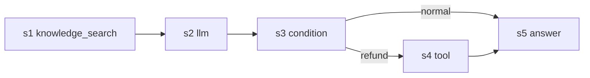
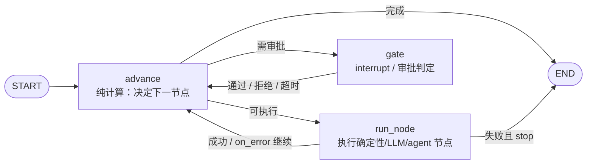

# Agent Hub 工作流 DSL v2 设计（用户可自定义的确定性编排）

> 状态：**待评审**（2026-11-16），本设计只定义方案，不含实现代码
> 前置基线：M9 工作流后端已收口（885 passed / 1 skipped，迁移 head `e8b4f2a6c9d3`）
> 依据：[M9 交付报告](../../feedback/2026-11-12-m9-backend-report.md)、[M9 Spike 报告](2026-11-12-m9-spike-report.md)、[M7–M9 立项 §5](2026-11-11-m7-m9-backend-roadmap-design.md)、[API 契约 §13](../../api.md)
> 建议立项：**M10 工作流 DSL v2**（编号待用户拍板；本文不占用编号，下称「v2」）

## 0. 结论摘要

M9 的「步骤模板注入 system prompt」解决了「用户可配置」的表层需求，但没有解决**「用户自定义后仍能可靠执行」**。
v2 把它升级为**受控 DSL + 确定性解释器**：DSL 仍是用户可增删改的数据，执行改由一张**固定结构的 LangGraph 解释器图**按数据推进，
LangGraph 只承担执行内核（checkpoint / interrupt / 流式），不自研运行时。

三条核心裁决：

1. **DSL 形状**：在现有 `steps` 数组上增加 `next` 路由与 `condition` 节点，**不引入独立 `edges` 字段**，存量模板零迁移即可继续运行；
2. **执行模型**：v2 模板走**解释器图**（图结构恒定），v1 模板继续走 M9 主图注入路径（冻结、不再增强），新模板默认 v2；
3. **节点分类**：确定性节点 / `llm` 节点 / `agent` 节点三类，**默认走前两类**，`agent`（即 M9 的自由工具循环）降级为显式选择。

## 1. 背景与意图

### 1.1 M9 现状（已交付）

- 数据层：`workflows`（`steps` JSONB、`scope`、`owner_user_id`、`enabled`、`version`）+ `workflow_runs` 映射行；
- 步骤类型五类：`knowledge_search` / `tool` / `a2a` / `approval` / `answer`，线性数组，≤12 步；
- 执行模型：`prepare_runtime` 把 steps 翻译成 **prompt 段落 + 工具白名单并集 + 强制审批集合 + 工具名→步骤事件映射**，注入**同一张固定主图**；
- 不做强制调度：模型按 prompt 自行推进，`workflow.step` 事件由工具调用反推；
- 契约：7 个 `/workflows` 端点、`POST /chat/stream` 的 `workflow_id` 入口、`workflow_version` 冲突检测、运行历史查询。

### 1.2 用户新需求

**用户可以自定义工作流（添加以及修改）。**

这个需求本身 M9 的 CRUD 已经满足，真正的缺口在于：用户一旦开始自由编排，「顺序正确」和「步骤可控」就必须由代码保证，而不是由模型自觉保证。

### 1.3 M9 模式的三个硬缺口

| # | 缺口 | 证据 | 后果 |
|---|---|---|---|
| 1 | 顺序是软约束 | `prompt_section` 只有一句「严格按序推进」 | 模型可能跳步、乱序、提前收尾 |
| 2 | 无分支/并行/循环 | 立项 §5.3 显式非目标 | 用户想「按类型分流」时无法表达 |
| 3 | 节点间无数据传递 | steps 只有 `instruction` 文本 | 「上一步结果」只能靠模型在上下文里自己找，无法结构化引用 |

M9 用**工具白名单**（硬）和**审批闸门**（硬）把不可靠范围压缩到「顺序」一个面，这在 MVP 阶段是务实选择；
但一旦前端接入编辑器、用户开始建多步条件模板，这三个缺口会同时爆发。

### 1.4 为什么不是「每模板编译一张图」

把每个模板 `add_node`/`add_edge` 后编译成独立 LangGraph 图，是实现 C 类工作流最直觉的做法，但生产上不可取：

- LangGraph checkpoint 按「节点名 + 结构」序列化，模板改版后旧 checkpoint 可能无法反序列化；
- 图对象需要按模板缓存，模板多、编辑频繁时缓存失效策略复杂；
- 图结构错误只能在运行时暴露，而不是保存时；
- 无法对「用户 A 的模板改变了执行语义」做静态审查。

LangGraph 官方文档对此有明确工程建议：

> In most cases, customization is best handled by conditioning on the config within individual nodes rather than dynamically changing the whole graph structure. This makes it easier to test and manage.
> —— [Rebuild graph at runtime](https://docs.langchain.com/langsmith/graph-rebuild)

这正是本设计采用的「**固定解释器图 + 数据驱动推进**」模式。

## 2. 目标与非目标

### 2.1 目标

- **DSL v2**：在兼容 v1 数组的前提下，支持条件分支、变量传递、显式终点；节点数上限提升到 50；
- **确定性执行**：步骤推进由代码（解释器）负责，顺序 100% 确定，不再依赖模型自觉；
- **变量池**：节点之间通过结构化选择器传值，保存期校验「只可引用上游」；
- **三类节点**：确定性节点、`llm` 节点（一次有界调用 + 输出 schema）、`agent` 节点（保留 M9 自由循环）；
- **保存期全量校验**：schema、环、可达性、变量溯源、工具白名单、审批覆盖、规模上限，一次报全；
- **运行期能力延续**：断点恢复、审批 `interrupt`/`resume`、SSE 流式、取消/失败/超时语义、运行历史、快照冻结全部复用 M9 机制；
- **新事件契约**：`node.started` / `node.finished` / `branch.taken` / `workflow.completed`，前端画布可实时高亮；
- **零破坏迁移**：存量 v1 模板行为不变；新建模板默认 v2；提供显式升级接口。

### 2.2 非目标（v2 不做）

- **自由画布与可视化编辑器**：v2 只交付后端 + 编辑器所需契约；画布属前端里程碑（C4）；
- **并行分支与迭代/循环**：v2 的解释器结构为它们预留（`ready` 集合、子图），但 C1 不实现；
- **外部工作流引擎**（Temporal / Camunda / Step Functions）；
- **代码节点 / HTTP 节点**：任意代码等于 RCE，HTTP 节点涉及 SSRF 面，均不进 v2；
- **跨用户模板市场**、模板导入导出；
- **多实例**：v2 仍单实例，事件总线与跨实例 resume 维持 M7 候选池口径；
- **v1 执行路径的增强**：v1 冻结，只修 bug 不加能力。

### 2.3 反目标（做了就算失败）

- 存量 v1 模板升级到 v2 后行为发生非预期变化，或升级不可回滚；
- 解释器图因模板编辑导致旧 checkpoint 失效、运行中 run 无法恢复；
- 变量选择器求值引入任意表达式执行（等价于 RCE），或允许引用下游/不存在的节点；
- 节点类型可被用户扩展注册，或 `config` 原样透传到执行器而不经 schema 校验；
- 并行（后续）写入同名变量池 key 导致结果不确定；
- 一个模板可编排到无上限步数，烧光 token 或拖垮进程；
- 前端编辑器保存了非法图，要到运行时才报错。

## 3. 约束与已确认事实

| 约束 | 结论 | 来源 |
|---|---|---|
| LangGraph 版本 | `langgraph>=1.2.11,<2.0`，当前 1.2.20 | `pyproject.toml` |
| Graph API 地位 | 官方 default，新工作流优先 Graph API；Functional API 用于包装外部框架 | [choosing-apis](https://github.com/langchain-ai/docs/blob/main/src/oss/langgraph/choosing-apis.mdx) |
| 动态改图 | 官方建议在节点内按 config 条件分支，而非动态改图结构 | [graph-rebuild](https://docs.langchain.com/langsmith/graph-rebuild) |
| interrupt 恢复语义 | 恢复时 **gate 节点重跑、工具节点不重跑**（M5 实测） | [M5 设计 §3](2026-11-10-m5-approval-security-design.md) |
| 测试库建表 | pytest 用 `Base.metadata.create_all`，不跑 alembic | 项目记忆 m_4c883c07 |
| 迁移 head | `e8b4f2a6c9d3`（M9）；新迁移 `down_revision` 必须指向它 | `alembic heads` |
| 快照原则 | 一次 run 的执行语义在 `start_chat` 时冻结进 `run.capabilities` | M9 设计 §3.1 |
| 事件回放 | `run_events` 已补 `event` 字段，支持 M7 续流 | M7 设计 |

## 4. 已拍板与待拍板

### 4.1 本设计自行裁决（评审可改）

| # | 裁决 | 理由 |
|---|---|---|
| D1 | DSL 用 `steps[] + next`，不引入独立 `edges` | 存量零迁移；`next` 足以表达有向图；前端画布可自行映射为连线 |
| D2 | 解释器图固定 4 节点（`advance`/`run_node`/`gate`/`END`） | 模板编辑不改图结构，checkpoint 永久兼容 |
| D3 | 审批独立成 `gate` 节点，不嵌在 `run_node` | 复用 M5 实测结论，避免恢复时工具重复执行 |
| D4 | 条件分支用「查表路由」，不做表达式引擎 | 避免 `eval` 注入面；路由是纯数据，判断交给上游 llm/确定性节点 |
| D5 | 变量选择器语法 `{{node_id.field}}`，保存期解析 | 简单可校验；渲染时才求值 |
| D6 | 节点数上限 50、变量引用深度 1 层 | 对齐 Dify `MAX_TREE_DEPTH` 经验值，防不可运维巨图 |
| D7 | v2 模板必须恰好一个 `answer` 节点，且为终点 | 明确「最终回复由谁产出」，避免输出规则歧义 |
| D8 | v2 新增 `dsl_version` 列，默认 1；开关开启时新建默认 2 | 显式区分执行路径，避免内容推断歧义 |
| D9 | 解释器使用独立 thread_id（`wf:<run_id>`），不复用主图 thread | 图结构不同，共用 thread 的 checkpoint 会串 |

### 4.2 需用户拍板

| # | 问题 | 选项 | 建议 |
|---|---|---|---|
| Q1 | 里程碑编号 | 复用 M10 / 记为 M9.5 / 不占编号 | 记为 **M10 工作流 DSL v2** |
| Q2 | v1 执行路径保留多久 | 永久双路径 / 演进期后下线（建议 2 个里程碑） | 演进期保留，下线另立候选 |
| Q3 | 节点类型范围 | C1 只做确定性 + llm / 同时保留 agent | 三类都做，`agent` 显式标记「不确定」 |
| Q4 | v2 默认是否对外开启 | 新模板默认 v2 / 配置开关灰度 | 配置开关 `WORKFLOW_DSL_V2_ENABLED`，默认关，联调后再开 |
| Q5 | 前端编辑器形态 | 线性表单先行 / 直接画布 | 线性表单先行，画布属 C4 |

## 5. DSL 设计

### 5.1 顶层形状

`workflows.steps` 仍是数组，v2 在同一数组上扩展。新增列 `dsl_version`（int，默认 1）标识语义版本。

```json
{
  "dsl_version": 2,
  "steps": [
    {"id": "s1", "type": "knowledge_search", "title": "查政策",
     "config": {"query": "{{trigger.question}}"}},
    {"id": "s2", "type": "llm", "title": "判断类型",
     "config": {
       "prompt": "根据 {{s1.output}} 判断是否需要退款，输出 route。",
       "output_schema": {"route": {"type": "string", "enum": ["refund", "normal"]}},
       "history": false
     }},
    {"id": "s3", "type": "condition", "title": "分流",
     "config": {"input": "{{s2.route}}",
                "routes": {"refund": "s4", "normal": "s5"},
                "default": "s5"}},
    {"id": "s4", "type": "tool", "title": "创建退款单",
     "config": {"tools": ["mcp__erp__refund"]}},
    {"id": "s5", "type": "answer", "title": "汇总回答"}
  ]
}
```

### 5.2 步骤通用字段

| 字段 | 必填 | 类型 | 说明 |
|---|---|---|---|
| `id` | 是 | string | 模板内唯一，≤64 字符，`[A-Za-z0-9_-]` |
| `type` | 是 | enum | 见 §5.3 |
| `title` | 否 | string | ≤100 字符，展示用 |
| `instruction` | 否 | string | ≤500 字符；注入 prompt/作为 llm 系统说明 |
| `config` | 否 | object | 各类型自有 schema，**必须通过校验** |
| `next` | 否 | string \| string[] | 执行成功后去往的节点；缺省 = 数组下一个；`answer` 必须缺省或 `[]` |
| `on_error` | 否 | object | `{"action": "stop" \| "continue", "to": "<node_id>"}`，缺省 `stop` |

**`next` 的数组形式**：仅为 C3 并行预留。C1 校验器限制长度 ≤1（§7.2 规则 12），当前等价于单个目标字符串。

**兼容规则**：v1 模板（`dsl_version=1`）不认 `next`/`on_error`，字段存在也不生效（校验器会提示升级）。

### 5.3 节点类型全集

| type | 类别 | 提供的工具 | 语义 | v1 是否有 |
|---|---|---|---|---|
| `knowledge_search` | 确定性 | `search_knowledge` | 一次检索，输出文本 + citations | ✅ |
| `tool` | 确定性 | `config.tools` 显式清单 | 按顺序调用一次 | ✅ |
| `a2a` | 确定性 | `send_message` | 一次远程委派 | ✅ |
| `approval` | 控制 | 无 | 对集合内工具强制审批（独立闸门，本身不执行工具） | ✅ |
| `answer` | 输出 | 无 | 生成最终回复，**恰好一个且为终点** | ✅ |
| `llm` | LLM | 无 | 一次有界 LLM 调用，产出结构化输出 | ❌ 新增 |
| `condition` | 控制 | 无 | 按变量查表路由到下游 | ❌ 新增 |
| `agent` | Agent | `config.tools` | 有界工具循环（M9 行为），显式标记不确定 | ❌ 新增 |

**不做的节点**：`code`（RCE）、`http`（SSRF 面）、`loop`/`parallel`（C3）、`subworkflow`（C3 后评估）。

### 5.4 各类型 `config` schema

| type | config 字段 | 约束 |
|---|---|---|
| `knowledge_search` | `query`（选择器字符串）、`categories`（string[]）、`top_k`（int 1–20） | `query` 必填 |
| `tool` | `tools`（string[]，≤10）、`args`（object，值可为选择器） | `tools` 必填非空 |
| `a2a` | `agent`（string）、`task`（选择器字符串）、`context`（选择器字符串） | `agent` 必填 |
| `approval` | `tools`（string[]，≤10） | 非空；v2 语义为**一次性人工闸门**：到达时挂起，通过后其 `tools` 在本 run 内视为已批准（见 §8.3.1） |
| `answer` | `style`（enum: `concise`/`detailed`，默认 `concise`）、`history`（bool，默认 true） | — |
| `llm` | `prompt`（string + 选择器，≤4000）、`system`（可选）、`output_schema`（object，≤10 字段）、`history`（bool）、`max_tokens`（int） | `prompt` 必填 |
| `condition` | `input`（单个选择器）、`routes`（map<string,node_id>，≤10）、`default`（node_id） | `input` 必填；`routes` 目标必须存在；无 `default` 时所有枚举值必须全覆盖 |
| `agent` | `tools`（string[]，≤10）、`instruction`（≤500）、`max_rounds`（int 1–8，默认 3） | `tools` 必填 |

### 5.5 控制流规则



- **线性**：`next` 缺省时沿数组顺序推进；
- **分支**：`condition` 的 `routes` 决定唯一去向（不并行）；
- **合并**：多个上游可指向同一节点；C1 是单指针顺序执行，**首次到达即执行，后续到达按 `visited` 跳过**（幂等），因此合并点天然只执行一次；
- **终点**：`answer` 节点不设 `next`；`next` 数组长度 >1 在 C1 视为非法（并行留 C3）；
- **错误**：`on_error.action=stop` 终止并写 `failed`；`continue` 记失败并走 `on_error.to`（缺省顺序下一个）。
- **不变量**：任何时刻只有一个 `cursor`，不存在并发执行（C3 才引入 `ready` 集合）。

### 5.6 规模与预算上限

| 项 | 上限 | 与 M9 对比 |
|---|---|---|
| 节点数 | 50 | M9 ≤12 |
| `instruction` | 500 字符 | 不变 |
| 单节点 `config` 文本总量 | 4000 字符 | 新增 |
| 模板全部文本总量 | 20000 字符 | M9 ≤8000 |
| 路由数（单 `condition`） | 10 | 新增 |
| 变量引用数（全模板） | 100 | 新增 |
| 并发分支（C3） | 5 | 预留 |

## 6. 变量系统

### 6.1 选择器语法

```

```

- `<node_id>`：本模板内节点 id，必须是**当前节点的拓扑上游**（含间接上游）；
- `<field>`：该节点输出对象中的字段名，`[A-Za-z0-9_]`，深度 1 层（不支持 `a.b.c`）；
- 特殊选择器：
  | 选择器 | 来源 |
  |---|---|
  | `{{trigger.question}}` | 本轮用户消息正文 |
  | `{{trigger.conversation_id}}` | 会话 id |
  | `{{trigger.user_id}}` | 当前用户 id |

**不做**：表达式、函数调用、算术、条件三元、深度嵌套。需要判断时用 `condition` 节点查表。

### 6.2 各节点输出结构（变量池契约）

| 节点 | 输出字段 |
|---|---|
| `knowledge_search` | `output`（string）、`citations`（array） |
| `tool` | `output`（string）、`status`（string）、`tool`（string） |
| `a2a` | `output`（string）、`status`（string）、`agent`（string） |
| `llm` | 由 `output_schema` 决定（每个字段一项） |
| `condition` | `branch`（string，选中的路由值） |
| `agent` | `output`（string）、`rounds`（int） |
| `answer` | `output`（string，最终回复） |
| `approval` | 无输出（控制节点） |

### 6.3 渲染与安全

- 变量值渲染进 prompt/工具参数时，**统一包裹边界标记**（沿用 `_wrap_external` 的 `<untrusted>` 思路），让模型能区分「用户数据」与「指令」；
- 渲染前做长度截断（单变量 ≤2000 字符），超长截断并记 warning 事件；
- 变量值不进入日志明文，审计只记节点 id 与字段名；
- 渲染后的完整 prompt 若触发 M5 的注入检测，走既有 `security.injection_suspected` 审计。

### 6.4 变量池状态

运行期变量池是解释器 state 的一部分：

```json
{
  "s1": {"output": "退货政策…", "citations": [...]},
  "s2": {"route": "refund"},
  "s3": {"branch": "refund"}
}
```

- key 恒为节点 id，天然避免并行写冲突（C3 时同节点只执行一次）；
- 池在每次 `run_node` 后原子更新，随 checkpoint 落库；
- 终态把池落到 `run.capabilities["workflow_outputs"]` 供运行详情展示（字段裁剪后）。

## 7. 校验器

### 7.1 分层

| 层 | 位置 | 职责 |
|---|---|---|
| DTO 层 | `schemas.py` | `steps` 是数组、`dsl_version` 合法；不做结构校验 |
| **图校验层（新）** | `app/modules/workflows/validator.py` | 全部结构/图/变量/安全规则，返回错误列表 |
| 执行层 | 解释器 | 只做防御性断言（如节点缺失转运行数据缺失） |

校验口径延续 M9：**唯一入口 `validate_workflow(dsl_version, steps)`，错误列表非空即 422 `workflow_steps_invalid`，消息拼前 3 条。**

### 7.2 规则清单（按执行顺序，全部收集不短路）

| # | 规则 | 错误消息示例 |
|---|---|---|
| 1 | `steps` 非空数组 | 「steps 不能为空数组」 |
| 2 | 节点数 ≤50 | 「steps 数量 51 超过上限 50」 |
| 3 | 每个节点是对象；`id` 非空、格式合法、唯一 | 「第 2 步 id 重复: s1」 |
| 4 | `type` ∈ 节点全集 | 「第 2 步 type 未知: loop」 |
| 5 | 各类型 `config` 通过类型 schema | 「第 3 步（condition 步骤）缺少 config.input」 |
| 6 | `tool`/`agent` 的 `tools` 非空且工具名合法 | 「第 4 步 config.tools 必须是非空字符串列表」 |
| 7 | `next`/`routes`/`on_error.to` 目标存在 | 「第 3 步 routes.normal 指向不存在的节点 s9」 |
| 8 | 无环 | 「模板存在环: s2 → s3 → s2」 |
| 9 | 从入口可达所有节点 | 「节点 s7 不可达」 |
| 10 | 恰好一个 `answer`，且无 `next` | 「模板必须恰好包含一个 answer 节点」 |
| 11 | 从每个节点都能到达 `answer`（无死路） | 「节点 s4 无法到达终点」 |
| 12 | `next` 数组长度 ≤1（C1）；`answer` 的 `next` 必须为空 | 「C1 不支持并行分支：第 3 步 next 有 2 个目标」 |
| 13 | 变量选择器语法合法 | 「第 2 步变量引用格式错误: {{s1}}」 |
| 14 | 变量引用的节点在拓扑上游 | 「第 2 步引用了非上游节点 s4」 |
| 15 | 引用的 `<field>` 在该节点输出契约内 | 「第 2 步引用了 s1 不存在的字段 result」 |
| 16 | 至少一个提供工具的节点（**仅 v1**；v2 解释器按节点声明工具，纯 llm 流程合法） | 「模板必须至少包含一个提供工具的步骤」 |
| 17 | 全部文本总量 ≤20000、单节点 config ≤4000 | 「全部文本总长度 21000 超过上限 20000」 |
| 18 | `condition` 枚举全覆盖或有 `default` | 「第 3 步 condition 未覆盖 route 值 other」 |
| 19 | `dsl_version` ∈ {1, 2}；v1 中出现 v2 字段给 warning | 「v1 模板不支持 next 字段，请升级到 v2」 |

规则 19 的 warning 不阻断保存，以 `warnings: []` 形式随响应返回（`WorkflowOut` 新增可选字段），供前端提示。

### 7.3 错误码

| 场景 | HTTP | code |
|---|---|---|
| 校验器返回错误 | 422 | `workflow_steps_invalid`（沿用） |
| `dsl_version` 非法 | 422 | `validation_error` |
| v1 模板携带 v2 字段 | 200/201 + `warnings` | 不阻断 |
| 升级接口目标已是 v2 | 409 | `workflow_already_v2`（新增，可选） |

## 8. 解释器设计

### 8.1 图结构（固定）



- 图结构在代码里写死，模板编辑**不触发重新编译**；
- `advance` 只读 state、只算下一步，**必须幂等**（恢复时可能重跑）；
- `run_node` 执行一个有界节点，**不调用 `interrupt()`**；
- `gate` 只处理审批挂起/判定，恢复时重跑安全。

### 8.2 状态定义

```python
class WorkflowState(TypedDict, total=False):
    graph: dict            # DSL 快照索引：nodes 映射 + 入口 + 输出契约
    cursor: str | None     # 当前/下一节点 id（C1 单指针）
    outputs: dict          # 变量池：node_id -> {field: value}
    visited: list[str]     # 已执行节点（顺序即轨迹）
    failed: dict[str, str] # node_id -> 错误码
    branch: str | None     # 最近一次 condition 选中的路由值
    approved: dict         # node_id / tool_name -> "approved"
    halted: bool           # 取消/清理
    error_code: str | None # 终止原因
```

序列化约束：只放 `str`/`int`/`float`/`bool`/`dict`/`list`；不放 ORM 对象、`set`、`UUID`、`datetime`（需要时转字符串）。

### 8.3 执行语义

| 场景 | 行为 |
|---|---|
| 线性推进 | `advance` 取 `cursor` 的 `next`（缺省数组下一个） |
| 条件分支 | `condition` 节点执行后写 `branch`，`advance` 按 `routes[branch]` 或 `default` |
| 审批 | 见 §8.3.1 |
| 失败 | `on_error.stop` → `error_code=failed`、`halted=True`、END；`continue` → 记 `failed` 并走 `on_error.to` |
| 取消 | 外部取消设置 `halted=True`，`advance` 直接 END；复用 M9 的 checkpoint 清理 |
| 恢复 | `Command(resume=...)` 从 `gate` 恢复，`advance` 重算下一步，`run_node` 不重跑已执行节点（`visited` 判断） |
| 循环保护 | 硬上限：单次运行节点执行次数 ≤ `max_steps×2`；超限转 `failed` 并记事件 |

### 8.3.1 审批语义（v2 不重复审批）

M9 的审批是「`approval` 步骤声明的工具集合 + 工具原生 `requires_approval`」叠加，v2 把两者统一为一个状态机：

1. **approval 节点 = 一次性人工闸门**：`advance` 发现下一节点是 `approval` 且 `approved` 中无该节点 → 路由到 `gate` 挂起；
   `gate` 通过后写 `approved[node_id] = "approved"`，并把该节点 `config.tools` 全部记入 `approved`；
2. **工具节点检查**：`run_node` 执行工具前，先看工具是否已在 `approved` 中；
   未覆盖且该工具**原生**要求审批（MCP `requires_approval` / A2A `requires_approval`）→ 由 `advance` 路由到 `gate` 审批该工具；
   已覆盖 → 直接执行，**不再二次挂起**；
3. **幂等**：`gate` 重新进入时按 `(run_id, node_id, tool_call_id)` 复用既有审批记录；同一审批通过后不会重复挂起；
4. **拒绝 / 超时**：写 `failed[node_id]`，按 `on_error` 决定终止或继续（缺省 `stop`）。

因此「工具既在 approval 节点声明、又有原生审批」只会挂起一次。

### 8.4 `advance` 与路由伪代码

```python
async def advance(state):
    """纯计算：挑出下一个待执行节点写入 cursor，并记录终止原因。必须幂等。"""
    if state.get("halted"):
        return {"error_code": "canceled"}
    nxt = select_next(state)          # 纯函数：next / routes / 缺省顺序
    if nxt is None:
        return {"cursor": None, "error_code": "succeeded"}
    return {"cursor": nxt}


def route_after_advance(state) -> str:
    if state.get("error_code"):
        return END
    if needs_approval(state):         # 见 §8.3.1
        return "gate"
    return "run_node"
```

### 8.5 与主图的关系

| 模板版本 | 执行路径 | 线程 |
|---|---|---|
| `dsl_version=1` | M9 主图（`build_graph`）+ prompt/白名单/审批注入 | `chat:<run_id>`（现状） |
| `dsl_version=2` | 解释器图（`build_workflow_graph`） | `wf:<run_id>`（新增） |

**v2 run 不再经过主图**，原因：主图是「模型自由决定工具调用」的循环，与解释器「代码决定下一步」语义冲突。v2 的 LLM 能力由节点内部直接调用 model 提供。

## 9. 运行时集成

### 9.1 入口分流

`POST /chat/stream` 带 `workflow_id` 时：

1. `_validate_workflow` 追加读取 `dsl_version`，按版本选择 `validate_workflow` 口径；
2. `run.capabilities` 快照新增两键：`workflow_dsl_version`、`workflow_executor="graph_v2"`（**执行期只读快照**）；
3. `_run` 根据 `workflow_executor` 选择 `build_graph` 或 `build_workflow_graph`；
4. 终态后把**裁剪后的变量池**写入 `run.capabilities["workflow_outputs"]`，仅供运行详情展示，不参与执行语义；
5. 取消/失败/超时/终态同步沿用 `_finalize_*` 与 `sync_workflow_run_status`，**不改**。

### 9.2 最终回复产出

- 必须由 `answer` 节点产出：其 `output` 写入 assistant 消息；
- `answer` 节点流式生成时，边生成边发 `message.delta`（复用现有 publisher）；
- 其他 `llm` 节点默认**不流式**，避免中间结果出现在聊天界面；可选 `config.stream=true`（C2 评估）。

### 9.3 会话历史

| 节点 | 是否带历史 | 说明 |
|---|---|---|
| `llm` | 由 `config.history` 决定（默认 false） | 默认只带当前模板上下文，降低串扰 |
| `answer` | 由 `config.history` 决定（默认 true） | 最终回复通常需要对话上下文 |
| `agent` | 恒带历史 | 与 M9 行为一致 |

### 9.4 事件契约

| 事件 | payload | 时机 |
|---|---|---|
| `node.started` | `{node_id, node_type, node_title}` | `run_node` 入口 |
| `node.finished` | `{node_id, node_type, status, output_preview, duration_ms}` | `run_node` 出口 |
| `branch.taken` | `{node_id, branch, target}` | `condition` 执行后 |
| `workflow.completed` | `{status, steps_executed, error_code}` | 终态前 |
| `workflow.step`（v1） | 5 键不变 | v1 模板继续发；**v2 模板不再产生**，统一用上面的 `node.*` 事件 |

- `event_type` 统一 `"workflow"`（沿用 M7 的 `event` 字段区分）；
- `output_preview` 截断 200 字符，不落敏感内容；
- 事件必落 `run_events`，可回放、可续流（M7 机制不变）。

### 9.5 并发与幂等

| 场景 | 设计 |
|---|---|
| 同一 run 恢复 | `visited` 判重，`run_node` 不重复执行已成功节点 |
| 工具副作用 | 节点内工具调用沿用 `ToolRunner` 的 invocation 记录与幂等键 |
| 审批恢复 | `gate` 重跑，按 `(run_id, tool_call_id)` 幂等复用审批记录 |
| 取消与完成竞态 | 沿用 M9 的 `halted` + 终态写库条件更新 |

## 10. API 契约变更

### 10.1 端点

| 端点 | 变更 |
|---|---|
| `POST /workflows` | 请求新增可选 `dsl_version`；`WORKFLOW_DSL_V2_ENABLED=true` 时缺省 2，关闭时固定 1；响应新增 `dsl_version`、`warnings` |
| `GET /workflows` / `GET /workflows/{id}` | 响应新增 `dsl_version`、`warnings` |
| `PATCH /workflows/{id}` | 请求/响同上；`dsl_version` 不可改（升级走专用接口） |
| `DELETE` / `PUT .../enabled` / `GET .../runs` | 不变 |
| `POST /workflows/validate`（新增） | 保存前预校验：请求 `{dsl_version, steps}`，响应 `{valid, errors, warnings}`；不算资源操作 |
| `POST /workflows/{id}/upgrade`（新增） | v1 → v2 一次性转换：线性数组补 `next`、五类节点映射为 v2 语义；成功 `version += 1`；幂等 |
| `GET /workflows/node-types`（新增） | 节点类型目录 + 每类 `config` JSON Schema，供编辑器渲染表单 |

> **路由注册顺序**：`/workflows/node-types`、`/workflows/validate` 必须注册在 `/workflows/{workflow_id}` **之前**，
> 否则会被路径参数吞掉（FastAPI 按注册顺序匹配）。

### 10.2 请求/响应示例

```json
// GET /workflows/{id}
{
  "id": "…",
  "scope": "user",
  "name": "退货处理",
  "description": "",
  "dsl_version": 2,
  "steps": [ … ],
  "enabled": true,
  "version": 3,
  "warnings": [{"field": "steps[0].next", "message": "v1 模板不支持 next 字段，请升级到 v2"}],
  "created_at": "…",
  "updated_at": "…"
}
```

### 10.3 错误码新增

| 场景 | HTTP | code |
|---|---|---|
| 校验预检失败 | 200 + `valid:false` | `workflow_steps_invalid`（errors 内） |
| 升级目标已是 v2 | 409 | `workflow_already_v2` |
| 升级时模板存在 v1 无法映射的步骤 | 422 | `workflow_upgrade_failed` |
| v2 未开启（配置开关关闭） | 409 | `workflow_dsl_v2_disabled` |

既有错误语义（404 / 409 `workflow_disabled` / 409 `workflow_version_conflict` / 422 `workflow_steps_invalid`）全部保持不变。

## 11. 前端契约

### 11.1 编辑器形态演进

| 阶段 | 形态 | 依赖 |
|---|---|---|
| E1 | 线性步骤表单（列表 + 上下移动 + 字段编辑） | 现有契约 + `node-types` |
| E2 | 条件分支表单（`condition` 的 routes 表） | v2 校验 + 预校验接口 |
| E3 | 图形画布（xyflow / Vue Flow） | 节点目录 + 实时事件 |

### 11.2 画布与 DSL 的映射

- 画布节点 → `steps[]` 元素；
- 画布连线 → 目标节点的 `next`（普通边）或 `condition.routes`（条件边）；
- 不允许连接 `answer` 出边；
- 前端保存前调 `POST /workflows/validate`，错误定位到画布节点。

### 11.3 实时轨迹

- 订阅 run 的 SSE，消费 `node.started`/`node.finished`/`branch.taken`；
- 按 `node_id` 高亮节点；`branch.taken` 高亮选中的边；
- 回放：`GET /runs/{id}/events?after_seq=`（M7）已支持，前端按事件序列重绘。

## 12. 数据迁移与兼容

### 12.1 迁移

| 变更 | 迁移 |
|---|---|
| `workflows` 新增 `dsl_version`（int，非空，默认 1） | 新迁移，`down_revision="e8b4f2a6c9d3"` |
| 无表结构其他变更 | `steps` JSONB 结构由校验器而非 DB 约束 |
| 存量数据 | 全部置 1，v1 行为不变 |

### 12.2 执行路径并存

| 版本 | 执行 | 状态 |
|---|---|---|
| v1 | M9 主图注入 | 冻结（只修 bug） |
| v2 | 解释器图 | 新增 |

- `WORKFLOW_DSL_V2_ENABLED=true`（联调后开启）：新建模板缺省 v2；关闭时新建固定 v1，且 v2 模板运行返回 409 `workflow_dsl_v2_disabled`（不静默降级）；
- 存量 v1 模板不自动升级，用户显式调 `POST /workflows/{id}/upgrade`；
- 升级接口做「转换 + 校验 + 落库」原子操作，失败不落库；升级后 `version += 1`。

### 12.3 回滚

- 执行路径：关闭 `WORKFLOW_DSL_V2_ENABLED` 后新建模板回到 v1；
- 数据：`dsl_version=2` 的模板在开关关闭后拒绝运行（409 `workflow_dsl_v2_disabled`），不静默降级；
- 迁移：`downgrade -1` 删除列（v2 模板数据仍在 `steps` 中，不丢）。

## 13. 安全

| 面 | 设计 |
|---|---|
| 节点类型 | 枚举写死，不可注册；未知名直接 422 |
| `config` | 每类 schema 严格校验，不透传未知键（`extra="forbid"`） |
| 变量 | 不执行表达式；选择器只做查表；值渲染包裹边界标记 |
| 工具 | 白名单并集（沿用）；v2 的 `tools` 校验与 v1 同口径 |
| 审批 | `approval` 节点 + 工具级 `requires_approval` 双重覆盖；审批集合按工具名全局生效 |
| 注入 | 变量值进 prompt 前做长度截断与边界标记；命中 M5 检测规则写审计 |
| 输出 | `answer`/`llm` 输出落库前沿用 M5 打码 |
| 越权 | 沿用 M9：他人模板 404、系统模板 runs 403 |
| 规模 | 节点/文本/轮次/变量数硬上限，防资源耗尽 |
| 审计 | `workflow.created/updated/enabled/deleted/upgraded/executed`（新增 `upgraded`、`executed` 可选） |

## 14. 可观测

| 指标 | 说明 |
|---|---|
| `workflow_run_total{dsl_version,status}` | 运行计数 |
| `workflow_node_duration_seconds{node_type}` | 节点耗时直方图 |
| `workflow_node_failures_total{node_type,error_code}` | 节点失败 |
| `workflow_steps_executed` | 单 run 执行步数分布 |
| `workflow_validation_failures_total{rule}` | 校验失败规则 Top |

- 标签不含 `workflow_id`/`user_id`/节点 id，防基数爆炸（沿用 M6 口径）；
- Trace：每个节点一个 span（`workflow.node`），run 一个根 span。

## 15. 分期与验收

### 15.1 分期

| 阶段 | 内容 | 依赖 | 粗略工作量 |
|---|---|---|---|
| **C1** | DSL v2（`next`/`condition`/`llm`）、变量池、校验器、解释器、事件、`node-types`/`validate`/`upgrade` 端点 | 本文档评审通过 | 2–3 周 |
| **C2** | 失败重试/超时/跳过、`on_error` 完整语义、节点级轨迹查询、指标面板 | C1 | 1–2 周 |
| **C3** | 并行分支（`Send`）、迭代/循环（子图）、汇合变量合并 | C1 | 2–3 周 |
| **C4** | 可视化画布、实时高亮、模板导入导出 | C1–C3 | 4–6 周（前端为主） |

### 15.2 C1 验收清单

| # | 验收项 | 证据 |
|---|---|---|
| 1 | 线性模板端到端跑通，顺序与数组一致 | 集成测试 + 事件序列断言 |
| 2 | 条件分支：两条路径各跑一次，`branch.taken` 正确 | 集成测试 |
| 3 | 变量传递：`llm` 节点使用 `{{s1.output}}`，渲染正确 | 单测 + 集成 |
| 4 | 审批中断：`approval` 节点触发 `interrupt()`，`resume` 后继续 | 集成测试（复用 M5 假模型） |
| 5 | 断点恢复：kill 后 `resume` 从 `cursor` 续跑，不重复执行 | 集成测试 |
| 6 | v1 模板零破坏：全量回归通过，v1 行为不变 | 全量 pytest |
| 7 | 校验器：19 条规则各有正反例 | 参数化单测 |
| 8 | 升级接口：v1 → v2 幂等、失败不落库 | 集成测试 |
| 9 | 迁移可逆：`upgrade → downgrade → upgrade` | 独立临时库 |
| 10 | 错误码与契约文档同步（api.md、OpenAPI） | 文档 diff |

## 16. 风险与开放问题

| # | 风险 | 影响 | 缓解 |
|---|---|---|---|
| 1 | 双执行路径长期并存 | 测试矩阵翻倍、维护成本 | v1 冻结 + 设下线里程碑（Q2） |
| 2 | 解释器图与现有 run 生命周期耦合 | `chat/service` 改动面大 | 先以单测覆盖解释器，再接入口 |
| 3 | LLM 节点输出 schema 不稳定 | 变量池污染、分支错走 | schema 校验 + 一次重试 + 失败走 `on_error` |
| 4 | 用户建出「看似合理但不可运维」的图 | 支持成本 | 节点上限 + 校验 + 预检接口 |
| 5 | 变量池状态过大 | checkpoint 膨胀 | 单变量 2000 字符截断 + 总池上限 |
| 6 | 前端编辑器与后端校验不同步 | 保存后才报错 | `node-types` 返回 schema，前端本地校验 + 预检双保险 |

**开放问题**：见 §4.2 的 Q1–Q5，需用户拍板后进入实施计划阶段。

## 17. 变更记录

| 日期 | 变更 |
|---|---|
| 2026-11-16 | 首版：C1 设计（DSL v2、变量池、校验器、解释器、事件、迁移、分期） |
